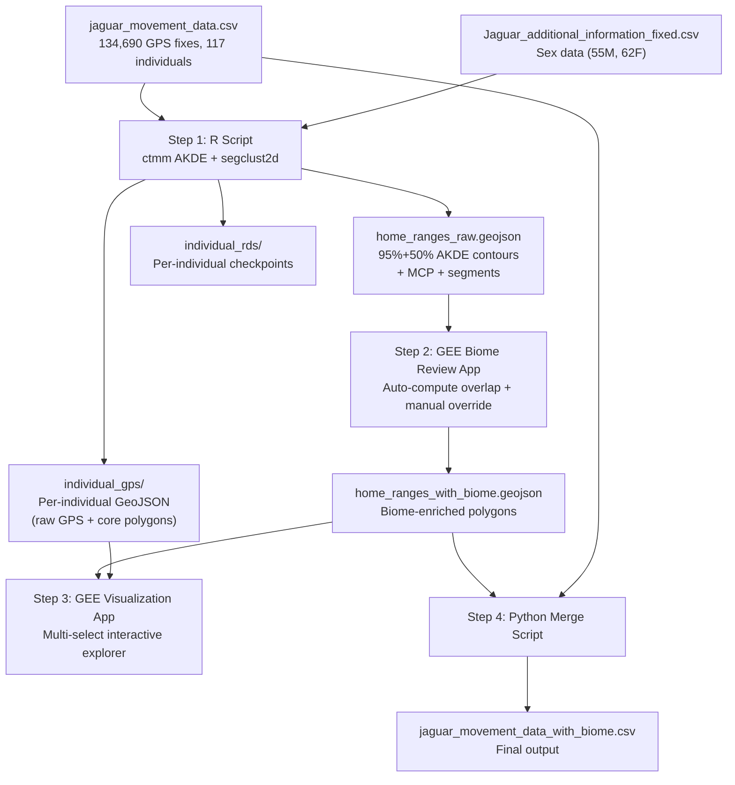

# Jaguar Home Range Analysis & Biome Classification

Compute AKDE home ranges for 117 jaguar individuals from the Morato dataset, detect temporal range shifts, assign RESOLVE biome types via spatial join in GEE, and produce `jaguar_movement_data_with_biome.csv` with a list-valued `biome_type` column.

**Scientific motivation:** The biome classification enables filtering the Morato dataset to forested-landscape individuals whose IRL movement policies are most likely to transfer to the Madre de Dios study site (disturbed forest mosaic near the interoceanic highway).

---

## Pipeline Overview

---

## Step 1: R Script — Home Range Estimation

### Overview

A parallelized R script that processes all 117 individuals through the following pipeline per individual:

1. **Variogram analysis** — Diagnose autocorrelation structure
2. **Model selection** — `ctmm.select()` fits candidate movement models (OUF, OU, IID, etc.)
3. **AKDE computation** — 95% (home range) and 50% (core area) utilization distributions
4. **MCP computation** — Minimum Convex Polygon as a simple baseline
5. **Temporal segmentation** — `segclust2d` change-point detection for range shifts
6. **Multi-core detection** — Check if 50% AKDE isopleth forms multiple disconnected polygons
7. **Per-segment AKDE** — If `segclust2d` detects segments, compute separate AKDEs per segment

### Required R Packages

| Package | Purpose |
|---|---|
| `ctmm` | AKDE home range estimation, variogram, model selection |
| `segclust2d` | Behavioral change-point detection for temporal segmentation |
| `sf` | Spatial data handling, GeoJSON export, polygon operations |
| `parallel` | Parallelization via `mclapply` |
| `jsonlite` | GeoJSON construction |
| `data.table` | Fast CSV reading |

### Input Files

- [jaguar_movement_data.csv](file:///mnt/documents/Dropbox/Documents/Luveen%20Wadhwani/OneDrive/Documents/Luveen-Obsidian/03%20-%20Projects/Columbia/00%20-%20Thesis/MaxEnt_IRL_trajectory_interpolation/jaguar_movement_data.csv) — 134,690 GPS fixes
- [Jaguar_additional_information_fixed.csv](file:///mnt/documents/Dropbox/Documents/Luveen%20Wadhwani/OneDrive/Documents/Luveen-Obsidian/03%20-%20Projects/Columbia/00%20-%20Thesis/MaxEnt_IRL_trajectory_interpolation/Jaguar_additional_information_fixed.csv) — Sex assignments (55 males, 62 females)

### Output Artifacts

#### [NEW] home_ranges_raw.geojson

A single GeoJSON `FeatureCollection` containing all contour polygons for all individuals. Each `Feature` has:

| Property | Type | Description |
|---|---|---|
| `individual_id` | integer | Individual identifier matching `individual.local.identifier (ID)` |
| `study_name` | string | Study name |
| `sex` | string | "Male" or "Female" from additional info file |
| `segment_id` | integer | 0 = full-trajectory, 1+ = temporal segments from segclust2d |
| `contour_level` | integer | 95 or 50 |
| `area_km2` | float | Area of this contour in km² |
| `method` | string | "AKDE" or "MCP" |
| `is_range_shift` | boolean | True if segclust2d detected ≥2 segments for this individual |
| `n_core_areas` | integer | Number of disconnected polygons in the 50% AKDE isopleth |
| `ctmm_model` | string | Best-fit model name (e.g., "OUF anisotropic") |
| `n_gps_points` | integer | Number of GPS points used |
| `trajectory_days` | integer | Duration of tracking in days |

#### [NEW] individual_gps/ directory

Per-individual GeoJSON files (`individual_{id}.geojson`), each containing:
- Raw GPS points as `Point` features with timestamp
- 50% AKDE core area polygon(s) as `Polygon` features
- Property `feature_type`: `"gps_point"` or `"core_area"`

#### [NEW] individual_rds/ directory

Per-individual RDS checkpoint files (`individual_{id}.rds`) containing the full ctmm analysis objects (telemetry, fitted model, AKDE UD, MCP, segclust2d results). Enables resuming from any point if the batch run crashes.

### Execution Strategy

1. **Test batch:** Process 5 individuals first (IDs 1, 26, 70, 85, 103 — chosen to span different studies, range sizes, and trajectory lengths)
2. **Validate test outputs** — User confirms contours and statistics look reasonable
3. **Full batch:** Run all 117 individuals in parallel using `parallel::mclapply` with `mc.cores = detectCores() - 1`
4. **Consolidation:** Merge per-individual RDS files and GeoJSON fragments into final outputs

#### [NEW] [home_range_analysis.R](file:///mnt/documents/Dropbox/Documents/Luveen%20Wadhwani/OneDrive/Documents/Luveen-Obsidian/03%20-%20Projects/Columbia/00%20-%20Thesis/MaxEnt_IRL_trajectory_interpolation/home_range_analysis.R)

Main R script. Key sections:
- Data loading and preparation (merge movement + sex data)
- `process_individual()` function: variogram → model select → AKDE → MCP → segclust2d → export
- Parallelized batch execution
- GeoJSON consolidation

---

## Step 2: GEE Biome Review App

### Overview

A Google Earth Engine Code Editor app for reviewing and confirming biome type assignments. Operates as a guided wizard that processes each individual sequentially.

### Behavior

1. **On load:** Checks for a cached biome assignment asset. If none exists, auto-computes % area overlap between each individual's 95% AKDE polygon and `RESOLVE/ECOREGIONS/2017` biome polygons.
2. **Left panel:** Scrollable list of all 117 individuals. Color-coded status:
   - 🟢 Green = biome confirmed
   - 🟡 Yellow = unreviewed (auto-computed suggestion)
   - 🔴 Red = no biome assigned (should not occur due to validation)
   - Sortable by study name, individual ID. Search bar for filtering.
3. **Map canvas:** Shows the currently-selected individual's 95% AKDE contour overlaid on RESOLVE biome boundaries (semi-transparent, color-coded by biome type).
4. **Right panel (single-individual view):**
   - Individual metadata: ID, study, sex, area (km²), tracking duration
   - Auto-computed biome overlap table (biome name, % overlap, area in biome)
   - Checkboxes for each biome type (pre-checked if overlap > 10%)
   - **Confirm** button: Saves assignment, updates status to green, triggers incremental export
   - **Reset** button: Reverts to auto-computed suggestions
   - Validation: Cannot confirm with zero biomes selected (Confirm disabled, warning shown)
5. **Persistence:** On every Confirm, exports the full current state (all 117 rows) to a single `biome_assignments.geojson` on Google Drive, overwriting the previous version.
6. **Export** button (always visible): Exports to a *separate* `biome_assignments_export.geojson` file without overwriting the auto-save file.

### Input

- `home_ranges_raw.geojson` (uploaded as GEE asset)
- `RESOLVE/ECOREGIONS/2017` (native GEE dataset)

### Output

- `biome_assignments.geojson` (auto-saved on each Confirm)
- `biome_assignments_export.geojson` (manual export)

Both contain the same schema as `home_ranges_raw.geojson` plus:

| Additional Property | Type | Description |
|---|---|---|
| `biome_types` | string (pipe-delimited) | Assigned biome type(s), e.g., `"Tropical & Subtropical Moist Broadleaf Forests\|Flooded Grasslands & Savannas"` |
| `ecoregion_names` | string (pipe-delimited) | RESOLVE ecoregion name(s) |
| `biome_overlap_pct` | string (JSON) | Full overlap breakdown, e.g., `{"Pantanal": 72.3, "Cerrado": 27.7}` |
| `assignment_status` | string | "confirmed" or "auto" |

#### [NEW] GEE Biome Review App script

Provided as a JavaScript file to paste into the GEE Code Editor.

---

## Step 3: GEE Visualization App

### Overview

Read-only interactive explorer for browsing home ranges across biomes, studies, and individuals.

### Layout

- **Left panel:** Multi-select cascading filters
  - Biome type(s) — multi-select checkboxes
  - Study name(s) — multi-select checkboxes (filtered by selected biomes)
  - Individual ID(s) — multi-select checkboxes (filtered by selected studies)
  - Selecting only biome type(s) shows all individuals in those biomes
  - Selecting only study name(s) shows all individuals in those studies
  - Can combine filters freely
- **Map canvas:**
  - RESOLVE biome boundaries (semi-transparent color fill, toggleable)
  - Selected individuals' 95% AKDE contours (outlined, semi-transparent fill)
  - Selected individuals' 50% AKDE core area contours (darker fill)
  - Temporal segments color-coded if range shift detected
  - **Hover on any AKDE contour:** Shows a "Show/Hide Detailed View" checkbox/button
  - **Detailed View (per individual):** Loads and displays that individual's raw GPS points (from per-individual GeoJSON) and core area polygons
  - **Global buttons:** "Show All Detailed Information" / "Hide All Detailed Information"
- **Legend:** Biome colors, contour level meaning, segment colors

### Input

- `biome_assignments_export.geojson` or `biome_assignments.geojson` (from Step 2, uploaded as GEE asset)
- `individual_gps/individual_{id}.geojson` files (uploaded as GEE assets, loaded on demand for detailed view)

> [!IMPORTANT]
> **GEE asset upload.** You will need to upload the GeoJSON files as GEE assets via the Asset Manager. The per-individual GPS GeoJSONs (117 files) could be tedious to upload manually. I will provide a `gsutil` or `earthengine` CLI command to batch-upload them. Please confirm you have the `earthengine` CLI installed, or I can provide instructions.

#### [NEW] GEE Visualization App script

Provided as a JavaScript file to paste into the GEE Code Editor.

---

## Step 4: Python Merge Script

### Overview

Joins biome labels from the GEE-exported GeoJSON back to the original movement CSV.

#### [NEW] [add_biome_column.py](file:///mnt/documents/Dropbox/Documents/Luveen%20Wadhwani/OneDrive/Documents/Luveen-Obsidian/03%20-%20Projects/Columbia/00%20-%20Thesis/MaxEnt_IRL_trajectory_interpolation/add_biome_column.py)

1. Load `biome_assignments_export.geojson` → extract `individual_id` → `biome_types` mapping
2. Load `jaguar_movement_data.csv`
3. Left-join on `individual.local.identifier (ID)`
4. Add columns:
   - `biome_type` — pipe-delimited list of biome types (e.g., `"Pantanal|Cerrado"`)
   - `ecoregion_name` — pipe-delimited list of ecoregion names
   - `sex` — from `Jaguar_additional_information_fixed.csv`
5. Validate: assert no nulls, assert row count matches original
6. Export: `jaguar_movement_data_with_biome.csv`

#### [NEW] [jaguar_movement_data_with_biome.csv](file:///mnt/documents/Dropbox/Documents/Luveen%20Wadhwani/OneDrive/Documents/Luveen-Obsidian/03%20-%20Projects/Columbia/00%20-%20Thesis/MaxEnt_IRL_trajectory_interpolation/jaguar_movement_data_with_biome.csv)

Original CSV with added columns: `biome_type`, `ecoregion_name`, `sex`.

---

## Verification Plan

### After Step 1 (R Script — Test Batch)

| Check | Expected |
|---|---|
| 5 RDS files created in `individual_rds/` | One per test individual |
| 5 GeoJSON files in `individual_gps/` | GPS points + core areas |
| Variogram plots for each individual | Should show asymptotic behavior if range-resident |
| AKDE area in reasonable range | Males: 30–300 km², Females: 15–100 km² (varies by biome) |
| MCP area ≥ AKDE area | MCP always ≥ AKDE (includes outliers) |
| segclust2d results | At least 1 of 5 test individuals should show >1 segment (individuals 70 and 85 have large ranges) |

### After Step 1 (Full Batch)

| Check | Expected |
|---|---|
| 117 RDS files, 117 individual GeoJSONs | Complete coverage |
| `home_ranges_raw.geojson` loads in QGIS/GEE | Valid GeoJSON |
| Cross-tab: sex × mean AKDE area | Males should have ~2× larger ranges on average |
| Individuals with detected range shifts | Flag and list for manual review |

### After Step 2 (GEE Biome Review)

| Check | Expected |
|---|---|
| All 117 individuals assigned ≥1 biome | No red-status individuals |
| Sanity checks (see table below) | Biome assignments match ecological expectations |

**Expected biome mappings:**

| Study Name | Expected RESOLVE Biome(s) |
|---|---|
| Pantanal / Paraguayan Pantanal / Panthera_Pantanal-Jaguar-Project | Tropical & Subtropical Grasslands, Savannas & Shrublands / Flooded Grasslands & Savannas |
| Atlantic forest / Jaguar Conservation in the Atlantic Forest | Tropical & Subtropical Moist Broadleaf Forests |
| Humid Chaco / Dry Chaco | Tropical & Subtropical Dry Broadleaf Forests / Tropical & Subtropical Grasslands |
| Jaguar Conservation in the Caatinga Biome | Tropical & Subtropical Dry Broadleaf Forests / Deserts & Xeric Shrublands |
| Costa Rica | Tropical & Subtropical Moist Broadleaf Forests |
| jaguar of sonora | Deserts & Xeric Shrublands |
| Jaguar_Mamiraua | Tropical & Subtropical Moist Broadleaf Forests |
| Sao Bento / jaguar_Oncafari Project / Rio Negro | Tropical & Subtropical Grasslands (Pantanal region) |

### After Step 4 (Final CSV)

- `jaguar_movement_data_with_biome.csv` has 134,690 rows (same as original)
- No null values in `biome_type`, `sex` columns
- Pipe-delimited `biome_type` values parse correctly
