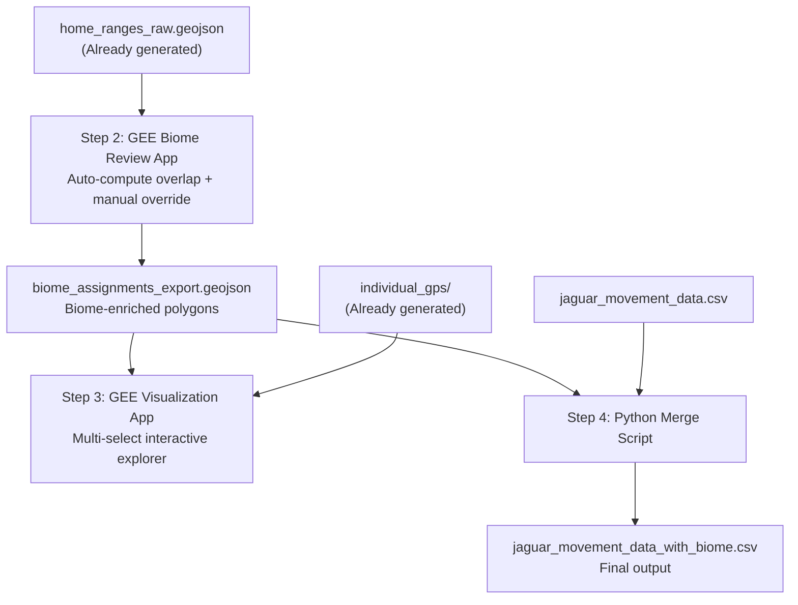

# Jaguar Home Range Analysis & Biome Classification v2

## Context & Completed Work
In the previous session, we successfully completed **Step 1: Home Range Estimation** for 117 jaguar individuals from the Morato dataset. 
- **Methodology**: We used `ctmm` for Autocorrelated Kernel Density Estimation (AKDE) and `segclust2d` (on $x,y$ coordinates) to detect temporal range shifts and ensure stationary segments for AKDE calculation.
- **Results**: 115 individuals were successfully processed (2 were automatically skipped due to having <20 valid GPS points). 83 individuals exhibited range shifts, and 11 had multi-core areas. The total batch execution took 28.6 minutes.
- **Outputs generated & Data Schemas**: 
  
  **1. `home_ranges_raw.geojson`**
  A single GeoJSON `FeatureCollection` containing all contour polygons for all 115 individuals (726 features total). Each `Feature` has:
  | Property | Type | Description |
  |---|---|---|
  | `individual_id` | integer | Individual identifier matching `individual.local.identifier (ID)` |
  | `study_name` | string | Study name |
  | `sex` | string | "Male" or "Female" from additional info file |
  | `segment_id` | integer | 0 = full-trajectory, 1+ = temporal segments from segclust2d |
  | `contour_level` | integer | 95 or 50 |
  | `area_km2` | float | Area of this contour in km² |
  | `method` | string | "AKDE" or "MCP" |
  | `is_range_shift` | boolean | True if segclust2d detected $\ge 2$ segments for this individual |
  | `n_core_areas` | integer | Number of disconnected polygons in the 50% AKDE isopleth |
  | `ctmm_model` | string | Best-fit model name (e.g., "OUF anisotropic") |
  | `n_gps_points` | integer | Number of GPS points used |
  | `trajectory_days` | integer | Duration of tracking in days |

  **2. `individual_gps/` directory**
  Per-individual GeoJSON files (`individual_{id}.geojson`), each containing:
  - Raw GPS points as `Point` features with timestamp
  - 50% AKDE core area polygon(s) as `Polygon` features
  - Property `feature_type`: `"gps_point"` or `"core_area"`

  **3. `individual_rds/` directory**
  Per-individual RDS checkpoint files (`individual_{id}.rds`) containing the full ctmm analysis objects (telemetry, fitted model, AKDE UD, MCP, segclust2d results). Enables programmatic reloading of spatial movement models in R.

The objective now is to move to **Step 2** to assign RESOLVE biome types to these core areas via spatial joins in Google Earth Engine (GEE), review them interactively, and ultimately merge the biome data back into the original CSV using Python.

---

## Pipeline Overview (Remaining Steps)

---

## Step 2: GEE Biome Review App (PENDING)

### Objective
Develop a Google Earth Engine (GEE) Code Editor application for reviewing and confirming biome type assignments for the 115 successfully processed jaguars. It will operate as a guided wizard processing each individual sequentially.

### Prerequisites
- Upload `home_ranges_raw.geojson` as a GEE Asset (or read dynamically from Google Drive if GEE allows).
- Access the `RESOLVE/ECOREGIONS/2017` dataset natively in GEE.

### App Behavior & UI
1. **Initialization:** Compute the % area overlap between each individual's 95% AKDE polygon and the RESOLVE biome polygons.
2. **Left Panel (Navigation):** 
   - Scrollable list of 115 individuals.
   - Status indicators: 🟢 Confirmed, 🟡 Unreviewed.
   - Filtering/Sorting by Study Name and ID.
3. **Map Canvas:**
   - Displays the selected individual's 95% AKDE contour.
   - Overlays RESOLVE biome boundaries (color-coded, semi-transparent).
4. **Right Panel (Review & Override):**
   - Displays individual metadata (ID, study, sex, area, tracking duration).
   - Overlap Table: Shows biome name, % overlap, and area.
   - Checkboxes for manual override of biomes (pre-checked if overlap > 10%).
   - **Confirm Button**: Saves the assignment, updates status to green.
   - **Reset Button**: Reverts to auto-computed suggestions.
5. **Data Export:**
   - The app must provide a way to export the confirmed assignments as `biome_assignments_export.geojson` (e.g., via `Export.table.toDrive`).

---

## Step 3: GEE Visualization App (PENDING)

### Objective
Develop a read-only interactive explorer in GEE for browsing home ranges across biomes, studies, and individuals.

### Layout & Features
- **Left Panel (Filters):** Cascading multi-select checkboxes for Biome Types, Study Names, and Individual IDs.
- **Map Canvas:**
   - RESOLVE biome boundaries (toggleable).
   - Selected individuals' 95% AKDE contours and 50% AKDE core areas.
   - Hover functionality to toggle "Detailed View".
   - **Detailed View**: Dynamically loads and displays the raw GPS points (from `individual_gps/`) for the selected jaguar.
- **Legend:** Color keys for biomes, contours, and segments.

### Prerequisites
- Upload `biome_assignments_export.geojson` to GEE.
- Batch upload all 115 `individual_gps/individual_{id}.geojson` files to GEE assets. (The agent should provide a `earthengine` CLI bash script to automate this tedious upload process).

---

## Step 4: Python Merge Script (PENDING)

### Objective
Write a Python script (`add_biome_column.py`) to join the confirmed biome labels back to the original movement CSV for the MaxEnt IRL pipeline.

### Execution Flow
1. Load `biome_assignments_export.geojson` and extract the mapping of `individual_id` $\rightarrow$ `biome_types`.
2. Load the original `jaguar_movement_data.csv`.
3. Left-join on `individual.local.identifier (ID)`.
4. Create new columns:
   - `biome_type`: Pipe-delimited list of confirmed biomes (e.g., `"Pantanal|Cerrado"`).
   - `ecoregion_name`: Pipe-delimited list of ecoregions.
   - `sex`: Merged from `Jaguar_additional_information_fixed.csv`.
5. Perform validation assertions (no nulls for processed IDs, row counts match exactly).
6. Export final dataset as `jaguar_movement_data_with_biome.csv`.

---

## Verification Plan

### After Step 2 (GEE Biome Review)
- All 115 individuals assigned $\ge1$ biome.
- Biome assignments match expected ecological baselines (e.g., Pantanal jaguars assigned to Flooded Grasslands & Savannas, Atlantic Forest jaguars assigned to Moist Broadleaf Forests).

### After Step 4 (Python Merge)
- Output CSV `jaguar_movement_data_with_biome.csv` retains exactly 134,690 rows.
- No null values in `biome_type` or `sex` for the 115 processed individuals. (The 2 skipped individuals should be properly handled/flagged).
- Pipe-delimited strings are formatted correctly for downstream IRL filtering.
