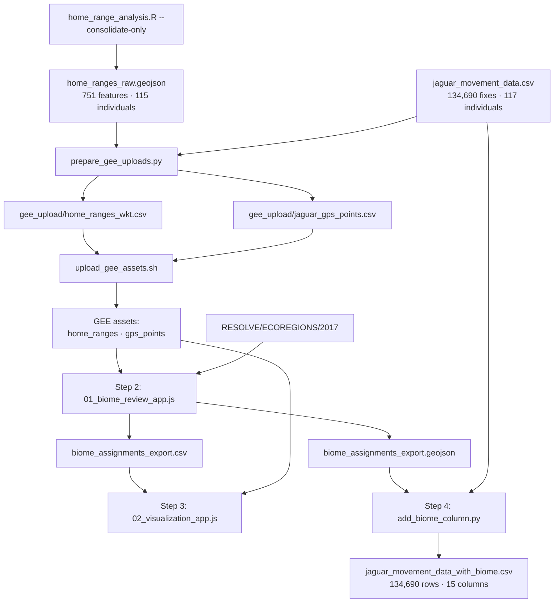

# Jaguar Home Range Analysis & Biome Classification v3

Status of every step, the decisions that shaped them, and how to run what has
been built. Supersedes v2.

| Step | Status | Artifact |
|---|---|---|
| 1. Home range estimation (R / ctmm) | **Done, and repaired** — see below | `home_range_output/` |
| 1b. GEE ingestion prep | **Done** | `prepare_gee_uploads.py`, `gee_upload/` |
| 1c. AGLW livestock ingestion | **Script written, awaiting a staging bucket** | `upload_aglw_assets.py` |
| 2. GEE biome review app | **Built, awaiting your review pass** | `gee/01_biome_review_app.js` |
| 3. GEE visualization app | **Built, awaiting Step 2 output** | `gee/02_visualization_app.js` |
| 4. Python merge | **Built and tested against a mock export** | `add_biome_column.py` |

---

## Correction to the Step 1 results reported in v2

v2 recorded that `home_ranges_raw.geojson` held all 115 successfully processed
individuals. It held **110**. Individuals **1, 26, 70, 85, 103** — exactly the
`TEST_IDS` list — had RDS checkpoints and per-individual GPS GeoJSONs but no
polygons in the consolidated file.

**Cause.** `build_consolidated_geojson()` iterated only the current run's
in-memory `results`. The final batch was run with `--resume`, which by design
skips individuals that already have a checkpoint, so the five test-batch animals
were never in `results` and silently vanished from the consolidated output.

**Impact.** The **entire Costa Rica study was missing** — individual 26 is its
only jaguar and carries 5,924 fixes, 4.4% of the dataset.

**Fix.** `build_consolidated_geojson()` now calls a new `load_all_checkpoints()`
that reads every `individual_*.rds` in `individual_rds/` and overlays anything
still in memory, so consolidation is complete regardless of run mode. A
`--consolidate-only` flag rebuilds the GeoJSON from checkpoints without redoing
any analysis.

```bash
Rscript home_range_analysis.R --consolidate-only
```

**Corrected Step 1 figures** (previous v2 numbers in brackets):

| Metric | Value |
|---|---|
| Features in `home_ranges_raw.geojson` | **751** [726] |
| Individuals represented | **115** [110 actual / 115 claimed] |
| Studies represented | **20** [19 — Costa Rica absent] |
| Individuals with range shifts | **85** [83] |
| Individuals with multiple core areas | **12** [11] |
| Median 95% AKDE, males | 334.9 km² (n=55) |
| Median 95% AKDE, females | 100.0 km² (n=60) |

Individuals **35** (17 fixes) and **38** (18 fixes) remain the two below the
20-fix threshold and still have no AKDE contour.

---

## Decisions taken

| Question | Decision |
|---|---|
| `biome_type` vs `ecoregion_name` | Two separate pipe-delimited columns, **positionally paired** |
| Geometry driving assignment | Full-trajectory 95% AKDE (`segment_id = 0`) |
| Individuals 35 and 38 | Point-in-polygon fallback, flagged via `assignment_method` |
| GEE asset paths | Placeholder `ASSET_ROOT` constant at the top of each script |

### The pairing rule

The unit of selection is the **ecoregion**. Ticking one ecoregion contributes
exactly one element to `ecoregion_name` **and** one to `biome_type`, at the same
index. Both columns therefore always carry an equal number of elements and
neither can be blank — the review app keeps **Confirm** disabled until at least
one ecoregion is ticked.

A biome name **repeats** when an individual's range covers two ecoregions of the
same biome:

```
ecoregion_name : Alto Paraná Atlantic forests|Araucaria moist forests
biome_type     : Tropical & Subtropical Moist Broadleaf Forests|Tropical & Subtropical Moist Broadleaf Forests
```

That repetition is deliberate. De-duplicating would break the index alignment
between the two columns. For the common case of filtering on one coarse class,
Step 4 emits `biome_type_primary` — the biome of the highest-overlap ecoregion.

---

## Gaps in the v2 plan that had to be closed

**Earth Engine cannot ingest GeoJSON.** Table ingestion accepts Shapefile and
CSV only ([Importing Table Data](https://developers.google.com/earth-engine/guides/table_upload)),
so "upload `home_ranges_raw.geojson` as a GEE Asset" was not workable.
`prepare_gee_uploads.py` converts to CSV with a WKT geometry column instead.
Polygon complexity is low — 781 vertices at worst against GEE's 1M-per-feature
limit — so nothing is lost.

This also affects the round trip: Step 2's GeoJSON export cannot be re-ingested
for Step 3, so the review app additionally exports **CSV with geometry** in a
`.geo` column, which GEE does accept.

**115 per-individual GPS assets were unnecessary.** v2 called for a CLI script to
batch-upload `individual_gps/individual_{id}.geojson` ×115. All fixes now go into
**one** 134,690-row table filtered on `individual_id`, which GEE resolves far
faster than 115 separate asset reads and reduces the upload to a single command.
Individuals 35 and 38 are included here, which is what makes their
point-in-polygon fallback possible.

**Overlap is computed lazily, per individual.** v2's "on load, compute overlap
for every individual" would mean 115 polygon intersections against RESOLVE before
the first frame renders. Instead each individual's intersection runs when you
select it (~1–3 s) and is cached for the session.

**Earth Engine apps cannot write files incrementally.** v2's "auto-save on every
Confirm" would mean 115 export tasks, each needing a manual RUN click. Replaced
with in-memory state plus a copy/paste **session JSON** for surviving reloads,
and explicit export buttons.

**No hover events exist for vector features** in `ui.Map`. Step 3's
"hover to toggle detailed view" is implemented as **click** to toggle instead.

---

## Pipeline



---

## Running it

### 1. Prepare and upload the assets

```bash
python3 prepare_gee_uploads.py
```

Produces `gee_upload/home_ranges_wkt.csv` (751 features, 6.3 MB) and
`gee_upload/jaguar_gps_points.csv` (134,690 points, 15.2 MB, carrying the
per-fix `hours_represented` time weights described below).

Then either edit `EE_ASSET_ROOT` and `GCS_BUCKET` at the top of
`upload_gee_assets.sh` and run it, or upload both CSVs by hand via
**Assets → NEW → CSV file**:

| CSV | Geometry setting | Asset ID |
|---|---|---|
| `home_ranges_wkt.csv` | geometry column `wkt` | `<ASSET_ROOT>/home_ranges` |
| `jaguar_gps_points.csv` | x = `longitude`, y = `latitude` | `<ASSET_ROOT>/gps_points` |

`upload_gee_assets.sh` needs `pip install earthengine-api` (the `earthengine`
CLI is not currently on this machine) and stages through Cloud Storage, because
the CLI ingests only from `gs://` URIs.

### 2. Review biomes

Set `ASSET_ROOT` at the top of `gee/01_biome_review_app.js`, paste the file into
the Code Editor, Run.

Work down the list. For each individual you get its metadata, every overlapping
ecoregion with its parent biome and % overlap, and pre-ticked suggestions for
anything over 10%. **Confirm & next** jumps to the next unreviewed animal.
Range-shift individuals carry a warning, since a full-trajectory 95% contour can
span ecoregions the animal never really used.

Individuals 35 and 38 appear marked `[pts]`; their overlap is the share of raw
fixes inside each ecoregion rather than an area fraction.

Copy the **session state** JSON before reloading — progress is in memory only.

When done, **Export confirmed → Drive** creates two tasks. Click RUN on both in
the Tasks tab.

### 3. Explore

Upload the exported `biome_assignments_export.csv` as `<ASSET_ROOT>/biome_assignments`
(geometry column `.geo`, usually auto-detected). Set `ASSET_ROOT` in
`gee/02_visualization_app.js`, paste, Run.

### 4. Merge

Download `biome_assignments_export.geojson` from Drive into the project root:

```bash
python3 add_biome_column.py
```

Add `--assignments <path>` to point elsewhere, or `--allow-missing` to downgrade
unassigned individuals from an error to a warning.

---

## Output schema

`jaguar_movement_data_with_biome.csv` — the original 9 columns plus:

| Column | Description |
|---|---|
| `biome_type` | Pipe-delimited RESOLVE `BIOME_NAME`, one element per selected ecoregion |
| `ecoregion_name` | Pipe-delimited RESOLVE `ECO_NAME`, index-aligned with `biome_type` |
| `biome_type_primary` | Biome of the highest-overlap ecoregion; use this for single-class filtering |
| `assignment_status` | `confirmed` or `auto` |
| `assignment_method` | `AKDE_95`, or `GPS_POINT_IN_POLYGON` for individuals 35 and 38 |
| `sex` | From `Jaguar_additional_information_fixed.csv` |

Written with standard LF line endings, unlike the CR-only input.

---

## Tier 2 source configuration

Three source questions that were open in v2 are now settled. All three are
constants at the top of `gee/00_covariates.js`.

### GRIP4 road type

The road-class attribute is a **string** field named `Highway`, taking
`motorway`, `trunk`, `primary`, `secondary`, `tertiary` — not the numeric
`GP_RTP` code carried by the raw GRIP4 shapefiles. `primary_road_density_km_km2`
counts the top three: motorway, trunk and primary are the paved, high-traffic
network that functions as a movement barrier and a source of vehicle mortality,
while secondary and tertiary roads in this range are mostly unpaved access
routes, a different mechanism that belongs in total density.

The failure mode for a wrong attribute name is a silent zero, not an error, so
the export now also carries **`n_primary_road_segments`**. If that column is 0
for every individual while `n_road_segments` is not, the filter matched nothing.
`describeRoadAttributes()` prints the property names and their distinct values
over a sample region for a one-time confirmation.

### AGLW gridded livestock

`upload_aglw_assets.py` ingests eight species × eighteen years (1999–2016) =
**144 single-band images** into `projects/perceptive-ivy-780/assets/AGLW/`,
named `<Code>_<year>` — no `.tif`, because an Earth Engine asset id is not a
filename and carrying an extension into one only invites the module and the
upload to disagree about whether it is there. The script cross-checks its own
asset folder and species codes against `gee/00_covariates.js` before doing
anything, so the two cannot drift apart.

```bash
export GCS_BUCKET=gs://your-staging-bucket
python3 upload_aglw_assets.py --dry-run     # plan only
python3 upload_aglw_assets.py               # clip, stage, ingest
```

**The rasters are clipped to the Americas first.** The source files are global,
8016 × 3160 at ~5 km, and span 360.03° of longitude from −168.84 — so their
eastern edge sits at 191.2°E, past the antimeridian. Clipping to
(−120, 35, −30, −35) takes each file from ~24 MB to ~3 MB, the whole upload
from 2.4 GB to a few hundred, and sidesteps the wrap. `-projwin` snaps to the
source pixel grid, so nothing is resampled. Pass `--global` to skip it.

**AGLW marks ocean with float NaN and sets no NoData tag**, so an unguarded
ingest hands Earth Engine 34 million valid NaNs and any coastal home range
reduces to NaN, poisoning the whole covariate dictionary. The clip writes
`NoData=nan` and the module additionally masks on `gte(0)` — a tag alone is one
interpretation away from being ignored.

Densities are combined in **Tropical Livestock Units** (Jahnke 1982; FAO), a
250 kg-liveweight equivalent, so a chicken cannot count as much as a bull. The
grouping is jaguar-specific rather than agricultural:

| Field | Contents | Why |
|---|---|---|
| `livestock_large_tlu_km2` | cattle, buffalo, horses | The stock jaguars actually take, and the depredation that triggers retaliation |
| `livestock_small_tlu_km2` | pigs, goats, sheep | Mostly a puma and ocelot conflict, kept for contrast |
| `poultry_per_km2` | chickens, ducks | An index of dispersed smallholder settlement, not prey |

Cattle (`Cattl`) drives the large-stock aggregate. Jaguar–livestock conflict in
this range is overwhelmingly cattle, and retaliatory killing is a mortality
pressure that shapes where animals will and will not go; the other seven ride
along because they are the same 144-file upload and they separate two things
cattle alone conflates — large-bodied stock worth a jaguar's while, and the
smallholdings whose presence says more about settlement than about prey.

**The matched uncertainty rasters are deliberately not ingested.** The AGLW
authors ask that they be consulted for long-term trends and regional inference,
but their stated weak spots are the 1960s–1990s and data-sparse regions, and
this study reads only 1999–2016. That is a judgement rather than a certainty —
the Gran Chaco interior is thinner ground than the Brazilian south — so if a
reviewer presses on livestock, the uncertainty layers are a separate Zenodo
download and `livestockBands()` is where they would attach.

### Non-terrestrial ecoregion guard

RESOLVE 2017 fills the gaps between terrestrial ecoregions with two
non-ecoregion classes — large lakes and rock/ice — carrying a placeholder
`BIOME_NAME`. A 95% AKDE contour around a Pantanal or Mamirauá animal overlaps
those polygons, and unguarded they appear in the candidate list as a "biome"
describing no vegetation at all while diluting the weights of the real ones.

`terrestrialEcoregions()` applies `ee.Filter.notNull` on `BIOME_NAME`,
`BIOME_NUM` and `ECO_ID`, then excludes `BIOME_NUM` 98 and 99, then excludes
`BIOME_NAME == 'N/A'`. Both apps assign and draw through it, so the outlines on
the map are exactly the polygons that could have been chosen.

**The null check alone would not have worked.** The asset's distinct
`BIOME_NAME` values are fifteen strings — the fourteen real biomes plus a
literal `'N/A'`, which is a perfectly non-null string and sails straight through
`ee.Filter.notNull`. The `BIOME_NUM` and `'N/A'` exclusions are what actually
remove the lakes and rock/ice. Keeping the numeric-code test as well as the name
test is deliberate: name strings drift between RESOLVE releases, `BIOME_NUM`
does not.

The fourteen that survive, confirmed against the asset:

Boreal Forests/Taiga · Deserts & Xeric Shrublands · Flooded Grasslands &
Savannas · Mangroves · Mediterranean Forests, Woodlands & Scrub · Montane
Grasslands & Shrublands · Temperate Broadleaf & Mixed Forests · Temperate
Conifer Forests · Temperate Grasslands, Savannas & Shrublands · Tropical &
Subtropical Coniferous Forests · Tropical & Subtropical Dry Broadleaf Forests ·
Tropical & Subtropical Grasslands, Savannas & Shrublands · Tropical &
Subtropical Moist Broadleaf Forests · Tundra

The explorer's `BIOME_COLORS` palette now covers all fourteen, so its grey
fallback is unreachable and grey on the map means a real data problem rather
than a palette gap.

**Mangroves (`BIOME_NUM` 14) is kept.** It is a real terrestrial biome, and
coastal and estuarine jaguars are a genuine part of this species' range —
dropping it would misclassify them, not clean them up.

Guarding changes what the weights are computed over, so two flags now report
the shortfall: `fixes_outside_terrestrial` when more than 1% of an individual's
fixes fall in no terrestrial ecoregion, and `area_outside_terrestrial` when more
than 5% of the contour does. Fixes matter more than area — a missing sliver of
area is geometric noise, but a fix landing in no terrestrial ecoregion is a real
point the assignment cannot speak for.

Set `RUN_SOURCE_AUDITS = true` in `gee/01_biome_review_app.js` for one run to
print both the RESOLVE biome audit and the GRIP4 attribute audit to the Console.

---

## Range-shifters, and what `usage_weight` measures

**Decision: biome assignment stays time-invariant.** An individual can hold
several biomes at once — that is what the paired lists are for — but *when* it
held each one is not recorded, and the weights carry the mixture instead. The
alternative, splitting a home range into time windows and cross-comparing each
against land-cover change in that period, was considered and rejected as more
complexity than it earns.

That decision is safe for the biome axis for a reason worth stating: **a biome
is a property of place, not of time.** RESOLVE's polygons do not move. An animal
that left the Cerrado for the Pantanal in 2007 was in Cerrado-the-native-template
before and Pantanal-the-native-template after, and both labels are recoverable
from location alone. Nothing about the timing can change which biome a fix sat
in. The same argument does **not** protect the Tier 2 covariates, which genuinely
do vary with year — see the caveat at the end of this section.

### What the decision did expose: fix counts are not time

`usage_weight` was a share of GPS fixes. Counting fixes is an unbiased estimator
of use only while the collar samples at a constant rate, and it does not:

| | |
|---|---|
| Individuals whose median fix interval changes >1.5× mid-track | **26 of 113** |
| …of those, individuals that are also range-shifters | **17** |
| Largest observed within-individual change | **4.0×** |

Those 17 are exactly where the bias has somewhere to go. A range-shifter is on
different ground before and after the change, so a doubled interval halves the
apparent use of whichever range came second — and `usage_weight` drives both the
ranking and the auto-suggestion, so it can hand the assignment to the wrong
biome.

**Fix.** `prepare_gee_uploads.py` now writes a per-fix `hours_represented`: half the gap
behind the fix plus half the gap ahead (the trapezoidal rule), capped at four
times that individual's own median interval. The cap matters — uncapped, a
single fix either side of a two-month collar outage would carry two months of
"use" and could by itself decide the assignment. The review app sums `hours_represented`
instead of counting features, so `usage_weight` is now a **share of tracked
time**. Where sampling is uniform the two agree exactly, so this costs nothing
for the 87 individuals it does not apply to.

`n_fixes_inside` is kept unweighted and is now part of the five-way paired-list
check, so the two measures stay comparable after the fact. The review app raises
`sampling_schedule_bias` where the top candidate's time share and fix share
differ by more than 5 points.

Sanity check on the weights: summed per individual they recover 85% of the
actual tracking span at the median, and the low outliers are precisely the
animals with long collar outages — the cap declining to credit a single fix with
weeks of presence, which is the intended behaviour.

### The caveat that timing does still apply to

Tier 2 covariates are computed at `year_mid` over the **merged** 95% contour.
For a range-shifter that used area A in 2003–2006 and area B in 2010–2014, that
is a landscape mean for neither the right place nor the right time. This is fine
for what the covariates are for — stratification metadata, "what condition was
this animal's world in" — and it is **not** fine if a covariate is used directly
as an IRL state feature.

Timing is not even the strongest objection there, only the most visible one.
**Next steps for IRL training**, at the end of this document, is the
self-contained account: why the Tier 2 columns cannot enter a reward function
as they stand, and the concrete procedure for re-deriving them at the resolution
of the state space.

---

## Verification

### Step 1 — done

- [x] 115 individuals in `home_ranges_raw.geojson`; only 35 and 38 absent
- [x] All 20 studies present, Costa Rica included
- [x] Every individual has a 95% AKDE, a 50% AKDE, and an MCP
- [x] Males median 334.9 km² vs females 100.0 km² — the expected ~2× sex ratio

### Step 4 — passing against a mock Step 2 export

`add_biome_column.py` was exercised against a synthetic export mimicking the
review app's output, since the real one needs your review pass first.

- [x] 134,690 rows preserved exactly
- [x] All 117 individuals assigned (115 `AKDE_95` + 2 `GPS_POINT_IN_POLYGON`)
- [x] No nulls in `sex`
- [x] Equal element counts in `biome_type` / `ecoregion_name` on every row,
      including the deliberate repeated-biome case
- [x] GeoJSON and CSV inputs produce byte-identical output
- [x] Rejects unequal pairing, conflicting per-individual assignments, and
      unconfirmed individuals — each exit code 1

### Step 2 — for you to check during the review pass

Expected biome per study, to sanity-check the auto-suggestions:

| Study | Expected RESOLVE biome |
|---|---|
| Pantanal / Paraguayan Pantanal / Panthera_Pantanal / Sao Bento / Oncafari / Rio Negro / Taiama | Flooded Grasslands & Savannas |
| Atlantic forest / Jaguar Conservation in the Atlantic Forest / Argentina | Tropical & Subtropical Moist Broadleaf Forests |
| Humid Chaco | Tropical & Subtropical Grasslands, Savannas & Shrublands |
| Dry Chaco | Tropical & Subtropical Dry Broadleaf Forests |
| Caatinga | Tropical & Subtropical Dry Broadleaf Forests |
| Costa Rica / Mamiraua / Lacandona / Jaguar Mex | Tropical & Subtropical Moist Broadleaf Forests |
| jaguar of sonora | Deserts & Xeric Shrublands |
| IOP | Tropical & Subtropical Grasslands, Savannas & Shrublands (Cerrado) |

Note that RESOLVE places the Pantanal in **Flooded Grasslands & Savannas**, not
in the grasslands biome that v2's table suggested for some Pantanal studies.

### Step 3 — after the explorer loads

- [ ] Biome filter lists only biomes actually assigned in Step 2
- [ ] Study and individual filters narrow correctly as biomes are unticked
- [ ] Detail view loads raw fixes; capped at 12 individuals at once

---

## Next steps for IRL training

Self-contained by design: everything needed to act on this is stated here, and
nothing above has to be re-read first.

### The one-paragraph version

This workflow produces two artifacts, and **neither is a state-feature table**.
`jaguar_movement_data_with_biome.csv` carries an individual-level biome label
repeated onto each of its fixes; `jaguar_individual_profile.csv` carries 33
Tier 2 habitat covariates, each a mean over that individual's whole 95% AKDE
contour at a single year. Both describe *animals*. A MaxEnt IRL reward is a
function of *states*. The covariates have to be re-derived at the resolution of
the state space before they can enter a reward function, and this section says
how.

### What to reuse, what to re-derive, what never to use

| Column | In IRL |
|---|---|
| `biome_type`, `ecoregion_name` | **Strata.** Fine for grouping individuals, train/test splits, and reporting. Not a per-state feature — the value is the individual's blended assignment, not the state's biome. If you want biome as a feature, sample RESOLVE per state (Step 4). |
| `usage_weight`, `area_weight`, `n_fixes_inside` | **Never a feature.** These are computed *from* the trajectory being learned. Using them would leak the demonstration into the reward. |
| All 33 Tier 2 covariates | **Re-derive per state.** See below. The profile values stay useful as controls and as the sanity check in Step 7. |
| `sex`, `study_name`, `year_start/end` | **Strata / metadata.** Safe, but individual-level. |

### Why the Tier 2 covariates cannot be reused as-is

**1. They have zero variance within an individual.** Every Tier 2 value is a
mean over the entire 95% AKDE contour. Copy it onto every state that animal
could occupy and it takes the same value everywhere. MaxEnt IRL fits weights by
matching feature expectations between the demonstrated trajectories and the
model's, and a feature that is constant across the state space has the same
expectation under *every* policy — its gradient is identically zero and its
weight is unidentifiable. It cannot distinguish a state the animal chose from
one it declined, which is the only thing a reward feature does. **This is the
fundamental objection, and no amount of re-timing fixes it.**

**2. They are pinned to a single year.** Everything is evaluated at `year_mid`.
Tracking spans 1999–2016 across the dataset and up to four calendar years within
one individual. Forest loss moves fastest — the review app already flags ranges
that lost more than 2% of canopy during tracking, and for those the landscape at
`year_mid` is not the landscape at either end.

**3. For range-shifters, the place and the time are both wrong.** An animal that
used area A in 2003–06 and area B in 2010–14 gets a mean over A ∪ B at roughly
2008 — a description of neither area at neither time. 85 of 115 individuals have
more than one segment.

**4. Two of them have no per-state meaning at all.** `road_density_km_km2` is
clipped road length divided by polygon area, and `protected_pct` is the share of
a polygon inside WDPA. Neither is defined at a point or a small cell. They need
reformulating, not resampling — see Step 3.

### The state space is already a grid, not a fix

`grid_analysis.py` has already built the Hirakawa et al. (2018) formulation:
one grid per individual, cell size chosen from that animal's own step-length
distribution, with the trajectories discretised into `(x, y, time_step)` in
`data/grid_trajectories/`. That grid — not the raw fix list — is the state space
the reward is defined over, so it is also what the covariates must be sampled
onto.

| | |
|---|---|
| Cell sizes in use | 0.25, 0.5, 1, 1.5, 2, 3, 4 km (median 0.5 km) |
| Grid cells, all individuals | 305,848 |
| …of which visited | 26,358 |
| Distinct tracking years per individual | median 2, max 4 |
| **Cell-years to sample** | **554,482** (largest single individual: 77,526) |

Sampling the visited cells alone is not enough. MaxEnt IRL normalises over the
paths the animal *could* have taken, so the unvisited cells are what the
partition function is computed across — they are the negative evidence, and a
reward fitted without them is fitted against nothing. Budget for all 554,482,
not the 26,358.

That volume is comfortable for Earth Engine when chunked per individual (117
export tasks).

### Step-by-step

**Step 0 — persist the grid anchor. This is currently a blocker.**
`grid_analysis.py` maps lon/lat to cell indices with a local equirectangular
approximation anchored at `(lon_min, lat_min)` and scaled by
`111.32 · cos(mean_lat)`, but `data/grid_analysis_report.csv` stores only
`cell_size_km` — not `lon_min`, `lat_min`, or `mean_lat`. Without those three
numbers per individual, a cell index cannot be turned back into a coordinate,
and no covariate can be attached to a state. Add the three columns to the report
(or, better, have `grid_analysis.py` emit cell-centre lon/lat directly), then
re-run it. Everything below assumes this is done.

**Step 1 — emit the candidate states as a table.** For each individual, every
cell in its `grid_width_cells × grid_height_cells` rectangle, one row:

```
individual_id, x, y, centre_lon, centre_lat, cell_size_km, year
```

with one row per cell per calendar year that individual was tracked in
(`fix_year` is now on every point in `gee_upload/jaguar_gps_points.csv`). Upload
as a CSV with `x_column=centre_lon, y_column=centre_lat` — the same route
`upload_gee_assets.sh` already uses for the GPS points. Reconstruct the cell
polygon server-side with `.buffer(cell_size_km * 500).bounds()`; carrying WKT
for 554,482 squares is not worth the upload.

**Step 2 — reduce over the cell, not a point in it.** The state is the cell, so
the feature is the cell's mean condition. A point sample at the centre of a
500 m cell throws away 99% of it and inherits the pixel noise of whatever 30 m
Hansen pixel the centre happened to land on.

- Continuous bands → `ee.Reducer.mean()`
- Binary bands (`inside_protected`) → `ee.Reducer.mean()`, read as a fraction
- Categorical bands (MapBiomas class) → a separate pass with
  `ee.Reducer.frequencyHistogram()`, or `ee.Reducer.mode()` if one label per
  cell is enough

**Step 3 — reformulate the covariates that have no per-cell meaning.**

| Home-range form | Per-state form | Why |
|---|---|---|
| `road_density_km_km2` | `road_distance_m` — distance to the nearest GRIP4 centreline | A density needs an area to divide by. What a moving animal responds to is proximity, which is also the better movement-cost feature |
| `primary_road_density_km_km2` | `primary_road_distance_m` | Same, filtered by `gripPrimaryFilter()` |
| `protected_pct` | `inside_protected` (0–1 fraction of the cell) and optionally distance to the boundary | Same |
| `forest_loss_pct_tracked` | `loss_year` from Hansen, compared against the state's own year | The tracked-window form is a summary of the whole trajectory and would leak its end into its beginning |

**Step 4 — build a geometry-free annual image.** `covariateImage()` in
`gee/00_covariates.js` takes a `geometry` because `protectedFraction()` paints
WDPA per range and `roadDensityStats()` is a vector computation over the
polygon. Neither survives the move to per-cell sampling, so the IRL variant is a
different function — everything else in the module is reused unchanged:

```js
/**
 * Every band here is a raster lookup, so it can be reduced over any geometry.
 * `bounds` is the individual's grid extent: the road distance transform and the
 * WDPA paint are both unbounded operations and must be given a region to work
 * in, or they will try to do it globally.
 */
function stateCovariateImage(year, region, bounds) {
  var image = forestCoverAtYear(year)
    .addBands(nppAtYear(year))
    .addBands(ghmAtYear(year))
    .addBands(popAtYear(year))
    .addBands(waterBands())
    .addBands(terrainBands())
    .addBands(ee.Image(SRC.hansen).select('lossyear').rename('loss_year'));

  var livestock = livestockBands(year);
  if (livestock) { image = image.addBands(livestock); }

  var roads = ee.FeatureCollection(SRC.roadsSouth)
    .merge(ee.FeatureCollection(SRC.roadsNorth))
    .filterBounds(bounds);
  image = image
    .addBands(roads.distance(50000).unmask(50000).rename('road_distance_m'))
    .addBands(roads.filter(gripPrimaryFilter()).distance(50000)
      .unmask(50000).rename('primary_road_distance_m'));

  image = image.addBands(ee.Image(0).byte()
    .paint(ee.FeatureCollection(SRC.wdpa).filterBounds(bounds), 1)
    .rename('inside_protected'));

  // Biome as a per-state feature: the fix's own ecoregion, not the
  // individual's blended assignment.
  image = image.addBands(ee.Image(0).int()
    .paint(terrestrialEcoregions().filterBounds(bounds), 'BIOME_NUM')
    .rename('biome_num'));

  if (region && MAPBIOMAS[region]) {
    image = image.addBands(
      mapbiomasClassification(MAPBIOMAS[region], year).rename('mb_class'));
  }
  return image.toFloat();
}
```

**Step 5 — loop over (individual × year), not over fixes.** The MapBiomas asset
is chosen per *study* via `STUDY_REGION`, and the year clamp differs per source,
so the loop key is the pair:

```js
cellYears.aggregate_array('individual_id').distinct().evaluate(function (ids) {
  ids.forEach(function (id) {
    var cells = cellYears.filter(ee.Filter.eq('individual_id', id));
    var bounds = cells.geometry().bounds();
    // studyOf() is yours to supply -- a client-side {individual_id: study_name}
    // lookup, which the roster in the review app already builds.
    var region = STUDY_REGION[studyOf(id)];

    cells.aggregate_array('year').distinct().evaluate(function (years) {
      years.forEach(function (y) {
        var slice = cells.filter(ee.Filter.eq('year', y));
        Export.table.toDrive({
          collection: stateCovariateImage(y, region, bounds).reduceRegions({
            collection: slice,
            reducer: ee.Reducer.mean(),
            scale: 30,
            tileScale: 8
          }),
          description: 'state_covariates_' + id + '_' + y,
          folder: DRIVE_FOLDER,
          fileFormat: 'CSV'
        });
      });
    });
  });
});
```

**Step 6 — join back on the composite key.** `(individual_id, x, y, year)`
identifies a state uniquely. For the demonstration trajectories,
`(individual_id, millis)` is unique across all 134,690 fixes — verified, no
duplicates — so no synthetic id is needed anywhere.

**Step 7 — sanity-check against the profile before trusting any of it.** Take
the per-cell values for one individual, average them over the cells its fixes
actually fall in, and compare with the corresponding Tier 2 column in
`jaguar_individual_profile.csv`. They should be *close but not equal*: the
profile is an area-weighted mean over the 95% contour, this is a use-weighted
mean over visited cells, and the gap between them is the area-versus-use
divergence the review app already flags per individual. A large discrepancy
means the grid anchor from Step 0 is wrong and the cells are in the wrong place —
which is otherwise a silent failure, since misplaced cells still return
perfectly plausible numbers.

### What the per-individual profile is still for

It does not become useless — it becomes the control layer. Stratifying train/test
splits so a habitat type is not entirely held out; per-individual normalisation
of the per-state features; reporting; and the transfer question, where matching a
source individual to the Madre de Dios target site is exactly a comparison
between two home-range-level descriptions.
