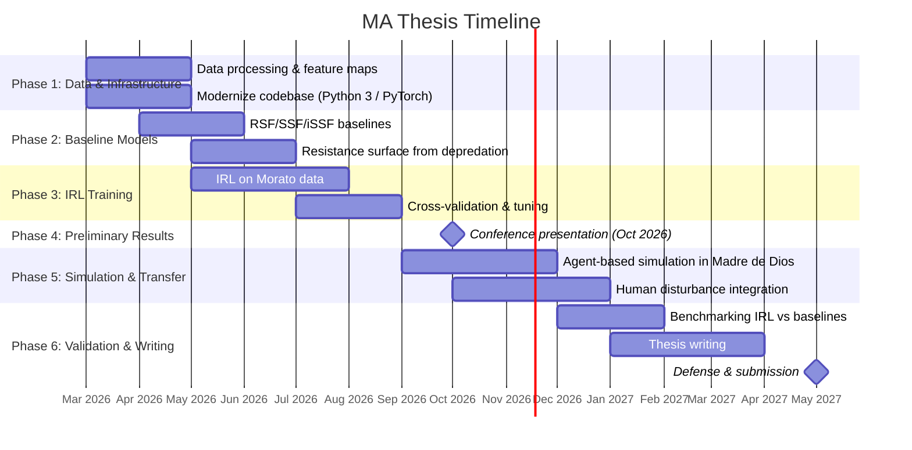

# IRL-Based Jaguar Movement Modeling: Comprehensive Thesis Plan

## Executive Summary

This plan details how to adapt the existing Hirakawa et al. (2018) MaxEnt IRL codebase to learn jaguar movement policies from the Morato et al. (2018) GPS dataset, transfer those policies to simulate jaguar movement in Madre de Dios (Peru), and validate results against baseline models and the unpublished depredation data.

> [!IMPORTANT]
> **Feasibility assessment: This research is feasible for an MA thesis with a May 2027 graduation**, but it is ambitious. The timeline from now (Feb 2026) gives ~15 months, with preliminary results needed by Oct 2026 (~8 months). The student's CS/ML background is a major strength. Key risks include: remote sensing data acquisition/processing time, computational resources for training, and the novelty of the IRL → transfer → simulation pipeline for a terrestrial carnivore (unprecedented in published literature).

---

## 1. Feasibility Analysis

### 1.1 Why This Research Makes Sense

Traditional parametric movement models (RSFs, SSFs, iSSFs) estimate *correlations* between environmental features and habitat use but do not recover the underlying *decision-making process*. IRL fills this gap by recovering a reward function that explains the *policy* generating observed trajectories — a fundamentally different, mechanistic insight. For jaguars:

- **Movement modality matters**: Schoen et al. (2025) showed that jaguars exhibit distinct behavioral states (resting, local, exploratory) with radically different environmental responses. A single parametric model conflates these.
- **Transfer potential**: Learned reward functions can generalize across landscapes if the feature space is consistent, enabling prediction in data-poor regions like Madre de Dios.
- **Conservation utility**: Agent-based simulations driven by learned policies can test "what-if" scenarios (e.g., road construction, deforestation) that parametric models cannot.

### 1.2 Caveats, Pitfalls, and Limitations

| Risk | Severity | Mitigation |
|------|----------|------------|
| **Spatial scale mismatch**: Hirakawa's code uses a small 2D grid (~100×100 pixels); jaguar home ranges are 10–1500 km² | High | Adopt a hierarchical approach: coarse grid (1 km cells) for exploratory movement, fine grid (100 m) for local/resting states |
| **Temporal irregularity**: Morato data has irregular fix intervals (1 hr to >1 week) vs. Hirakawa's regular time steps | High | Pre-process with trajectory interpolation (ctmm, crawl). Avoid complex ML imputation (like Torney GP) to limit compounding bias on sparse data. |
| **Data sparsity**: n≈40–60 individuals seems small for ML | Low/Med | IRL learns from *behavioral steps* (state-action pairs), not just individual counts. 40 individuals × 1000 fixes = 40,000 steps, providing ample data for policy learning. |
| **Feature map construction**: Original code uses satellite imagery features; jaguar model needs ecologically meaningful landscape features | High | Build custom raster feature maps from GEE/remote sensing (forest cover, NDVI, distance to water, elevation, slope, human disturbance indices) |
| **State-space explosion**: 3D (x, y, t) arrays for large landscapes consume extreme memory (original code: 256 GB RAM) | High | Use sparse representations, tile-based processing, or migrate to deep MaxEnt IRL with neural network reward approximation |
| **No human disturbance in training data**: Morato jaguars mostly in protected/semi-wild areas | Medium | Cannot directly learn human-avoidance behavior from training data. Must model human disturbance as an additional feature layer at simulation time, calibrated using the unpublished depredation dataset |
| **Transfer learning validity**: Reward function portability across biomes is unproven | Medium | Validate using held-out Morato individuals in different countries/biomes; test feature importance stability |
| **Bias in validation data**: Depredation points represent conflict locations, not typical movement | Medium | Use as negative attractors (jaguars were *present* at these points); interpret with caution; supplement with camera trap occurrence records if available |

### 1.3 Timeline



---

## 2. Code Adaptation Plan: Hirakawa → Jaguar IRL

### 2.1 Current Codebase Architecture

The [existing code](file:///home/luveenw/Dropbox/Documents/Luveen%20Wadhwani/OneDrive/Documents/Luveen-Obsidian/03%20-%20Projects/Columbia/00%20-%20Thesis/MaxEnt_IRL_trajectory_interpolation) implements Ziebart (2008) MaxEnt IRL for seabird trajectory interpolation:

| Component | File | Description |
|-----------|------|-------------|
| Core IRL engine | [MaxEntIRL.py](file:///home/luveenw/Dropbox/Documents/Luveen%20Wadhwani/OneDrive/Documents/Luveen-Obsidian/03%20-%20Projects/Columbia/00%20-%20Thesis/MaxEnt_IRL_trajectory_interpolation/MaxEntIRL.py) | 3D state space (y, x, time), 9 discrete actions (8 neighbors + stay), soft value iteration, policy computation, forward distribution |
| Training | [train.py](file:///home/luveenw/Dropbox/Documents/Luveen%20Wadhwani/OneDrive/Documents/Luveen-Obsidian/03%20-%20Projects/Columbia/00%20-%20Thesis/MaxEnt_IRL_trajectory_interpolation/train.py) | Multi-process exponentiated-gradient weight optimization |
| Inference | [test.py](file:///home/luveenw/Dropbox/Documents/Luveen%20Wadhwani/OneDrive/Documents/Luveen-Obsidian/03%20-%20Projects/Columbia/00%20-%20Thesis/MaxEnt_IRL_trajectory_interpolation/test.py) | Loads trained weights, computes value function, policy, and forecast distribution |
| Feature map | [make_3d_feature_map.py](file:///home/luveenw/Dropbox/Documents/Luveen%20Wadhwani/OneDrive/Documents/Luveen-Obsidian/03%20-%20Projects/Columbia/00%20-%20Thesis/MaxEnt_IRL_trajectory_interpolation/data/feature_map/make_3d_feature_map.py) | Replicates static 2D features across 610 time steps |

**Key limitations for jaguar adaptation:**
0. **Branching Strategy:** Create separate Git branches (`feature/linear-irl` and `feature/deep-irl`) to manage diverging linear and deep neural network implementations gracefully.
1. **Python 2.7** — must port to Python 3.10+
2. **OpenCV dependency** for visualization/masking — replace with scipy/skimage
3. **Fixed 9-action grid** (1-cell moves) — inappropriate for variable step lengths in jaguar data
4. **Static feature maps** replicated across time — cannot capture dynamic land use change or seasonal variation
5. **Single hard-coded `max_length = 610`** — jaguar trajectories vary enormously (10 to 10,000+ fixes)
6. **Flat reward function** (linear in features) — may be too simple for complex jaguar-landscape interactions
7. **No behavioral state switching** — ignores Schoen et al.'s (2025) finding that jaguars operate in distinct movement modes

### 2.2 Adaptation Steps

#### Phase A: Modernization & Refactoring

##### [MODIFY] [MaxEntIRL.py](file:///home/luveenw/Dropbox/Documents/Luveen%20Wadhwani/OneDrive/Documents/Luveen-Obsidian/03%20-%20Projects/Columbia/00%20-%20Thesis/MaxEnt_IRL_trajectory_interpolation/MaxEntIRL.py) → `jaguar_irl/core/maxent_irl.py`
- Port to Python 3.10+
- Replace `cv2.dilate` mask operations with `scipy.ndimage.binary_dilation`
- Replace `print` statements with `logging` module
- Replace `sys.exit` with proper exceptions
- Add type hints and docstrings
- Make grid resolution, action space, and max trajectory length configurable

##### [NEW] `jaguar_irl/core/state_space.py`
- Parameterized state-space definition (cell size, temporal resolution, extent)
- Support for geographic coordinate ↔ grid index conversion (UTM projection)
- Memory-efficient sparse state representations for large landscapes

##### [NEW] `jaguar_irl/core/action_space.py`
- Variable-distance action sets (not just 1-cell moves)
- Support for 8-directional actions at multiple step scales (e.g., 1, 2, 5 cells)
- Diagonal distance correction (√2 factor)

##### [MODIFY] [train.py](file:///home/luveenw/Dropbox/Documents/Luveen%20Wadhwani/OneDrive/Documents/Luveen-Obsidian/03%20-%20Projects/Columbia/00%20-%20Thesis/MaxEnt_IRL_trajectory_interpolation/train.py) → `jaguar_irl/training/trainer.py`
- Port to Python 3 with modern multiprocessing
- Add GPU acceleration with PyTorch for value iteration and policy computation
- Implement mini-batch training across individuals
- Add learning rate scheduling (replace manual λ adjustment)
- Add TensorBoard logging for training metrics
- Add checkpointing and early stopping

##### [MODIFY] [test.py](file:///home/luveenw/Dropbox/Documents/Luveen%20Wadhwani/OneDrive/Documents/Luveen-Obsidian/03%20-%20Projects/Columbia/00%20-%20Thesis/MaxEnt_IRL_trajectory_interpolation/test.py) → `jaguar_irl/inference/predictor.py`
- Separate inference from visualization
- Add agent-based simulation mode (sample trajectories from learned policy)
- Add batch prediction for multiple start/end configurations

##### [MODIFY] [util.py](file:///home/luveenw/Dropbox/Documents/Luveen%20Wadhwani/OneDrive/Documents/Luveen-Obsidian/03%20-%20Projects/Columbia/00%20-%20Thesis/MaxEnt_IRL_trajectory_interpolation/util.py) → `jaguar_irl/utils/`
- Split into `io.py`, `geo.py`, `visualization.py`

---

#### Phase B: Data Pipeline

##### [NEW] `jaguar_irl/data/movement_processor.py`
Process [jaguar_movement_data.csv](file:///home/luveenw/Dropbox/Documents/Luveen%20Wadhwani/OneDrive/Documents/Luveen-Obsidian/03%20-%20Projects/Columbia/00%20-%20Thesis/MaxEnt_IRL_trajectory_interpolation/jaguar_movement_data.csv):

1. **Parse & clean**: Fix CR line endings, parse timestamps, validate coordinates
2. **Per-individual trajectory extraction**: Group by `individual.local.identifier`
3. **Quality filtering**: Remove individuals with <30 fixes, >50% missing days, or GPS error >100m
4. **Temporal regularization**: Options:
   - **Option A (recommended for Phase 1)**: Resample to regular intervals (e.g., 4-hour) using `ctmm` or `crawl` (R packages via `rpy2`)
   - **Option B (advanced)**: Use Torney (2021) multilevel GP. *Note on risk*: While elegant, this approach risks obfuscating and amplifying bias if the raw data is extremely sparse. Stick to simpler interpolation (`ctmm`) and filter out individuals with massive data gaps to ensure data integrity.
5. **Trajectory segmentation**: Rather than arbitrary 30-day trips, determine behavioral change points quantitatively. Use the `segclust2d` or `ctmm` R packages to identify distinct movement phases (e.g., resident vs. dispersing) based on step lengths and path tortuosity.
6. **Coordinate projection**: Convert WGS84 (degrees, which vary in metric scale depending on latitude) → UTM zone-specific projection (meters). This is **strictly necessary** so that grid cell dimensions and action step lengths represent consistent physical distances.
7. **Grid discretization**: Map continuous coordinates to grid cells. The specific 1km (regional) and 100m (local) dimensions should be determined empirically by testing 2-3 resolutions, evaluating computational memory limits against model fit (log-likelihood).

##### [NEW] `jaguar_irl/data/feature_builder.py`
Construct raster feature maps from remote sensing data:

| Feature | Source | Resolution | Temporal |
|---------|--------|------------|----------|
| Forest cover | Hansen GFC / TMF | 30m | Annual |
| NDVI / EVI | MODIS MOD13A2 | 250m/1km | 16-day |
| Distance to water | HydroSHEDS | 30m | Static |
| Elevation / slope | SRTM / ALOS | 30m | Static |
| Distance to roads | OpenStreetMap | N/A | ~Annual |
| Distance to settlements | GHSL | 250m | 5-year |
| Land use / land cover | MapBiomas / ESA CCI | 30m/300m | Annual |
| Night light intensity | VIIRS DNB | 500m | Monthly |
| Edge density (forest/non-forest) | Derived from forest cover | 30m | Annual |
| Protected area status | WDPA | N/A | Static |

Implementation approach:
- Use Google Earth Engine Python API to query raw, specific remote sensing datasets (e.g., Hansen for forest, MODIS for NDVI). You will extract one distinct raster per feature, resample them to identical bounds and resolutions, and stack them into a multi-band array.
- Align all layers to a common, empirically derived grid bounding box.
- Normalize features (z-score or min-max within study area)
- Store as NumPy array: `shape = (n_features, n_rows, n_cols, n_timesteps)`
- For temporal features: match to trajectory time periods

##### [NEW] `jaguar_irl/data/hmm_classifier.py`
Implement behavioral state classification following Schoen et al. (2025):

1. Compute step lengths and turning angles from trajectory data
2. Fit Hidden Markov Model (3-state: resting/local/exploratory) using `hmmlearn` or `pomegranate`
3. Classify each fix into a behavioral state
4. **Behavioral modeling**: Try *both* approaches: 1) Train entirely separate IRL models per state, and 2) Use state as an additional input feature. Quantitatively compare their out-of-sample log-likelihood and DIC/WAIC to empirically justify the final choice (Schoen 2025 supports separate models due to fundamentally different resource selection).

---

#### Phase C: Enhanced IRL Model

##### [NEW] `jaguar_irl/models/deep_maxent_irl.py`
Replace linear reward function with a neural network:

```python
class DeepRewardNet(nn.Module):
    """Non-linear reward approximation for MaxEnt IRL."""
    def __init__(self, n_features, hidden_dims=[64, 32]):
        super().__init__()
        layers = []
        in_dim = n_features
        for h_dim in hidden_dims:
            layers.extend([nn.Linear(in_dim, h_dim), nn.ReLU(), nn.Dropout(0.1)])
            in_dim = h_dim
        layers.append(nn.Linear(in_dim, 1))
        self.network = nn.Sequential(*layers)
    
    def forward(self, features):
        return self.network(features).squeeze(-1)
```

This addresses the limitation that jaguar-landscape relationships are non-linear (e.g., jaguars may prefer moderate forest edge density but avoid both interior and open areas).

##### [NEW] `jaguar_irl/models/state_aware_irl.py`
IRL with behavioral state switching (inspired by dDIRL / SWIRL):

- Maintain separate reward functions per behavioral state
- Use HMM-classified states (from Phase B) to route through appropriate reward
- Alternatively, learn reward switching jointly with state transitions

---

## 3. IRL Training Plan

### 3.1 Data Preparation for Training

1. **Select training individuals**: From 117 jaguars, select those with:
   - ≥100 fixes after quality filtering
   - Regular fix intervals (≤6 hr median gap)
   - ≥60 days tracking duration
   - Estimated n ≈ 40–60 individuals

2. **Stratify by biome/country**: Ensure representation across:
   - Pantanal (Brazil): dense data, wetland/savanna mosaic
   - Atlantic Forest (Paraguay/Brazil): fragmented forest
   - Cerrado (Brazil): savanna
   - Humid Chaco (Paraguay/Argentina): subtropical
   - Dry forests (Mexico, Costa Rica): more human-modified
   *(Note: Augment the dataset with a distinct `Biome` categorical feature using WWF Ecoregion polygons if the CSV lacks it, as biome context is critical).*

3. **Create train/validation/test splits**: 
   - 70% individuals for training, 15% validation, 15% testing.
   - **Selection process**: Use stratified random sampling based on Biome and Disturbance Class so that each split has proportional representation across ecological contexts.

4. **Define study area tiles**: 
   - **Tile Size Procedure**: Calculate the 100% Minimum Convex Polygon (MCP) or 99% Kernel Density Estimate (KDE) home range for the individual. Add a substantial buffer (e.g., 20km) around this polygon to capture available but unused space. The bounding box of this buffered polygon dictates the tile size for that specific individual. Extracted feature maps (see Section 2.2) correspond exactly to this bounding box.

### 3.2 Training Procedure

```
For each training individual i:
    1. Load trajectory T_i (discretized to grid cells)
    2. Load feature map F_i for individual's home range tile
    3. Compute empirical feature counts from T_i
    For each training epoch:
        4. Compute reward R = θ(F_i) using current parameters θ
        5. Backward pass: compute soft value function V from endpoint
        6. Forward pass: compute state visitation frequencies D
        7. Compute expected feature counts from D
        8. Compute gradient: ∇ = f_empirical - f_expected
        9. Update θ using Adam optimizer
    10. Evaluate log-likelihood on validation trajectories
    11. Early stopping when validation LL plateaus

**Hyperparameter Tuning (Random Search / Grid Search):**
```python
# Pseudocode for model tuning on the validation set
best_ll = -float('inf')
for hp_config in sample_hyperparameters():
    model = initialize_model(hp_config)
    model.train(training_individuals)
    
    val_ll = 0
    for val_traj in validation_individuals:
        val_ll += model.compute_trajectory_likelihood(val_traj)
        
    if val_ll > best_ll:
        best_ll = val_ll
        save_model_weights(model)
```
```

### 3.3 Hyperparameters

| Parameter | Range to Search | Selection Method |
|-----------|----------------|-----------------|
| Grid cell size | 250m, 500m, 1km, 2km | Cross-validation |
| Temporal resolution | 2hr, 4hr, 6hr, 12hr | Match to median fix interval |
| Learning rate | 1e-4 to 1e-2 | Learning rate finder |
| Network architecture | [32], [64,32], [128,64,32] | Validation LL |
| Regularization (L2) | 1e-5 to 1e-2 | Validation LL |
| Number of behavioral states | 2, 3, 4 | BIC from HMM |

---

## 4. Agent-Based Simulation in Madre de Dios

### 4.1 Simulation Framework

##### [NEW] `jaguar_irl/simulation/agent.py`

```python
class JaguarAgent:
    """Simulated jaguar moving in Madre de Dios landscape."""
    
    def __init__(self, start_position, policy, behavior_state_model):
        self.position = start_position
        self.policy = policy  # learned from IRL
        self.behavior_model = behavior_state_model
        self.trajectory = [start_position]
        self.current_state = 'exploratory'
    
    def step(self, feature_map, human_disturbance_map=None):
        """Execute one movement step based on learned policy."""
        # Select behavior-specific policy
        policy = self.policy[self.current_state]
        
        # Compute action probabilities at current position
        action_probs = policy.get_action_probs(
            self.position, feature_map, human_disturbance_map
        )
        
        # Sample action
        action = np.random.choice(len(action_probs), p=action_probs)
        
        # Move
        self.position = self.apply_action(self.position, action)
        self.trajectory.append(self.position)
        
        # Update behavioral state
        self.current_state = self.behavior_model.update(
            self.trajectory[-3:]  # recent movement history
        )
```

### 4.2 Madre de Dios Feature Maps

Construct feature maps for Madre de Dios:
1. Use identical GEE pipeline (`jaguar_irl/data/feature_builder.py`). The script just takes the Madre de Dios bounding box as an argument instead of drawing the bounding box from an individual's trajectory MCP.
2. Add **human disturbance layer** calibrated to Madre de Dios:
   - Road density (specifically the Transoceanic Highway)
   - Deforestation frontier (Hansen GFC recent loss)
   - Agriculture/ranches (MapBiomas or manual classification)
   - Proximity to settlements/communities (GHSL + Peru census data)

### 4.3 Incorporating the Unpublished Depredation Data

The 150+ livestock depredation points provide crucial information:

1. **Validation of predicted conflict zones**: Do simulated jaguar movement corridors pass near depredation sites?
   - **Implementation (`jaguar_irl/evaluation/depredation_validator.py`)**: After simulating hundreds of paths in Madre de Dios, generate a KDE movement density map. Extract the core corridor polygons. Compute the proportion of actual depredation points that fall within or near (e.g., 1km buffer) these simulated corridors vs. random null-model corridors.
2. **Prior for human disturbance**: Use the environmental coefficients from your unpublished depredation model as Bayesian priors for the disturbance feature weights in the IRL model.

> [!WARNING]
> **Bias consideration**: Depredation points represent *extreme* jaguar-human interactions, not typical movement. They are spatially biased toward livestock presence (i.e., ranches). 
> - **Expert Corridors**: Supplement evaluation with expert corridors (e.g., Rabinowitz and Zeller 2010). *Process*: Georeference map images from papers in QGIS using known landmarks/coordinates. Manually trace the visible corridors to create polygon shapefiles. Rasterize these shapefiles onto the Madre de Dios grid to compute overlap with simulated paths (`jaguar_irl/evaluation/corridor_overlap.py`).

### 4.4 Transfer Learning: Human Disturbance

The Morato et al. (2018) data largely comes from protected or semi-natural areas. To model human avoidance:

1. **Feature-augmented transfer**: Include human disturbance features (distance to roads, settlements, deforestation) in the feature map during training. Even if Morato jaguars aren't in heavily disturbed areas, the learned reward for "distance to roads = 0" should be low (negative).
2. **Prior-based augmentation**: Impose a **Bayesian prior** on human-disturbance feature weights using the unpublished depredation model's parameters. This injects domain knowledge about avoidance behavior.
3. **Fine-tuning with pseudo-labels**: Use the depredation presence/absence model to generate pseudo-trajectories (simulated paths that avoid high-conflict areas) and fine-tune the IRL model.
4. **Sensitivity analysis**: Run simulations with and without human disturbance layers to quantify predicted behavioral shifts.

---

## 5. Baseline Parametric Models

### 5.1 Resource Selection Functions (RSF)

##### [NEW] `jaguar_irl/baselines/rsf.py`

Using the `statsmodels` or `glm` approach:

1. **Response variable**: Used (GPS fix) = 1 vs. Available (random background points) = 0
2. **Predictors**: Same features as IRL model (forest cover, NDVI, distance to water/roads/settlements, elevation, slope, land cover type, edge density)
3. **Model**: Logistic regression (exponential RSF) with individual as random effect
4. **Implementation**: Python `statsmodels` GLM with mixed effects, or R `glmmTMB` via `rpy2`

### 5.2 Integrated Step Selection Functions (iSSF)

##### [NEW] `jaguar_irl/baselines/issf.py`

Following Avgar et al. (2016) methodology:

1. **Data structure**: For each observed step, generate ~20 random available steps (matched on step length/turning angle distributions)
2. **Predictors**: End-point habitat features + movement characteristics (step length, turning angle)
3. **Model**: Conditional logistic regression (`survival::clogit` in R via `rpy2`, or Python `lifelines`)
4. **Behavioral state interaction**: Following Schoen et al., fit interaction terms between behavioral state (from HMM) and habitat features

### 5.3 Resistance Surface

##### [NEW] `jaguar_irl/baselines/resistance_surface.py`

1. Start from the unpublished depredation model's resistance parameters
2. Use RSF predictions (inverted) as resistance values
3. Compute least-cost paths between known jaguar occurrence points
4. Compare corridor predictions against known connectivity paths and Panthera corridor data

### 5.4 Specific Predictors to Use

| Predictor | Justification | Source |
|-----------|--------------|--------|
| **Forest cover (%)** | Jaguars are strongly forest-dependent (Morato et al.) | Hansen GFC |
| **NDVI** | Vegetation productivity → prey availability | MODIS |
| **Distance to nearest water body** | Jaguars are semi-aquatic, use riparian corridors | HydroSHEDS |
| **Elevation** | Constrains range; Madre de Dios is lowland Amazon | SRTM |
| **Slope** | Affects movement cost | Derived from DEM |
| **Land cover class** | Forest type matters (primary vs. secondary vs. agriculture) | MapBiomas/ESA CCI |
| **Forest edge density** | Schoen (2025) found edge metrics critical for habitat selection | Derived |
| **Distance to nearest road** | Barrier/avoidance effect; death risk | OSM |
| **Distance to nearest settlement** | Human avoidance | GHSL |
| **Night light radiance** | Proxy for cumulative human disturbance | VIIRS |
| **Protected area buffer** | Inside/outside/edge of PA affects behavior | WDPA |
| **Prey density index** | Vegetation + water → proxy for prey | Composite index |
| **Seasonality (wet/dry)** | Schoen (2025) found seasonal effects | CHIRPS rainfall |

---

## 6. Validation & Benchmarking Plan

### 6.1 Cross-Validation of IRL Model

**Spatial block cross-validation** (Roberts et al. 2017):
- Divide study areas into spatial blocks.
- **Block size selection**: Crucially, block size must be greater than the range of spatial autocorrelation. Use the R package `blockCV` to fit variograms of predictor variables and empirically determine the effective autocorrelation range to set block dimensions.
- Train on blocks from some regions, test on held-out regions
- Prevents spatial autocorrelation inflating accuracy

**Individual-level cross-validation**:
- Hold out entire individuals (not just portions of trajectories)
- Train on individuals A, B, C; test on D, E
- Tests generalization across individual variation

### 6.2 Quantitative Metrics

| Metric | Description | How to Compute |
|--------|-------------|----------------|
| **Log-likelihood** | How well the learned policy explains held-out trajectories | Sum of log π(a\|s) along test trajectory |
| **AUC-ROC** | Discrimination between used and available locations | Compare predicted habitat value at GPS fixes vs. random points |
| **Boyce Index (CBI)** | Habitat suitability model calibration | Spearman correlation of predicted vs. observed across habitat bins |
| **Mean Squared Displacement (MSD)** | Match between simulated and observed movement characteristics | Compare MSD curves of simulated vs. real trajectories |
| **Step length distribution** | Simulated movement realism | KS test: simulated vs. observed step length distributions |
| **Turning angle distribution** | Simulated movement realism | KS test: simulated vs. observed turning angle distributions |
| **Utilization distribution overlap (UDOI/BA)** | Spatial overlap between simulated and observed space use | Bhattacharyya affinity or UDOI between KDE UDs |
| **Earth Mover's Distance (EMD)** | Spatial distribution match for movement density | Wasserstein distance between predicted and observed spatial distributions |
| **Corridor overlap with Panthera corridors** | Independently validates large-scale connectivity | IoU or buffer overlap with known corridor delineations |

### 6.3 IRL vs. Baselines Comparison

```
For each test individual:
    1. Compute IRL predicted space use → UD_irl
    2. Compute RSF predicted space use → UD_rsf
    3. Compute iSSF predicted space use → UD_issf
    4. Compute observed space use (KDE of real trajectory) → UD_obs
    5. Compare: BA(UD_irl, UD_obs) vs. BA(UD_rsf, UD_obs) vs. BA(UD_issf, UD_obs)
    6. Statistical test: paired Wilcoxon signed-rank across individuals
```

### 6.4 Transfer to Madre de Dios Validation

1. **Depredation point prediction**: Do simulated jaguar movement corridors pass through/near depredation sites?
   - Metric: Proportion of depredation points within X km of predicted corridors
   - Compare against random expectation (null model)

2. **Presence/absence concordance**: Compare IRL-predicted habitat suitability against the unpublished depredation model's jaguar presence predictions
   - Metric: Spearman correlation between two independent predictions

3. **Expert validation**: Present simulated corridor maps to local researchers/conservationists for qualitative assessment of ecological plausibility

### 6.5 Sensitivity Analyses

1. **Grid resolution sensitivity**: Run model at e.g., 250m, 500m, 1km → does prediction quality change?
2. **Feature Importance**: Instead of basic ablation, use **Recursive Feature Elimination (RFE)**, **Principal Component Analysis (PCA)** on the input layers, or **L1 Regularization (LASSO)** within the IRL optimization step to robustly identify and prune uninformative features.
3. **Training data volume**: Subsample training individuals → minimum viable sample size?
4. **Human disturbance scenarios**: Simulate with 0%, 50%, 100%, 200% current disturbance levels → quantify behavioral response

---

## 7. Detailed Implementation Steps

### Step 1: Base Porting & Branch Setup (Week 1)

- Create branching strategy: `git checkout -b feature/linear-irl` and `git checkout -b feature/deep-irl`
- Port [MaxEntIRL.py](file:///home/luveenw/Dropbox/Documents/Luveen%20Wadhwani/OneDrive/Documents/Luveen-Obsidian/03%20-%20Projects/Columbia/00%20-%20Thesis/MaxEnt_IRL_trajectory_interpolation/MaxEntIRL.py), [train.py](file:///home/luveenw/Dropbox/Documents/Luveen%20Wadhwani/OneDrive/Documents/Luveen-Obsidian/03%20-%20Projects/Columbia/00%20-%20Thesis/MaxEnt_IRL_trajectory_interpolation/train.py), and [test.py](file:///home/luveenw/Dropbox/Documents/Luveen%20Wadhwani/OneDrive/Documents/Luveen-Obsidian/03%20-%20Projects/Columbia/00%20-%20Thesis/MaxEnt_IRL_trajectory_interpolation/test.py) to Python 3.10+ with PyTorch
- Replace `cv2` dependencies in existing files with `scipy`
- Add type hints and replace print statements with logging
*(Note: This is the foundational prerequisite before building new pipelines in Steps 2-5)*

```bash
# Create project structure
mkdir -p jaguar_irl/{core,data,models,baselines,simulation,evaluation,utils,config}
pip install numpy scipy scikit-learn pytorch torchvision tensorboard
pip install geopandas rasterio shapely pyproj movingpandas
pip install hmmlearn pomegranate
pip install earthengine-api
pip install rpy2  # for R interop (ctmm, amt, glmmTMB)
```

### Step 2: Data Processing (Weeks 1–4)

1. Parse [jaguar_movement_data.csv](file:///home/luveenw/Dropbox/Documents/Luveen%20Wadhwani/OneDrive/Documents/Luveen-Obsidian/03%20-%20Projects/Columbia/00%20-%20Thesis/MaxEnt_IRL_trajectory_interpolation/jaguar_movement_data.csv) (fix CR line endings, extract columns)
2. Compute per-individual statistics (n_fixes, duration, median fix interval, geographic extent)
3. Filter individuals meeting quality criteria
4. Regularize trajectories to 4-hour intervals using `crawl` via `rpy2`
5. Project to UTM; discretize to grid

### Step 3: Feature Map Construction (Weeks 2–6)

1. Set up GEE account and workspace
2. Extract raster layers for each study area tile
3. Align, resample, normalize; store as [.npy](file:///home/luveenw/Dropbox/Documents/Luveen%20Wadhwani/OneDrive/Documents/Luveen-Obsidian/03%20-%20Projects/Columbia/00%20-%20Thesis/MaxEnt_IRL_trajectory_interpolation/data/tracking/208.npy) arrays
4. For Madre de Dios: construct equivalent feature maps

### Step 4: HMM Behavioral Classification (Weeks 4–6)

1. Compute step lengths and turning angles
2. Fit 2-state and 3-state HMMs
3. Select best via BIC
4. Classify each fix

### Step 5: IRL Model Implementation (Weeks 4–8)

1. Port [MaxEntIRL.py](file:///home/luveenw/Dropbox/Documents/Luveen%20Wadhwani/OneDrive/Documents/Luveen-Obsidian/03%20-%20Projects/Columbia/00%20-%20Thesis/MaxEnt_IRL_trajectory_interpolation/MaxEntIRL.py) to Python 3 with PyTorch
2. Implement `DeepRewardNet` 
3. Implement configurable state/action spaces
4. Write unit tests for value iteration, policy computation
5. Run smoke test on synthetically generated trajectories

### Step 6: IRL Training (Weeks 8–14)

1. Train on full training set
2. Hyperparameter search using validation set
3. Train state-specific models
4. Inspect learned reward maps for ecological interpretability

### Step 7: Baseline Models (Weeks 6–10)

1. Fit RSFs in R via `rpy2`
2. Fit iSSFs using `amt` package
3. Construct resistance surface; compute least-cost corridors

### Step 8: Simulation (Weeks 12–18)

1. Implement `JaguarAgent` 
2. Run simulations in Madre de Dios (100+ agents, 1000+ realizations)
3. Aggregate into predicted movement density maps
4. Test with/without human disturbance layers

### Step 9: Validation (Weeks 16–22)

1. Compute all metrics from §6
2. Statistical testing (IRL vs. baselines)
3. Madre de Dios validation against depredation data
4. Generate plots and tables for thesis

### Step 10: Thesis Writing (Weeks 18–28)

1. Introduction & literature review
2. Methods (data, models, evaluation)
3. Results
4. Discussion & conservation implications
5. Revision cycles with advisor

---

## 8. Verification Plan

### 8.1 Automated Tests

The following tests verify the core implementation:

```bash
# Run all unit tests
python -m pytest jaguar_irl/tests/ -v

# Specific test modules:
python -m pytest jaguar_irl/tests/test_data_processor.py -v  # Data pipeline
python -m pytest jaguar_irl/tests/test_maxent_irl.py -v      # Core IRL
python -m pytest jaguar_irl/tests/test_trainer.py -v          # Training
python -m pytest jaguar_irl/tests/test_simulation.py -v       # ABM
```

Key test cases:
1. **Data processor**: Parses CSV correctly; filters individuals; produces expected grid coordinates
2. **MaxEnt IRL core**: Value iteration converges on a simple 5×5 grid; policy sums to 1; reward recovery matches ground truth on synthetic data
3. **Trainer**: Loss decreases monotonically on toy problem; checkpointing works
4. **Baseline models**: RSF coefficients match R `glm` output on shared test data
5. **Simulation**: Agent stays within bounds; step distributions match stochastic policy

### 8.2 Manual Verification

These require human review:
1. **Feature map visual inspection**: Overlay extracted rasters on satellite imagery in QGIS — do they look correct?
2. **Learned reward map interpretation**: Does the model assign high reward to forested areas near water, low reward to agriculture? (ecological face validity)
3. **Simulated trajectory inspection**: Do simulated jaguar trajectories qualitatively look like real jaguar movement? (sinuous, with area-restricted search bouts interspersed with directed movements)
4. **Madre de Dios corridor plausibility**: Do predicted corridors follow rivers and forest patches? Do they avoid open mining areas?

---

## 9. Summary of Key Architectural Decisions

> [!NOTE]
> The most critical decision is whether to use the **original linear MaxEnt IRL** (simpler, faster, more interpretable) or **deep MaxEnt IRL** (more expressive, handles non-linearity, but harder to interpret). **Recommendation**: Start with linear for interpretability and initial results by Oct 2026, then add deep model for comparison if time permits.

| Decision | Choice | Rationale |
|----------|--------|-----------|
| Grid resolution | 1 km (regional), 100 m (local) | Balances memory with ecological relevance for jaguar home ranges |
| Temporal resolution | 4 hours | Median fix interval across Morato individuals |
| Behavioral states | 3 (resting, local, exploratory) | Following Schoen et al. (2025) |
| Reward function | Linear first, then deep NN | Start simple, add complexity if needed |
| Human disturbance | Additive feature layer + prior from depredation model | Cannot learn from training data directly |
| Transfer approach | Feature-consistent prediction (same feature space, new landscape) | Standard approach; reward functions are landscape-agnostic if features are consistent |
| Primary framework | Python 3.10 + PyTorch + R (via rpy2 for ecological packages) | CS background makes Python natural; R necessary for `ctmm`, `amt`, `glmmTMB` |
