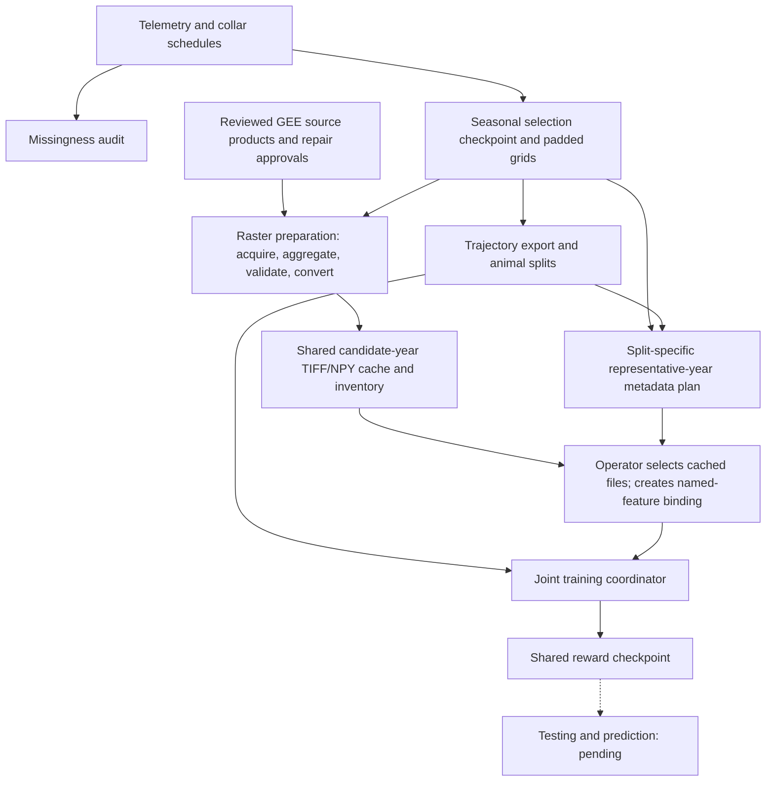

# Jaguar seasonal movement workflow: decisions and operations

**Status:** implemented processing, export, map binding and joint training;
**scientific testing/prediction integration remains to be designed and reviewed.**
Last checked against the code and persisted artifacts: **2026-11-04**.

This is the maintained operating manual for the active Pantanal workflow. It
records what the code does, why the architecture takes this shape, and how to run
and inspect each phase. Historical research notes contain earlier proposals and
thresholds; use the policies and contracts below for new runs. An artifact's own
manifest remains authoritative for the configuration that produced that artifact.

[Architecture decision record](../../docs/adr/0001-seasonal-joint-reward.md) ·
[Project glossary](../../GLOSSARY.md) ·
[Documentation maintenance instructions](../../AGENTS.md)

## Contents

1. [Purpose, ecological assumptions and decisions](#1-purpose-ecological-assumptions-and-decisions)
2. [Components, identities and data flow](#2-components-identities-and-data-flow)
3. [Workspace and source inputs](#3-workspace-and-source-inputs)
4. [Audit acquisition coverage and retention](#4-audit-acquisition-coverage-and-retention)
5. [Select seasonal bursts and spatial groups](#5-select-seasonal-bursts-and-spatial-groups)
6. [Export trajectories and assign animal splits](#6-export-trajectories-and-assign-animal-splits)
7. [Prepare and bind spatial covariates](#7-prepare-and-bind-spatial-covariates)
8. [Prepare and train the joint model](#8-prepare-and-train-the-joint-model)
   - [New season from source data to the first cluster job](#new-season-from-source-data-to-the-first-cluster-job)
9. [Resume, replace inputs and recover from failures](#9-resume-replace-inputs-and-recover-from-failures)
10. [Optional iSSA comparison](#10-optional-issa-comparison)
11. [Scientific testing and prediction — placeholder](#11-scientific-testing-and-prediction--placeholder)
12. [Software verification and current evidence](#12-software-verification-and-current-evidence)
13. [Maintenance and unresolved decisions](#13-maintenance-and-unresolved-decisions)

## 1. Purpose, ecological assumptions and decisions

The immediate goal is to retain useful local movement evidence from as many of
the 56 Pantanal jaguars as possible, then learn one shared movement-reward
function for a chosen season. The longer-term objective includes predicting
movement and studying landscape change. Transfer to other biomes/sites is a
later research question; this pipeline does not establish transfer validity.

The working model is `reward(group, cell) = weights · covariates(group, cell)`.
Every group uses the same learned coefficient vector and the same feature
semantics, but has its own map. Local movement probabilities can therefore differ
between groups even though the reward parameters are shared.

| Decision in force | Reason | Consequence to retain in interpretation |
| --- | --- | --- |
| One Pantanal season per fit, pooling occurrences across years | Approximate landscape seasonality with static feature maps while keeping sufficient telemetry | Seasonal and interannual consistency are assumptions, not demonstrated facts. |
| All qualifying local bursts, rather than one best week per animal | Retain usable observations despite long gaps elsewhere in an animal's record | The model receives multiple separate routes per animal; retained bursts are not independent animals. |
| Two-hour target, nominal four-hour cap plus 15-minute jitter, three selected fixes | Current project compromise between retention and local temporal continuity | These are operational thresholds, not validated jaguar ecological constants. |
| Separate small map extents with common feature definitions | Keep raster acquisition, storage and dynamic programming manageable | Groups are computational domains, not biological populations or independent validation sites. |
| One joint objective across all groups from initialization onward | Fit a common reward without repeatedly fitting A, then A+B, then A+B+C | Every update includes all training-active maps; map order is canonicalized for numerical reproducibility. |
| Equal-animal mean trajectory likelihood | Keep animals with many retained bursts from automatically dominating by burst count | Longer routes can still contribute more information; no per-step normalization is applied. |
| Checkpoint completed optimizer iterations | Resume without a partial-gradient/group-progress state machine | A failed partial iteration is recomputed; completed updates survive. |
| Separate identity/provenance metadata from numeric route arrays | Keep the numerical solver independent of telemetry file conventions | Manifests and event links are required parts of the dataset, not optional descriptions. |

Hofmann et al. (2024) motivates retaining irregular movement evidence with an
appropriate duration-aware model. Its Dynamic+Model strategy is an **iSSA**
method; selecting similar bursts does not implement its duration correction in
MaxEnt IRL. The current IRL model has a spatial-move clock and static covariates.
See the [paper](https://doi.org/10.1186/s40462-024-00476-8) and
[local evidence notes](../../research_notes/Jaguar%20trajectory%20coverage/hofmann_missingness_primary_evidence.md).

The seasonal-static representation is an explicit approximation. It assumes
that the chosen seasonal composites sufficiently describe conditions relevant
to the included routes, despite within-season flood changes, between-year
variation, and possible behavioral differences. Calendar grouping does not
establish residency, a constant movement process, random GPS missingness, or
habitat fidelity. Full-study MCPs provide map-planning geometry; they do not
certify a stable home range. No additional speed-outlier or device-accuracy
filter has been silently introduced.

A static flood-influenced vegetation class and a dated map of inundation are
different predictors. Changing one into the other changes the scientific model.
Likewise, seasonal averaging of categorical classes requires an explicit choice
of indicator, majority class, or proportion; numeric class codes cannot simply
be averaged into a meaningful habitat variable.

### Approved operational seasons

Dates shown to readers include both named days. Internally each season ends at
midnight starting the next day, so there is neither overlap nor an unassigned day.

| Season | Display dates | User-supplied climatic description | Collection example |
| --- | --- | --- | --- |
| Winter | May 15–August 14 | Dry with rare showers | `WIN-C01` |
| Spring | August 15–November 14 | Hottest season | `SPR-C01` |
| Summer | November 15–March 21 | Hot, humid, intense rain | `SUM-C01` |
| Autumn | March 22–May 14 | Cooling, declining rain, rivers returning to banks | `AUT-C01` |

These dates were approved for this experiment; they do not imply synchronous
hydrology across the Pantanal. Summer's `season_year` is its November start year.
There is no season buffer. Source timestamps have unspecified timezone and are
used as recorded, without an inferred UTC/local-time conversion. **The user
selected Spring (`SPR-C01`) as the first season on 2026-11-03, with all four
seasons intended eventually.** Winter commands below remain illustrative.
The first exercise uses a whole-animal train/test split and interpolation of
thinned or partially withheld test trajectories. All six Spring raster recipes are specified and their candidate caches are
complete. Spring34/9 animal holdout and train/test epochs are now frozen; candidate
input bindings are prepared. Hirakawa-style scaling and zero L2 are selected;
The 50-update baseline reached its cap. The uncapped Spring continuation is
paused at update 12657 after verifying compact logs and checkpoint retention.
Scientific evaluation remains open.

**Terminology correction (2026-11-03):** the selected technical units are
**bursts**, defined by acquisition and processing rules. **Bouts** refer to
behavioral episodes; no behavioral-state inference is performed here. Existing
code/schema names (`BoutProcessor`, `source_bout_id`, `n_bouts`, policy IDs and
filenames containing `bout`) are legacy names for bursts and remain valid.
The active seasonal selection HTML report and its figures label these units
as bursts. Historical schemas and downloaded tables retain their identifiers. See the glossary for the distinction.

## 2. Components, identities and data flow



| Component | Owner / entry point | Input → output contract |
| --- | --- | --- |
| Missingness analysis | `analysis.pantanal_missingness.audit` | Original fixes + nominal collar schedules → animal/month/burst diagnostics and HTML; does not choose training animals |
| Temporal selection | `movement_processor_pantanal_seasonal` delegates to `BoutProcessor` | Verified Pantanal records → accepted bursts, preserved source observations and rejection records |
| Spatial planning and collections | `pantanal_spatial`, `pantanal_seasonal_collections` | Full-study MCP geometry + seasonal bursts → bounded map groups and canonical evidence ownership |
| Selection checkpoint | `pantanal_checkpoint`, `write_seasonal_checkpoint` | Selected source evidence + ownership + grids + policy → immutable inventoried CSV/JSON bundle |
| IRL export | `export_pantanal_bouts_irl` → seasonal exporter → generic exporter | Selection checkpoint + collection + optional split JSON → route arrays, original-event links, diagnostics and provenance |
| Raster preparation | `terrain_roughness prepare/convert`; recipe `gee/.../acquire.py` drivers and SRTM `cloud_scripts/acquire_run.py`; `gee/verify_spring_covariate_cache.py` ([walkthrough](#raster-preparation--operational-walkthrough)) | Saved padded grids + candidate years + pinned source recipes/approvals → validated TIFFs, separate float32 NPYs, raw/QA/repair provenance, Drive copies and shared cache inventory |
| Covariate epoch planning | `jaguar_irl.training.plan_covariates` | Already split-labelled trajectory export + saved grids → supporting year counts and selected train/test-context epochs; no split creation or automatic asset binding |
| Covariate binding | `jaguar_irl.training.shared bind` | Named arrays + feature semantics + group IDs → versioned sidecar on the selection checkpoint |
| Training coordinator | `jaguar_irl.training.shared prepare/train` | Export + bindings + split + settings → frozen run plan and one shared reward fit |
| Numerical likelihood | `jaguar_irl.core.shared_reward.statistics` | One `[F,H,W]` map stack, `[F]` weights and `[T,2]` route → scalar log-likelihood and `[F]` gradient |
| Scientific testing | **Pending** | Proposed boundary: trained reward + frozen feature contract + independently assigned evaluation evidence → predictions and animal-level scores |

### Implementation and execution status —2026-11-04

| Capability | Implementation | What has actually run |
| --- | --- | --- |
| Raster extraction/conversion/QA | Implemented five recipe pipelines for six features | All six Spring caches complete;133NPYs on13maps/24annual candidate pairs |
| Animal split generation/attachment | `animal_splits` freezes random IDs; exporter reads ID→role JSON | Spring34/9 frozen, seed20261104;534eligible training routes/149test; diagnostic animal54unassigned |
| Representative-year plans | Implemented separate train/test metadata selection | Frozen real train/test plans and split-isolation software tests; baseline fit plan prepared |
| Cache-to-binding resolution | `cache_bindings resolve` checks the shared index and fills manifests | Real train/test manifests prepared; full-training-map Hirakawa-style scaling selected, raw/z-score profiles retained |
| Named-feature binder | Versioned default sidecar or explicit `--binding-dir` profile | Selected Hirakawa hull-bound profile used by real baseline pilot and continuation |
| Shared multi-extent reward fitting | Implemented common weights, animal-weighted objective, backtracking and atomic resume | Numerical/recovery tests plus a passed real six-feature pilot; full continuation launched, no ecological validation |
| Learned independent movement-pattern feature/kernel | Not implemented as a separate model component | Current core has landscape-linear reward and eight-neighbour, endpoint/horizon-conditioned routes |
| Held-out interpolation/forecasting, metrics, CV and ablations | Pending requirements/implementation review | No formal ecological test or transfer experiment |

The full [implementation audit](../../research_notes/Jaguar%20trajectory%20coverage/shared_training_implementation_audit_20261104.md)
traces code/tests/artifacts. Rechecked27split/resolver/profile/trainer/planner tests passed in the current update. The persisted
current synthetic demonstrations stopped after three accepted updates because
of their iteration limit; `complete=true` does not imply gradient convergence.
Existing likelihood/gradient support is a fitting primitive, not a completed
prediction interface. Separate movement-signal modeling and the proposed
landscape/movement/combined comparison require additional explicit design.

### One animal can supply many independent route inputs

Here, `independent` is the export representation label distinguishing ordinary
fragments from matched `paired` cases. It is **not a claim of statistical
independence** among an animal's bursts.

A jaguar's full record is divided into local bursts at tag, season-occurrence and
hard-gap boundaries. Each retained burst can produce exported fragments/variants.
Each numerical route is evaluated separately with its own start, final cell and
length. Routes from different bursts are never joined by an invented movement
between the end of one and the start of another.

| Identity / relationship | Where it lives | Required use |
| --- | --- | --- |
| Original animal ID | `individual_id` in checkpoint and export tables | Preserve across all bursts, groups, variants and splits |
| Original observation | `source_event_key`, original `event_id` and `source_row` | Trace observation ownership and detect reused evidence |
| Selected burst | `window_id` / `window_key`, plus selector subtrajectory IDs | `window` now means a local burst in this policy, not a seven-day window |
| Spatial group | `group_id` and checkpoint-specific `group_key` | Choose a map context; one group can include several animals |
| Grid | `grid_key` → `grids.json` | Resolve CRS, extent, cell size and row/column convention |
| Seasonal collection | `collection_id`, `season`, collection-members table | Select one canonical cover, suppressing alternative ownership of the same evidence |
| Exported route | `trajectory_id` → `array_path` in `trajectory_manifest.csv` | Resolve animal, burst, group, grid, season, variant and split without parsing filenames |
| Source-to-export crosswalk | `selector_export_crosswalk.csv`, `point_links.csv` | Relate selector IDs and actual observations to an exported route and its grid indices |

The **exporter** carries animal and seasonal identities into metadata. The
**training coordinator** reads those identities, enforces the chosen split,
resolves each map, rejects duplicated source evidence and weights each animal.
The **numerical likelihood routine** does not know animal IDs, dates, seasons or
biomes. Thus identity is external to the numerical core, but it is actively used
by the training workflow. The corresponding testing integration has not yet
been established and must preserve this same identity chain.

The [joint weighting walkthrough](#walkthrough--one-animal-across-years-and-extents)
shows how separate routes share one animal's weight across years and extents.
Replacing original IDs with per-burst IDs would change the weights and could
split the same animal between training and testing.

## 3. Workspace and source inputs

Run all examples **from the repository root**. Use the same Python environment
for processing, export and training. These phases need NumPy and pyproj;
the missingness report additionally uses Matplotlib. Verification uses pytest.
Optional TIFF conversion needs Rasterio; the optional iSSA workflow has separate
R dependencies. No installation or environment pinning is performed by these
commands; preserve package versions with the experiment.

| Input | Current path / requirements |
| --- | --- |
| Morato telemetry CSV | `data/jaguar_movement_data.csv`; required fields include `Event_ID`, `timestamp`, `location.long`, `location.lat`, `individual.local.identifier (ID)`, `study.name`, `country`; supply `tag.local.identifier` to preserve tag boundaries |
| Timestamp format | `%m/%d/%y %H:%M`; duplicate animal/timestamp rows cause a failure requiring explicit resolution |
| Collar metadata | `data/Jaguar_additional_information_fixed.csv` (**capital J** in this checkout); `ID`, `Sex`, and `Planned Schedule (h)` are relevant to metadata/audit workflows |
| Cohort definition | Explicit 56-ID list plus matching Pantanal study names in `movement_processor_pantanal.py`; no generic biome inference from coordinates |
| Geographic input | WGS84 longitude/latitude; parsing screens invalid coordinates/times and checks cohort/study consistency |

Start with these shell variables to reuse the existing selection:

```bash
export SELECTION=analysis/pantanal_seasonal_selection
export CP="$SELECTION/checkpoints/selection_5bf188474d229bb43e3efde0"
export COLLECTION=WIN-C01
export RUN=analysis/pantanal_shared_reward/winter_v1
export MAP_MANIFEST=data/pantanal_covariates/winter_v1/covariates.json
```

`CP` is a **selection checkpoint**. `RUN` is a separate **training run**. Changing
the season requires changing the collection and choosing corresponding map
products and experiment paths. A newly processed selection prints its own `CP`;
the example hash above is a historical artifact identity, not a permanent alias.

## 4. Audit acquisition coverage and retention

```bash
python3 -m analysis.pantanal_missingness.audit
```

This script currently reads fixed repository paths for telemetry and metadata
and writes to `analysis/pantanal_missingness/`; it has no configurable input/output
CLI. It recomputes selection with `BoutConfig(gap_jitter_minutes=15)` to compare
raw coverage with the current policy. It overwrites its report products, so
preserve an earlier audit separately before rerunning if you need both versions.
It does not consume the training checkpoint or rewrite the selection checkpoint.

Inspect `index.html`, `monthly.csv`, `individuals.csv`, `retained_bouts.csv`,
`gaps.csv`, `tag_runs.csv`, and `summary.json`. The monthly table covers each
animal's observed study duration, including months with no observations.

| Quantity | Denominator and interpretation |
| --- | --- |
| Nominal slots vacant | Vacant / expected slots on a timetable anchored to the first observation of each same-tag run, using `Planned Schedule (h)` |
| Selected retention | Two-hour-target selected observations / original observed fixes in the reporting scope |
| Native preservation | Original observations preserved inside accepted bursts / original observed fixes in that scope; this includes selected observations |
| Optimizer eligibility | Routes passing geometry/movement/map-budget checks after export; not an acquisition-completeness measure |

The audit assigns observations to the nearest nominal slot, counting an occupied
slot once even when multiple fixes map to it. Its timetable spans the observed
tag run, not an assumed full deployment before/after observations. Same-tag
silences count as exposure in the primary scenario; inter-tag gaps do not.
Missing acquisition-attempt logs and schedule-change dates prevent interpreting
vacancy as an identified GPS failure rate. Long-gap and alternative-cadence
estimates are sensitivity analyses, not corrected truth.

Schedule-review flags and monthly vacancy are **diagnostic, not additional
selection cutoffs**. High retention among observed fixes can coexist with high
nominal vacancy. Do not reject a whole month simply because some of it is missing,
or interpret the 15-minute nominal-slot alignment diagnostic as another filter.
The [missingness README](../../analysis/pantanal_missingness/README.md) defines
these diagnostics in detail.

**Completion check:** review source hashes, cohort size, schedule flags and the
animal/month rows relevant to the intended season; record unresolved schedule
assumptions in the experiment notes.

## 5. Select seasonal bursts and spatial groups

Skip regeneration when reusing the existing checkpoint. For a new selection,
choose `SELECTION` deliberately: reports in that directory are overwritten,
whereas checkpoint generations are preserved.

```bash
python3 -m jaguar_irl.data.movement_processor_pantanal_seasonal \
  --csv data/jaguar_movement_data.csv \
  --collar-metadata data/Jaguar_additional_information_fixed.csv \
  --output "$SELECTION" \
  --max-collections 1 \
  --growth-buffer-km 5 --map-padding-km 5 \
  --max-side-km 40 --max-area-km2 1600
```

This entry point invokes the all-bursts processor with 15 minutes of jitter and
writes under **`pantanal_seasonal_selection`**, not `pantanal_seasonal_bouts`.
`--no-report` skips HTML rendering but still produces data/checkpoints.
`--max-collections 1` requests one canonical cover per season; larger values
produce alternative covers, not additional independent evidence to concatenate.
`--seasons-json` exists, but using it changes the experiment's approved seasonal
contract. The main path uses the dates in section 1.

### Temporal contract

| Rule | Effective current value / behavior |
| --- | --- |
| Policy ID | `all_seasonal_bouts_two_hour_three_fix_four_hour_jitter15_v2` |
| Next-fix target | Previous selected timestamp + 2 hours |
| Regular band | 1.5–2.5 hours inclusive; choose nearest actual observation to target, earlier observation breaks a tie |
| Fallback | Earliest later actual observation at least 1.5 hours after the current selected observation |
| Hard cap | 4.25 hours inclusive on both adjacent native and selected observations; larger gaps split |
| Minimum retained burst | 3 selected fixes **before** rasterization |
| Restart boundaries | Individual, tag, season occurrence, native hard gap; selected gaps can cause further cuts |
| Gates disabled | Weekly density/span, affected-endpoint percentage budget, short-fragment-loss budget |
| Source preservation | Native observations from the accepted burst's first selected fix through its disjoint source envelope, including unselected trailing observations |

The schedule phase follows actual selected timestamps. This is observed-point
thinning, not insertion of missing GPS fixes or sampling on a fixed global clock.
“Forgiveness 2” describes the nominal four-hour/two-hour ratio; the separate
15-minute jitter allowance yields 4.25 hours. A regular six-hour schedule does not
become eligible merely because its acquisitions are complete.

The sampler retains every qualifying burst it produces, not the globally optimal
set over every possible starting phase. A three-fix burst provides two observed
displacements and at most one defined turn; it does not guarantee an informative
IRL route after gridding.

**Compatibility trap:** `BoutConfig()` instantiated directly still defaults to
the historical strict four-hour policy. Python callers must specify
`gap_jitter_minutes=15`. The standalone burst CLI also defaults to 15, but its
output default is `analysis/pantanal_seasonal_bouts`. The seasonal CLI above is
the preferred entry point for this analysis. `--legacy-weekly` deliberately
selects the superseded weekly workflow; its defaults are not this experiment.

### Spatial contract

**Padding verified2026-11-04:** the checkpoint uses5km export padding, distinct
from the5km MCP grouping distance. The rectangle enclosing member MCP95s plus
selected excursions is padded on all four sides, then rounded outward to500m.
All324 saved candidate groups' selected-fix margins were at least5004.52m;
48 land-cover TIFFs,72 cached array shapes and13 SRTM TIFFs matched the full
saved grids. Padding is already inside generated assets; no regeneration is
required for this concern. The user selected it on ecological grounds; no
additional padding or boundary-sensitivity requirement is imposed here.
[Verification record](../../analysis/pantanal_covariates/padding_verification_20261104.json).

Full cleaned study records, before seasonal thinning, supply radially trimmed
MCP95 grouping geometry. The current projected CRS is **EPSG:32721**, cell size
**500 m**. The growth distance (5 km between a candidate MCP and the current union)
and export padding (5 km around the map rectangle) are separate parameters.
Selected source excursions are included when constructing the final extent;
an MCP95 boundary is not used to delete observations. Final extents align to
the grid and are checked against 40 km maximum side and 1,600 km² maximum area.

Each group's `grid_key` resolves to `grids.json`: bounds `[xmin,ymin,xmax,ymax]`,
`rows`, `cols`, `cell_size_m`, `crs`, upper-left origin, rows increasing south,
columns increasing east. Arrays of equal shape on different grids are not
interchangeable. No environmental barrier mask is supplied; diagonal moves and
corner crossing are allowed.

Some temporally qualifying evidence can require an over-budget map. It remains
in checkpoint/report diagnostics and can later fail optimizer eligibility. A
canonical collection's complete temporal coverage does not mean every burst is
trainable. Full-study, telemetry-informed map domains also matter for future
validation: they support a known-domain problem, not automatically a test of
transfer to an independently defined new area.

### Products and inspection

| Product under `SELECTION` | What to inspect |
| --- | --- |
| `index.html` | Season → collection → group → individual overview |
| `cutoffs.json` | Actual threshold values and policy identity for this run |
| `selection_manifest.json` | Run configuration/provenance and checkpoint reference |
| `data/season_summary.csv`, `data/season_individual_coverage.csv` | Seasonal totals and each animal's retained/preserved fractions |
| `data/group_season_coverage.csv`, `data/group_individual_coverage.csv` | The same quantities in particular map contexts; alternative groups repeat evidence |
| `data/rejected_bouts.csv`, `data/sensitivity.csv` | Short-burst losses and alternative-policy diagnostics, not automatic main-policy changes |
| `mcp95_full_study.geojson` | Grouping proxy geometry |
| `checkpoints/selection_…/` | Self-contained accepted-source, ownership, grid, metadata and policy bundle |

In the [Spring collection report](../../analysis/pantanal_seasonal_selection/index.html#SPR-C01),
look for the **Season-years** column and the timeline rows labeled by animal ID
and year. For example, ID 25 appears in Spring 2012 and 2015. The report shows
retained bursts, so use the source data and rejection table when checking a
year with observations but no retained burst.

The seasonal selection report uses “burst” throughout its narrative, headings,
table labels, figure captions and SVG text/tooltips. Presentation labels do not
rename checkpoint fields, machine-readable CSV headers or exporter modules.
Report visualizations use muted, Set2-inspired categorical colors on white backgrounds.
Identity colors are reserved for map tracks, hulls and group envelopes.
In each group MCP95 plot, bold colored ID labels, selected tracks and the
individual’s dashed MCP95 hull share a color; hulls use a 2-pixel dashed stroke.
The hulls summarize full-study observations before seasonal filtering. Captions
explain that solid tracks connect selected fixes within separate bursts and that
MCP95 is a map-planning proxy, not a habitat boundary. Collection maps instead
use group colors for their envelopes and member hulls, with this distinction
explained beneath the map. Count bars, histograms and burst timelines share one restrained blue-gray,
so redundant category colors do not compete with the maps. Weekly count heatmaps
use the standard viridis sequence (purple through teal to yellow), represented
by nine sampled stops with matching interpolation in the cells and color bar.
Numeric cell labels switch between dark and white ink according to background
luminance. The categorical palette is inspired by Set2 and extended for larger
collections; it is not the continuous viridis scale applied to unordered IDs.
Blank heatmap cells and exact count labels retain their existing meanings.

The readability update was checked across all report plot types and regenerated
from the saved `selection_manifest.json` without rerunning movement selection.
The checkpoint hash was checked before and after rendering. Seventeen seasonal
report/burst software tests passed; these checks concern presentation and report
contracts, not scientific validation.

### Observed movement scale and the 500 m grid (2026-11-03)

The reproducible [movement-scale audit](../../analysis/pantanal_movement_scale/results/pantanal_movement_scale_report.html)
uses all canonical temporally selected fixes, before optimizer exclusions:
43,244 fixes, 2,669 technical bursts and 40,575 within-burst observed steps.
It deduplicates alternative spatial groups and verifies exact agreement with
independent `two_hour` export edges. WGS84 geodesic displacement divided by
actual elapsed hours is an interval displacement rate, not instantaneous speed
or reconstructed true path length. No speed filter or selection change is made.

| Season | Animals | Median displacement (m) | Steps <500 m | Same-cell endpoint pairs, 500 m |
| --- | --- | --- | --- | --- |
| Winter | 31 | 29 | 79.0% | 66.7% |
| Spring | 44 | 64 | 72.1% | 59.6% |
| Summer | 34 | 31 | 79.2% | 66.0% |
| Autumn | 23 | 25 | 80.1% | 68.8% |

These are pooled step summaries; animal-balanced and gap-stratified metrics
are included in the audit. Seasonal contrasts are descriptive and confounded
by animal/site/year/schedule composition. Near-zero displacement cannot identify
a resting/feeding state and may include GPS error or unobserved returns.
Same-cell pairs differ from distances below a cell width: the grid origin matters.
The exporter compresses these repeated cells, so elapsed residence time is not
represented in the core spatial-move likelihood. Conversely, 13.4–20.1% of
observed steps have nonadjacent endpoint cells and require inferred connectors.

Counterfactual 250 m grids sharing each group's upper-left origin reduce
same-cell pairs by only 6.7–7.7 percentage points; no maps or exports were changed.
The additional 100 m scenario gives same-cell shares of 47.9%, 41.8%, 47.3%
and 48.7% for Winter, Spring, Summer and Autumn, respectively: reductions of
17.8–20.0 percentage points relative to 500 m. The same observations and origins
are used, with no new selection or optimizer eligibility calculation; candidate
subsets remain defined by the 500 m exports. The sensitivity table, figure and
seasonal/per-animal CSVs include 100, 200, 250, 500 and 1,000 m. The 200 m scenario gives same-cell shares of 55.6%, 49.9%, 56.2% and 56.8%
in seasonal order, requiring 6.25 times the cell count of 500 m at fixed extent.
Some compared partitions (including 100 versus 250 m and 200 versus 500 m)
are not nested, so their difference is a net rate comparison. Figure 1 now uses
one displacement-CDF panel per season, with consistently colored dashed cell-width
references at 100/200/250/500 m. Matching legend labels report actual same-cell
**observation-pair** percentages; they are not point fractions or the CDF heights
at those distances. Figures 1 and 2 use red and blue dashed lines for the mean
and median displacement across all retained steps in each season. Figure 2
organizes the speed and gap diagnostics by season and draws those pooled
markers on both displacement panels. Figure 3 compares all five grid sizes.
The recommendation is to retain 500 m as the initial broad-route baseline and
later compare 250 m and 100 m on identical whole-animal evaluation splits with
appropriate aligned maps. At fixed extent, 100 m has 25 times the cells of 500 m
and potentially longer model routes; runtime has not been benchmarked. A lower
same-cell share alone does not demonstrate a better ecological model. This is a proposed scientific validation exercise, not completed
prediction/testing functionality. Finer resolution alone does not recover time
or within-interval paths. ID 114 contributes 222/278 observed steps above 5 km
and warrants coordinate/collar/neighboring-fix QC; it has not been excluded.
Omitting it only as a diagnostic sensitivity leaves the grid conclusion intact.

```bash
python3 -m analysis.pantanal_movement_scale.analyze
python3 -m analysis.pantanal_movement_scale.report
```

The first command accepts `--checkpoint`, `--exports-index` and `--output`;
defaults point to the current checkpoint and seasonal export index. It writes
`steps.csv`, seasonal/animal metrics, largest-speed diagnostics, figures and
input hashes under `analysis/pantanal_movement_scale/results/`. The second
command renders the default results directory into a portable HTML report
with embedded figures and downloadable metric tables. Re-execution overwrites
these diagnostics only. Dependencies are NumPy, pyproj and Matplotlib.
Checks verify gap/burst boundaries, unique evidence, source/export edge equality,
and actual-export same-cell classifications; these are software checks, not
biological validation. Source checkpoint/export hashes were unchanged.

The selection checkpoint contains `checkpoint.json` with hashes/inventory;
`source_points.csv` with original records; `window_events.csv` linking source
events to bursts; `windows.csv`, `selector_points.csv`, `selector_subtrajectories.csv`;
`groups.csv`, `group_members.csv`, `grids.json`; `collections.csv`,
`collection_members.csv`, `window_seasons.csv`, `seasons.json`; and cohort/collar/QC
tables. Its schema is `pantanal_selection_checkpoint/1`, with seasonal extensions
recorded in the manifest. It preserves native evidence inside accepted envelopes,
not every original rejected seasonal observation. Keep the original CSVs and
coverage reports for full-study denominators.

**Completion check:** use only collection members with `selection_status=selected`
for canonical counts. Check retained animals, rejected bursts, map exceptions and
season definitions; save the printed checkpoint path as `CP`. A larger count in
an all-groups report can reflect alternative map contexts, not additional animals.

## 6. Export trajectories and assign animal splits

Use the burst adapter to carry the checkpoint's three-fix floor and 4/4.25-hour
policy into the export. Calling the older generic/seasonal exporter with default
arguments can reintroduce five-fix and affected-point-budget settings.

```bash
python3 -m jaguar_irl.data.export_pantanal_bouts_irl \
  --checkpoint "$CP" --collection "$COLLECTION" \
  --output "$SELECTION/exports"
```

The command prints a **new timestamped export directory**; record it as `EXPORT`.
Pass `--output` explicitly. Omitting it falls back to the underlying exporter's
`data/tracking` location, not the selection analysis folder. This command does
not write new output into `pantanal_seasonal_bouts` when the explicit path above
is used. `SELECTION/exports.json` indexes the previously generated seasonal
exports; it is a convenience file, not an automatically maintained registry.

To retrieve a previously recorded winter export without guessing the latest
folder name:

```bash
export EXPORT=$(python3 - <<'PY'
import json, os
from pathlib import Path
index = Path(os.environ['SELECTION']) / 'exports.json'
print(json.loads(index.read_text())['winter'])
PY
)
```

This reads the index; it does not identify a freshly exported directory unless
you have updated the index. For another season change the JSON key. Always use
the printed path for a newly created export.

### Frozen Spring split and cached input manifests —2026-11-04

The whole-animal allocation is now frozen:34eligible training animals and9test
animals, sampled uniformly without replacement using NumPy PCG64 seed20261104
on numerically sorted original IDs. No group/sex/year strata or redraws were
used. Test IDs:32,41,74,81,84,108,109,111,117. Animal54 has no optimizer-eligible
Spring routes (five residence-only bursts after gridding) and remains unassigned
in diagnostic exports; it is not a tenth test animal or a35th contributing
training animal. It was outside the agreed43-animal eligible roster.

Files: `analysis/pantanal_splits/spring_whole_animal_v1/animal_splits.json`,
`split_metadata.json`, `split_export.json` and `split_export_verification.json`.
The new export preserves all3,086existing numeric arrays/trajectory IDs and all
3,692manifest rows, with923independent two-hour fragments. Of683eligible routes,
534belong to training animals and149to test animals. All years/bursts/variants
inherit one original animal's role. The original unassigned export remains
unchanged; the convenience `analysis/pantanal_seasonal_selection/exports.json`
still points to it. Read the new `split_export.json` receipt for this experiment.

Existing exporter/year-planner/binder CLIs have been supplemented by:

| Entry point | Role |
| --- | --- |
| `python -m jaguar_irl.training.animal_splits` | Freeze the uniform ID allocation plus eligible/ineligible roster, seed/algorithm/version and source hashes; refuse a different draw in the same output directory |
| `python -m jaguar_irl.training.cache_bindings fit-scaling` | Compute a **candidate** training-only equal-animal z-score profile from route departure states, including grid connectors; refuse test-plan fitting |
| `python -m jaguar_irl.training.cache_bindings resolve` | Resolve the year plan through the shared cache inventory, check hashes/grid/shape and populate a named-feature manifest without copying arrays |
| `shared bind --binding-dir DIRECTORY` | Store a separate versioned binding profile outside the default checkpoint sidecar |
| `shared prepare --binding-state STATE_JSON` | Pin an explicit binding version, avoiding reliance on whichever profile is currently selected by a pointer |

The application-specific allocation and resolver are **our workflow code**, not
steps named in Hirakawa's paper. The binder associates map IDs, grids, feature
order/units and file hashes; it does not fit the reward or change cached arrays.
Scaling is separate: it is recorded in the manifest and applied when fitting
loads a map. The candidate z-score profile has not been selected or endorsed as
Hirakawa's procedure. No real-data fitting or held-out evaluation has started.

Use the existing frozen outputs rather than drawing another seed. Commands are
shown to make the implemented path inspectable/reproducible; exporter invocations
create timestamped exports, so use the receipt to reuse the existing export.
From repository root:

```bash
export PYTHONPATH="$PWD"
WORKFLOW_PY=/tmp/pantanal-gee-venv/bin/python
CP=analysis/pantanal_seasonal_selection/checkpoints/selection_5bf188474d229bb43e3efde0
SPLIT_DIR=analysis/pantanal_splits/spring_whole_animal_v1
BIND_DIR=data/pantanal_covariates/bindings/spring_whole_animal_v1
CACHE_INDEX=data/pantanal_covariates/spring_covariate_cache_inventory_v1.json
"$WORKFLOW_PY" -m jaguar_irl.training.animal_splits \
  --checkpoint "$CP" --collection SPR-C01 \
  --export analysis/pantanal_seasonal_selection/exports/spring-SPR-C01-20261102T232801913923Z-ec50b73bb05c \
  --output "$SPLIT_DIR" --test-count 9 --seed 20261104
# For NEW exports only (already completed for this allocation):
# "$WORKFLOW_PY" -m jaguar_irl.data.export_pantanal_bouts_irl \
#   --checkpoint "$CP" --collection SPR-C01 --split "$SPLIT_DIR/animal_splits.json" \
#   --output "$SPLIT_DIR/exports"
SPLIT_EXPORT=$("$WORKFLOW_PY" - <<'PY'
import json
from pathlib import Path
print(json.loads(Path('analysis/pantanal_splits/spring_whole_animal_v1/split_export.json').read_text())['path'])
PY
)
"$WORKFLOW_PY" -m jaguar_irl.training.plan_covariates \
  --checkpoint "$CP" --collection SPR-C01 --export "$SPLIT_EXPORT" \
  --split train --output "$BIND_DIR/train_year_plan.json"
"$WORKFLOW_PY" -m jaguar_irl.training.plan_covariates \
  --checkpoint "$CP" --collection SPR-C01 --export "$SPLIT_EXPORT" \
  --split test --output "$BIND_DIR/test_year_plan.json"
```

The train plan chooses years for13maps; the test plan for its5represented maps.
Test G057uses2015 versus training2014; test G225uses2012 versus training2013.
The other three represented test maps use the same epochs as training. These
are metadata-based selections from existing products, not new acquisitions.
The realized draw happens to leave all13maps represented in training; that was
not an allocation constraint. Both raw-unit and proposed z-score manifests/binding
states are prepared under `$BIND_DIR/{raw_units,animal_zscore}/{train,test}/`.
`preparation.json` lists profile paths and now selects `hirakawa_hull_bounds`,
regularization=0, `training_prepared=true`, `training_started=true`. The raw and
z-score profiles remain unused candidates for possible later runs. Actual
preparation explicitly passed `--l2 0` to override the CLI default. The first
pilot passed and full continuation launched; see section 8 for the run and logs.
The default checkpoint binding pointer was not modified.

The numerical scaling candidate is in `$BIND_DIR/animal_zscore/scaling.json`.
It averages per-animal feature moments: each animal has equal total mass and
all its route departure-state visits share that mass, including repeated visits
and inferred connectors; terminal states are excluded. This is **not** an
additional per-step normalization of the likelihood. Zero-SD features would
receive scale1 and an explicit constant-feature flag rather than being dropped.
All six real training features have nonzero SD. This proposal is an adaptation
requiring review, not an approved or literature-mandated sample-weighting rule.
Raw-unit manifests record offset0/scale1 and alter no physical feature values.
Test transforms reuse the exact candidate training parameters.

To inspect/recreate either candidate profile without running training:

```bash
# Candidate computation only; this does not select it for the experiment.
"$WORKFLOW_PY" -m jaguar_irl.training.cache_bindings fit-scaling \
  --plan "$BIND_DIR/train_year_plan.json" --inventory "$CACHE_INDEX" \
  --output "$BIND_DIR/animal_zscore/scaling.json"
"$WORKFLOW_PY" -m jaguar_irl.training.cache_bindings resolve \
  --plan "$BIND_DIR/train_year_plan.json" --secondary-plan "$BIND_DIR/test_year_plan.json" \
  --inventory "$CACHE_INDEX" --identity --output "$BIND_DIR/raw_units/train/manifest.json"
"$WORKFLOW_PY" -m jaguar_irl.training.shared bind \
  --checkpoint "$CP" --manifest "$BIND_DIR/raw_units/train/manifest.json" \
  --binding-dir "$BIND_DIR/raw_units/train/binding"
# For a z-score candidate, replace --identity with:
# --scaling-file "$BIND_DIR/animal_zscore/scaling.json"
# and use the separate animal_zscore output directory. For test, swap plan roles.
```

The resolver uses the primary split's epochs where it has evidence. It can fill
remaining **inventory-only** maps from the secondary context so the current
preparation contract has all requested map bindings. Those maps are flagged
inactive for the primary split, never choose its active epochs and contribute
no fitting likelihood. Actual split filtering is still performed by preparation.
No map/animal is removed to maintain local training support.

`--binding-dir` profiles are independent version roots; changed definitions or
scales require a different root, not overwriting an old version. For a future
fit, explicitly pass the selected **train** state's immutable path from
`preparation.json` to `shared prepare --binding-state`; do not use the test
profile for fitting or mutate the input state. A test binding is prepared input
metadata, not a working evaluator. Existing defaults still use
`CHECKPOINT/covariates/current/state.json` when no explicit state is supplied.

### Animal split contract

Without a split file all routes are `unassigned`. To attach an agreed experiment
partition, add `--split path/to/animal_splits.json`. The file maps **original
animal IDs, as JSON strings**, to `train`, `validation`, `test`, or `unassigned`:

```json
{"27": "train", "41": "validation", "51": "test"}
```

This is a **format-only example**, not a proposed allocation. A real supplied
file must assign every selected animal in the requested collection. All of an
animal's bursts/variants inherit its assignment. Split generation, stratification,
fold design and evaluation metrics are not implemented by this exporter and are
reserved for section 11. Keep animal assignment consistent across extents and
any paired comparison; do not randomly split `.npy` filenames as independent cases.

### Numeric route contract

Each `.npy` holds an integer array of shape `[T,3]` with columns `[row,col,k]`.
`k = 0,1,…,T-1` counts **spatial moves**, not acquisition times or two-hour slots.
The exporter projects observations onto the checkpoint grid, collapses consecutive
same-cell observations while preserving later revisits, and inserts eight-connected
Bresenham cells between nonadjacent observed anchors. Source timestamps and links
stay in tables; inserted connecting cells are inferred geometry, not newly
observed locations. There are no repeated stationary grid states in a route.

Consequently, a three-fix observed burst can collapse to one or two grid states,
or expand into many grid moves. The minimum observation count and the numerical
minimum route length are different requirements. Residence within one cell is
retained as a diagnostic even though this route-only backend cannot learn from it.

| Export product | Purpose |
| --- | --- |
| `export_manifest.json`, `grids.json`, `seasons.json` | Schema, input hashes, policies, splits, grid geometry and inventoried products |
| `two_hour/*.npy`, `fine/*.npy` | Alternative representations of the same source evidence; the current shared trainer uses `two_hour` only |
| `paired/fine/`, `paired/two_hour/`, `data/paired_cases.csv` | Matched comparisons; do not add these to ordinary demonstrations as extra evidence |
| `data/trajectory_manifest.csv` | Canonical route-to-animal/burst/group/grid/season/split/path mapping and eligibility reasons |
| `data/point_links.csv`, `data/source_points.csv` | Original observations and their links to route indices |
| `data/grid_steps.csv` | Each grid transition, its observed bracketing events/times and whether it is inferred |
| `data/selector_export_crosswalk.csv` | Selector subtrajectory IDs → exported fragment/trajectory IDs |
| `data/observation_edges.csv`, `data/comparison_edges.csv`, `data/cuts.csv`, `data/window_diagnostics.csv` | Actual intervals, displacements, turns, representation membership, cuts and losses |
| `lists/independent/two_hour/<split>.txt` and companion lists | Convenience array stems; these lists alone omit the identities/maps needed by the shared trainer |
| `provenance/` | Original checkpoint manifest and underlying per-group export manifests |

Schemas are `pantanal_plain_maxent_export/1` plus
`pantanal_seasonal_export/1`. Keep the whole export, not just `.npy` files.

`data_eligible=True` includes the export's temporal and geometry checks.
`optimizer_candidate=True` additionally requires a moving route with at least
two grid transitions and a group within the map budget. The one-move case is
excluded as a unique route; longer routes are not exhaustively screened for all
possible identifiability problems. These flags do not establish habitat fidelity.

The exporter's `inputs_bound`, `feature_map_status`, and `training_ready` fields
refer to its older optional map-binding contract; `training_ready` is currently
written as false. They are not updated when the new shared trainer binds maps
later. The authoritative checks for this workflow are a successful shared
`prepare` and the resulting frozen plan. The shared trainer selects
`collection=independent`, `variant=two_hour`, and the requested split. Normally
it requires `optimizer_candidate=True`. A size-only map-budget exception is automatically reported and
can admit otherwise qualified routes excluded only for map side/area limits (see
section 8); other spatial violations cannot be waived this way. It does not glob
every array or use `training_ready` as its gate. The original export flags remain
unchanged; `plan.json` records each included route's `admission` and original flags.

More precisely, `training_ready` is a **legacy placeholder hard-coded to false**,
introduced when export existed but trainer integration was pending. No readiness
transition is implemented. It remains false even after a shared fit succeeds;
the accompanying `training_status=requires_separate_trainer_integration` text is
also historical exporter metadata. Tests assert this export contract, and summary
counts repeat it, but the new coordinator does not use it to admit routes.

There is no implemented future consumer for this flag. The recommended future
change is to deprecate it and report **input readiness for a particular training
plan**, based on that run's routes, bindings, split and settings. This is a
proposal, not a schema change made by this manual. Even successful preparation
does not promise that numerical training will finish within memory limits or
that its result will be scientifically adequate.

```bash
python3 - "$CP" "$EXPORT" <<'PY'
import sys
from jaguar_irl.data.pantanal_checkpoint import load_selection_checkpoint
from jaguar_irl.data.export_pantanal_irl import validate_export
load_selection_checkpoint(sys.argv[1])
manifest = validate_export(sys.argv[2])
print(manifest['export_key'], manifest['counts'])
PY
```

**Completion check:** validate the full export, inspect exclusions by animal and
group, and confirm the split, collection, policy and actual path. Do not assume
the selection's animal or burst counts equal the training cohort after export.

### Where training eligibility is reported

**The seasonal selection HTML currently reports temporal eligibility only.** Its
note about grid collapse refers to a later export check; it does not contain the
optimizer-candidate results. Open the selected export's
`data/trajectory_manifest.csv` and filter to `collection=independent` and
`variant=two_hour`. Read `optimizer_candidate` and `optimizer_exclusion_reason`.

A small terminal summary for the export selected above:

```bash
python3 - "$EXPORT" <<'PY'
import csv, sys
from pathlib import Path
from collections import Counter
with (Path(sys.argv[1]) / 'data/trajectory_manifest.csv').open() as handle:
    rows = [r for r in csv.DictReader(handle)
            if r['collection'] == 'independent' and r['variant'] == 'two_hour']
candidates = [r for r in rows if r['optimizer_candidate'] == 'True']
print('Export fragments:', len(rows))
print('Optimizer candidates:', len(candidates))
print('Contributing animals:', len({r['individual_id'] for r in candidates}))
print('Exclusions:', dict(Counter(r['optimizer_exclusion_reason'] for r in rows
                                 if r['optimizer_candidate'] != 'True')))
PY
```

`unsupported_residence_evidence` means all anchors collapsed to one cell;
`no_route_choice` identifies a one-move route; `selection_map_budget_exceeded`
means the associated group exceeds a spatial planning limit. The first label
neither establishes residency nor says the animal did not move within the cell.
These losses must be counted after temporal retention, not folded into GPS vacancy.

## 7. Prepare and bind spatial covariates

### What “binding” means

Binding is our file/grid/provenance association layer. It answers: for this saved
map, which six cached arrays supply its cells, in which feature order, with what
units, definitions, epoch and optional scaling? It checks shapes/grid declarations,
finite values and hashes, then records immutable references. It does not fit
reward weights, invent movement observations, resample rasters or assign animals.
The arrays remain shared across splits. The mathematical input is the feature
vector at each model state; our versioned manifest is one way of supplying it.
Hirakawa's example instead loads a prepared feature stack with `np.load`; it has
no counterpart to our cache/binding registry. Thus binding is not a scientific
preprocessing method inherited from that paper.

Selecting file references and selecting feature scaling are separate decisions.
The binder records a chosen `(value-offset)/scale` transform; the objective applies
it when loading a map. Raw cached arrays remain unchanged. Raw-unit identity and
candidate standardized profiles are currently prepared in separate directories;
neither has been selected for the first fit. User requested source-based review
before choosing scaling and regularization. The first Spring baseline pilot passed and full continuation was launched; see live training progress below.

All six Spring covariates have completed validated candidate caches. The
[covariate-generation handoff](../../research_notes/Jaguar%20trajectory%20coverage/pantanal_covariate_generation_handoff.md)
records the current checkpoint; the workflow below is the operating reference.
Reuse products rather than launching another extraction. Further seasons require
reviewed epoch/source coverage and new versioned acquisition plans.

### Raster preparation — operational walkthrough

**Current state (2026-11-04):** all six Spring covariates have finite float32
`[rows,cols]` NPY arrays and validated GeoTIFFs. Nothing needs downloading or
converting again to use these caches. They cover the **13 selected Spring maps**
and **24 observed map/year combinations**, not all324 alternative candidate maps.
Five covariates are annual; roughness is static and reused across years.

| Binding key | NPY path under `data/pantanal_covariates/` | Files | Units / meaning |
| --- | --- | ---: | --- |
| `roughness` | `spring_srtm_roughness_v1/products/GROUP/roughness.npy` | 13 | m²; mean of90 m local elevation variances |
| `grassland` | `spring_mapbiomas_landcover_v1/products/GROUP/YEAR/grassland_fraction.npy` | 24 | Natural-grassland classified-area fraction0–1 |
| `flooded_habitat` | `spring_mapbiomas_landcover_v1/products/GROUP/YEAR/flooded_habitat_fraction.npy` | 24 | Narrow herbaceous/shrubby flooded-habitat fraction0–1 |
| `shrubland` | `spring_esa_shrubland_v1/products/GROUP/YEAR/shrubland_fraction.npy` | 24 | ESA CCI120/121/122 area fraction0–1 |
| `tree_cover` | `spring_mapbiomas_wooded_cover_v1/products/GROUP/YEAR/forest_savanna_fraction.npy` | 24 | MapBiomas3+4 area fraction0–1; not measured canopy percentage |
| `human_population` | `spring_globpop_density_v1/products/GROUP/YEAR/human_population_density.npy` | 24 | Published density-surface mean, people/km², with approved LandScan gap fallback |

There are **133 unique NPY arrays** (120 annual+13 static), with144 references when
six features are listed for every candidate pair. Trajectory NPYs are a separate
export: `[T,3]` row/column/move-index routes, not environmental rasters. Each
product directory also contains `source.tif`, `validation.json` and
`checksums.json`. `source.tif` is the validated final-grid TIFF; for population
it was generated locally from archived native GEE values. It is not necessarily
the original provider's global raster. TIFFs contain feature and QA bands; the
NPY stores only the named feature. NPYs contain no CRS metadata, so keep their
validation/grid/provenance records and never identify a map by array shape alone.

#### 1. Establish the workspace and inspect existing assets

All commands here run from the repository root. The currently installed isolated
environment is used explicitly; a shell's default Python need not have these
packages. This section does not install/change dependencies or credentials.

```bash
export PYTHONPATH="$PWD"
RASTER_PY=/tmp/pantanal-gee-venv/bin/python
CP=analysis/pantanal_seasonal_selection/checkpoints/selection_5bf188474d229bb43e3efde0
COLLECTION=SPR-C01
"$RASTER_PY" -c 'import ee, numpy, rasterio, pyproj, shapely; print("Raster dependencies import successfully")'
"$RASTER_PY" gee/verify_spring_covariate_cache.py
```

The second command is **offline**: it verifies24 pairs/13 grids, all133 arrays,
checksums, shapes, finite/range checks and product grid identities. It writes or
identically reuses
[data/pantanal_covariates/spring_covariate_cache_inventory_v1.json](../../data/pantanal_covariates/spring_covariate_cache_inventory_v1.json).
That index lists relative array paths, hashes, units, product validation paths and
the six legacy binding keys. It does not assign animals, choose representative
years or bind maps. For a deliberately changed cache use a new inventory path
with `--output`; do not overwrite an accepted inventory to conceal changed inputs.
The dependencies/runtime used for the population recipe are recorded in
`spring_globpop_density_v1/software_environment.json`. A recreated environment
must be checked against each recipe's pinned dependencies before cloud resumption;
this temporary environment path is not a portable installation guarantee.

For example, read the six files for one cached pair without cloud access:

```bash
"$RASTER_PY" - <<'PY'
import json
from pathlib import Path
index=json.loads(Path('data/pantanal_covariates/spring_covariate_cache_inventory_v1.json').read_text())
for name, entry in index['group_years']['G050_2008']['features'].items():
    print(name, entry['path'], entry['units'])
PY
```

#### 2. Understand the acquisition inputs and frozen recipes

For a new version, inputs are: the immutable selection checkpoint and saved
padded grids; the complete candidate-year roster; reviewed source asset IDs and
versions; a fixed spatial/temporal recipe; explicit repair approval; and cloud
project/destination settings. **No animal split is needed to acquire the cache.**
All recipes retain EPSG:32721,500 m cells, saved affine/bounds/orientation and the
existing ecological5 km padding. Use saved grids, not newly drawn GIS rectangles.
For source/repair details, read the corresponding recipe sections below before
creating a different version.

| Recipe / entry point family | Actual processing | Output scope |
| --- | --- | --- |
| SRTM: `jaguar_irl.training.terrain_roughness prepare/convert`; `gee/spring_srtm_roughness_v1/cloud_scripts/acquire_run.py` | GEE elevation→30 m working grid→3×3 variance→500 m mean; driver validates and converts | 13 static two-band TIFFs and13 roughness arrays |
| MapBiomas grassland/flooded: `gee/spring_mapbiomas_landcover_v1/acquire.py` plus registered repair driver | Native priority mosaic→class indicators→overlap means; approved G115water fallback and G316class4 repair | 24 TIFFs and48 arrays |
| ESA shrubland: `gee/spring_esa_shrubland_v1/acquire.py` | Pinned annual CCI mirror→120/121/122 indicators→500 m overlap means | 24 TIFFs and24 arrays |
| MapBiomas wooded: `gee/spring_mapbiomas_wooded_cover_v1/acquire.py` | Same mosaic/repairs→3+4 indicator→500 m overlap mean | 24 eight-band TIFFs and24 arrays |
| GlobPOP: `gee/spring_globpop_density_v1/acquire.py` | Native GEE values/masks→guarded same-year LandScan0 fallback→local physical polygon-overlap integration | 24 four-band TIFFs and24 arrays |

`gee/RECIPE/jobs/plan.json` and script/bundle/approval snapshots define the actual
job identities. Cloud setup/publication helpers prepare credentials/project,
source snapshots and destinations; they are **not** a general new-geography
wizard. The current drivers have pinned Spring-specific paths, sources and repair
coordinates. Do not repoint them at another season or silently regenerate their
plans. New recipes/epochs/geographies require a new reviewed version with its own
bundle, destination and manifest. The roughness `prepare`/`convert` CLI is reusable,
but it does not by itself configure cloud credentials or change scientific policy.

Use project `perceptive-ivy-780`, EE script repository
`users/luveenw/ColumbiaMAThesis`, and Drive parent
`columbia_ma_thesis/jaguar_irl/seasonal_covariates`. Each recipe has its own
`pantanal_RECIPE` leaf; actual IDs/parents are in `cloud_setup.json`. Do not log
credentials/signed URLs or add cloud configuration changes while resuming exports.
Executable code stays in `gee/`; shared libraries in `jaguar_irl/training/`;
actual data, provenance, raw sources, masks and ledgers in `data/`.

#### 3. Resume acquisition only when products are missing

**These commands can contact GEE/Drive and submit/download/upload data.** They
are recovery entry points, not required checks for the already completed cache.
Keep ledgers, snapshots and raw data. Source/helper/hash changes must fail and
be investigated; they are not a reason to delete state and resubmit blindly.
Only run one acquisition driver at a time unless its concurrency policy has
explicitly been reviewed. Follow the recipe README and saved setup, not a generic
copy of another recipe's export arguments.

```bash
# Existing pinned SRTM run; no pilot-only flag on this driver.
"$RASTER_PY" gee/spring_srtm_roughness_v1/cloud_scripts/acquire_run.py
# ESA: --pilot-only for the first job; omit it to resume all24.
"$RASTER_PY" gee/spring_esa_shrubland_v1/acquire.py --pilot-only
# Wooded: independent new recipe, same pilot-then-full pattern.
"$RASTER_PY" gee/spring_mapbiomas_wooded_cover_v1/acquire.py --pilot-only
# Population: native retrieval and local500 m integration, same pattern.
"$RASTER_PY" gee/spring_globpop_density_v1/acquire.py --pilot-only
```

For those three `--pilot-only` drivers, rerun without that flag to complete or
resume the frozen candidate set. They verify existing files/ledger identities
and reuse completed products; they do not select train/test assets.

**MapBiomas repair-specific recovery:** the base grassland/flooded `acquire.py`
intentionally refuses to run once `repair_resolution.json` is registered. Do not
retry its original failed G316job or delete the repair registration. Current
recovery uses the versioned repair driver:

```bash
"$RASTER_PY" gee/spring_mapbiomas_landcover_v1/repairs/G316_2011_temporal_consensus_v1/acquire.py --check-only
# Omit --check-only only when actual repair recovery is needed.
```

The base driver remains the pre-repair acquisition entry point for its historical
bundle. The current complete inventory must use the resolved verifier below.
Uncertain submissions/uploads require matching remote identity and checksum
reconciliation; never invent a batch task ID for a direct request. Recorded
interactive EECU is unknown, not zero; batch task usage is only part of project
usage. No local counter establishes remaining project allowance.

#### 4. Verify source-specific products, then the combined cache

These checks are offline and do not launch exports. They may refresh verification
report sidecars; product arrays/TIFFs and historical input manifests are retained.
Run from the repository root with the environment above:

```bash
"$RASTER_PY" gee/spring_srtm_roughness_v1/cloud_scripts/verify_outputs.py
"$RASTER_PY" gee/spring_mapbiomas_landcover_v1/verify_resolved_outputs.py
"$RASTER_PY" gee/spring_esa_shrubland_v1/verify_outputs.py
"$RASTER_PY" gee/spring_mapbiomas_wooded_cover_v1/verify_outputs.py
"$RASTER_PY" gee/spring_globpop_density_v1/verify_outputs.py
"$RASTER_PY" gee/verify_spring_covariate_cache.py
```

Acceptance includes exact grids/CRS/affine/shapes, valid masks **and finite values**,
complete domain coverage, appropriate value ranges, source/repair identities,
checksums and recorded Drive size/MD5/parent identities. Source-specific checks
also validate coverage/fallback fractions, cross-class exclusivity or physical
area partitioning as applicable. Offline checks establish consistency with saved
Drive metadata, not a fresh remote listing. Raw GlobPOP NaNs remain archived;
only approved active native gaps receive guarded source-based0. QA bands are not
additional learned covariates. Validation is software/lineage evidence, not local
census accuracy, land-cover accuracy or successful movement prediction.

#### 5. Select cached epochs and create a binding

After assigning/versioning animal roles and exporting them, run
`jaguar_irl.training.plan_covariates` separately for `--split train` and
`--split test` (see next subsection). It records year choices and supporting
identities; it neither creates the split nor resolves files from the cache.
Use the combined inventory to look up the chosen `GROUP_YEAR` feature paths;
reuse the same13 roughness files. Two plans can reference the identical product
and hash. There is no train/test-owned copy or export.

Create a named-feature manifest using `shared template`, replace placeholders
with reviewed definitions/units/shared scaling and the selected cached files,
then use `shared bind` as described below. The `cache_bindings resolve` CLI now performs this selection-to-manifest step
with hash/grid checks; feature transformation remains an explicit policy choice. Read each feature's
meaning: `tree_cover` is the3+4 classified-area proxy; `human_population` is the
published density-surface mean with documented fallback. Paths are relative to
the manifest's parent, not necessarily the repository root. Binding records
array hashes and exact grid identity in a versioned checkpoint sidecar. Do not
bind all candidate years simultaneously into a time axis; the current solver
accepts one static feature set per group for a particular fit.

Training bindings and future test-context bindings can use different cached
annual maps, while keeping learned weights, feature definitions and training-
derived scaling fixed. The default binder has one `current` pointer per checkpoint; separate
`--binding-dir` roots now provide isolated input profiles. Each profile
requires one shared feature-definition/scaling contract. There is no completed evaluator to
consume a separate test binding, so do not rebind a prepared training run in place
or claim a test has been run. A prepared run pins its original binding version.
Cache-ready, bound, training-prepared, fitted and scientifically evaluated are
five different states. Spring has a frozen split, selected train/test epochs,
convex-hull scaling, zero L2 and a paused fit. These artifacts are specific to
Spring.

### Cache reuse and planner responsibilities

`plan_covariates.py` reads an existing split-labelled export; it does not draw
animal allocations, write split files, download/reorganize cached assets or
resolve its selected epochs to validated product files. It emits a versioned
metadata/query plan: split, animal/route identities, exclusions, candidate year
support, selected year/dates, exact grids and input/software hashes. Output says
`source_product_availability=not_checked`. Cache-to-plan binding is a separate
step; `cache_bindings resolve` now implements cache lookup/manifest creation,
but no scientific evaluator is implied.

A plan's `split` describes the evidence used to choose that plan, not ownership
of a raster. External cache products are shared across train/test/folds whenever
grid, recipe, source epoch and provenance match. Two plans can reference the
same file/hash; do not duplicate, relabel or lock cached products by split.
Keep movement allocation, map selection and immutable raster identity distinct.

### Choose representative covariate years without filtering trajectories

**User-confirmed policy:** a representative year determines only the year queried
for covariates. All otherwise admitted trajectories from the selected biome,
season, groups and split remain inputs, regardless of their year. No date-matching
feature-map switch or new trajectory-year cutoff is introduced.

The local planner chooses a year independently for each group extent using the
same route-admission rules as training. Its deterministic ranking is:

1. Most distinct original individuals with at least one admitted route in that
   season-year; an animal contributes once per year, regardless of fix count.
2. Most distinct animal-days of linked selected observations, breaking ties.
   Multiple fixes or fragments from the same animal/day count as one animal-day.
3. Earliest season-year, breaking remaining ties.

These are operational selection/tie rules, not tests of ecological
representativeness. No additional support minimum is imposed. All candidate
years, individual IDs, route counts, source-observation counts and animal-day
counts are reported, including losing years. Summer uses its November start
year, joined from `window_seasons.csv`; it is not split into calendar years.
For fitting use training-only metadata (`--split train`, the default).
Plan testing context separately with `--split test`; its epochs do not alter
training bindings or coefficients. Maps absent from the chosen split are skipped
and listed in `groups_without_split_evidence`.
Current unsplit exports require the explicit exploratory `--split unassigned`.

```bash
python3 -m jaguar_irl.training.plan_covariates \
  --checkpoint "$CP" --collection "$COLLECTION" --export "$EXPORT" \
  --split unassigned --output data/pantanal_covariates/my_plan.json
```

`--group` can be repeated instead of `--collection`. Repeatable `--exclude-group`
and `--allow-map-budget-exception` have the same meaning as training preparation;
size-only exceptions are automatically accepted, warned and recorded;
use the same options for both. No rasters or GEE credentials are needed.

The output schema `pantanal_covariate_plan/1` records checkpoint/export/software
hashes, admitted trajectory identities and array hashes, exclusions, exact
group grids/CRS/affine transforms, raw float32 bytes per feature, year rankings
and target query dates. `trajectory_year_filter=null` explicitly records the
absence of a year filter. `query_end_exclusive` is a machine interval endpoint;
reports use `display_start`/`display_end`, e.g. March 22–May 14. Source timestamps
retain their original unspecified timezone. A GEE recipe must separately declare
how its observation timestamps relate to these target dates.

Identical reruns leave the file unchanged. Different settings, inputs or recorded
software hashes require a new output path. Publication uses a locked directory
and atomic file replacement; an interrupted pending file is not an accepted plan.
Selection checkpoints, exports and existing bindings are never rewritten.

The plan does **not** confirm source-product availability, derive covariates or
prove that the chosen landscape represents other years. Actual product epochs
must be recorded separately from the requested year. Unavailable dates require
an explicit product/fallback decision, not silent substitution. Pooling years
assumes reasonable landscape fidelity; counts alone do not establish it.

### Coordinate reference and exact-grid contract

The general movement processor (`movement_processor.py:project_to_utm`) derives
an individual's UTM zone from its mean longitude/latitude and transforms from
EPSG:4326. The active Pantanal seasonal workflow instead fixes one common
metric CRS, **WGS 84 / UTM zone 21S, EPSG:32721**, through
`SpatialConfig.metric_crs`. Original longitude/latitude are preserved. The
exporter transforms those coordinates from EPSG:4326 into each saved grid CRS
with `always_xy=True` (longitude first), then computes row/column from the grid's
bounds and cell size. WGS 84 is still the underlying datum; UTM supplies metre
coordinates. This verifies the software's source-CRS assumption, not the
original collar datum's independent survey accuracy.

The checkpoint's `grids.json`, rather than an independently inferred local UTM
zone, is authoritative for covariate outputs. On 2026-11-03, all 13 canonical
Spring grids were checked: EPSG:32721, 500 m cells, and dimensions consistent with
bounds. The grids file hash matched the historical checkpoint manifest.
Preserved source coordinates fall within zone 21S; a forward/inverse numerical
roundtrip had maximum error below 2e-14 degrees. These are software/metadata
checks, not ground-truth geolocation validation or verification of a GEE export.

Source products can retain their native CRS. Final covariates must match the
saved CRS, bounds, shape, orientation and upper-left origin, with transform
`[500, 0, xmin, 0, -500, ymax]` on these north-up grids. Merely selecting UTM and
500 m scale is insufficient. Derive GEE exports from the saved transform;
validate downloaded TIFFs before creating NPY arrays. Continuous elevation can
be interpolated; categorical classes need class-aware processing. Do not apply
one resampling rule indiscriminately to all covariates.

### Raster preparation is a separate phase

The trainer consumes numeric arrays, not GeoTIFFs or GEE tile catalogs. Acquire
manageable tiles, derive the required covariates, and mosaic/reproject/crop each
covariate onto each **local checkpoint grid**. A collection of original tiles is
not directly interchangeable with the group-to-array binding. No whole-biome
mosaic is needed, but each bound array must cover its entire local model domain.
Record product versions, acquisition/composite dates, processing operations,
NoData handling and resampling/aggregation choices with the resulting arrays.

The six starting predictors are motivated by
[Alvarenga et al. (2021)](https://doi.org/10.1016/j.biocon.2020.108900),
§§2.3–2.4 and Table 1
([full text](https://www.fs.usda.gov/rm/pubs_journals/2021/rmrs_2021_alvarenga_g001.pdf)).
Their path-selection model supplies predictor context, not fixed MaxEnt weights.

| Feature name in template | Definition to document for the actual product |
| --- | --- |
| `roughness` | Terrain roughness; identify elevation source, formula and neighborhood. A different terrain index is not automatically equivalent. |
| `human_population` | Population density/pressure component, its units, transformation and epoch; distinguish it from a composite human-footprint score. |
| `grassland` | Grassland indicator or explicitly redefined area fraction, with the classification legend. |
| `tree_cover` | Current source choice: MapBiomas wooded-class area fraction, with exact class crosswalk and annual epoch; supersedes the unexecuted continuous-canopy proposal. |
| `flooded_habitat` | Flood-influenced habitat/vegetation class; distinguish it from dated inundation or open water. |
| `shrubland` | Shrubland indicator or explicitly redefined fraction and legend. |

The paper's 4/32 km availability scales are not automatic raster smoothing
radii in this model. Feature construction still requires an explicit experimental
specification. See [the iSSA covariate notes](../../analysis/pantanal_issa/README.md)
for prior derivation work; its map template must also be adapted to the exact
checkpoint grids when reused here.

Keep covariates separate: either one `[rows,cols]` file per feature or distinct
bands of a `[features,rows,cols]` static stack. Do not precombine them into one
suitability raster using Alvarenga's regression coefficients. The shared IRL
weights supply the combination learned in this experiment.

### Remaining covariates — planning resumed 2026-11-03

**Completed2026-11-04:** MapBiomas classes3+4 forest/savanna area fraction was
extracted for all24 Spring group/year pairs across13grids:24 NPY arrays and24
8-band TIFFs,100,402 model cells. Thus five covariates now have Spring products;
human population is now complete as detailed below. Full-grid coverage, affine/CRS, ranges,
source/imputed fractions, cross-feature forest+grassland+wetland sums and Drive
checksums passed. All295 existing product files were unchanged. G316/2011's
live adjacent-year class4 repair contributes851.47034m² wooded area in one cell;
G115 Chaco water remains zero wooded cover. Four targeted tests passed; root
independently checked all24 array hashes/ranges/cell counts. This is software QA,
not ecological-accuracy validation. Interactive EECU was not metered.

Code/CLI/README: `gee/spring_mapbiomas_wooded_cover_v1/`; shared module
`jaguar_irl/training/mapbiomas_wooded_cover.py`. Data:
`data/pantanal_covariates/spring_mapbiomas_wooded_cover_v1/`, including
`verification.json`, `acquisition.json` and `manifest.json`.
Drive leaf `pantanal_spring_mapbiomas_wooded_cover_v1` under the established parent
has ID `1uDHZKP_OT8a-M71oSMs-RXVsvhwToGjo`. Published EE script:
`users/luveenw/ColumbiaMAThesis:seasonal_covariates/pantanal_spring_mapbiomas_wooded_cover_v1/extract_wooded_cover`,
verified commit `e7f8f842054c5f0eafb986f5edc19c13851d9420`.
Output `forest_savanna_fraction` is0–1; legacy template `tree_cover` must retain
that classified-area meaning when bound. No animal allocation, epoch selection,
feature binding or ecological training was performed by acquisition.

**Current decision — MapBiomas wooded-cover proxy (2026-11-03):** the user
selected annual MapBiomas land-cover products for the Pantanal, superseding the
Hansen `treecover2000` proposal. This changes the predictor's meaning from
continuous canopy closure to the **fraction of each 500 m cell classified as
specified wooded vegetation**. The user finalized **classes 3 and 4 only**: Forest Formation / closed woodland
(3) plus Savanna Formation / open woodland (4), with collection-specific
descriptions checked. Separately mapped flooded forest/woodland (6) and flooded
savanna (7) are excluded, even where woody vegetation is present.
A savanna pixel assigned to the indicator contributes its entire mapped area;
the output is not its measured tree-canopy percentage. Tree/shrub mixtures in
national legends must be retained in the feature description. This is a new
feature recipe; old source/provenance records must not be relabelled.

**Geographic portability requirement:** revisit this source choice before moving
to a geography lacking MapBiomas coverage. Verify spatial footprint, years,
legend and feature comparability; do not silently substitute another source
under the same recipe identity. The user's motivation is regional suitability;
superior local accuracy versus global canopy products has not been established
by this workflow's QA.

Spatial treatment: construct native categorical membership indicators, then
apply overlap-area-weighted means onto the exact saved 500 m EPSG:32721 grid,
without interpolation of class codes or extra moving-window smoothing. Output
units are classified-area fraction (0–1); multiplying by 100 gives percent area
in selected classes, not percent canopy closure. Source priority is applied
before class membership, and complete domain coverage/provenance are required.
For Spring, the representative annual classification is applied throughout
August 15–November 14 inclusive (November 15 exclusive). This is an annual
land-cover approximation for the whole season, not an observed intra-season
canopy series. Do not average numeric class IDs, invent subannual observations,
or average cache years. Candidate products may be cached before splitting.
The planner skips maps with no evidence in the requested split and records
them; run it separately for train/test context without constraining allocation.
Summer's cross-calendar-year source convention remains unresolved.

**Collection review — retain current sources:** the separate Chaco audit
queried all 24 Spring group/year pairs on their exact grids, plus the 96 G115
native gap centers and the G316/2011 center. The officially advertised current
Chaco product is Collection 5 integration v2 (1985–2023), already in our fallback.
Chaco alone covers all of G203, 57.0551% of G115, and none of the other 11 Spring
groups. Brazil+Chaco still misses 42.9449% of G115 (266.0435 km²), affecting 1,117
of 2,478 cells, with 1,008 entirely missing, in each of 2005 and 2006. All 96
original G115 gap centers remain observed Chaco water (26). G316's missing
2011 native center is masked in Chaco and every national product; valid Brazil
2010/2012 class 4 consensus was reconfirmed. Chaco cannot remove that repair.
The current national mosaic plus Chaco water fallback has full source coverage
for 23 pairs; the one approved temporal repair completes G316/2011. Coverage
checks support retaining the existing products, not a Chaco-based re-extraction;
they do not independently validate classification accuracy. Scope is current
Spring grids/epochs, not all MapBiomas territories or all seasonal extents.
[Collection review](../../research_notes/Jaguar%20trajectory%20coverage/mapbiomas_chaco_collection_review_20261103.md),
[detailed coverage](../../data/pantanal_covariates/mapbiomas_chaco_review_20261103/coverage_summary.json),
[exact gap centers](../../data/pantanal_covariates/mapbiomas_chaco_review_20261103/exact_gap_pixels.json),
[official Chaco asset](https://chaco.mapbiomas.org/en/tools/).

Shrubland remains ESA CCI. The wooded-proxy crosswalk confirms 3/4 as broad
forest/closed woodland and savanna/open woodland in the pinned national
collections (with tree/shrub mixtures). After considering the broader 3/4/6/7
option, the user explicitly chose **3/4 only**. Paraguay 6 and Brazil 7 occur in
priority-selected Spring-domain evidence and contribute zero to this predictor.
Call it a forest/savanna class-area proxy, not all wooded habitat or tree cover
above 5 m. Transitions into excluded flooded classes can change this predictor
without canopy loss; no flood-transition correction or cross-border accuracy
validation is claimed. Such transitions have not been quantified by this audit.
[Wooded-proxy recipe review](../../research_notes/Jaguar%20trajectory%20coverage/mapbiomas_wooded_cover_recipe_20261103.md).
Under the finalized 3/4 definition, the approved G316 class-4 imputation
contributes to wooded area (0.00340587 of the affected cell), with the original
observed/imputed QA retained. It must not inherit the old grassland/wetland zero.
The source decision is persisted in
[decision record](../../data/pantanal_covariates/wooded_cover_source_decision_20261103.json).

**Superseded Hansen preparation:** source metadata and the Drive folder were
created, and draft code lives under `gee/spring_hansen_tree_cover_v1` with setup
provenance under `data/pantanal_covariates/spring_hansen_tree_cover_v1`. No pilot,
export, graph download or production raster was submitted. Retain those records
as superseded preparation; do not resume that source pipeline.

Human population now uses the completed annual GlobPOP density-surface recipe
with approved LandScan gap fallback below. Raw people/km² were selected, not
Venter's transformed pressure component or total Human Footprint. All six
Spring caches are complete; binding and fitting remain separate future steps.

### Component-source coverage and approved fallback and completed production —2026-11-04

**Production complete:** all24Spring group/year pairs across13grids now have
`human_population_density.npy` and four-band TIFFs,100,402 model cells. Units
arepeople/km², no additional smoothing/log transform. Native GEE values and
masks/NaNs are archived; local64-segment angular edges, UTM intersections and
WGS84 ellipsoidal overlap areas produce target-cell means. LandScan fallback
is guarded by exact approved native scope and actual observed zero counts;
finite negative observed densities fail rather than being imputed.412native
pixel-year fallbacks affect1,745model-cell-years. Physical fallback area is
334,654,086.700854m² versus334,408,887.992064m² projected, summed across cached
years; these are different area measures, not distinct ecological territories.
QA bands are observedGlobPOP fraction, LandScan fallback fraction and effective
coverage, separate from the one feature. All coverage finite/complete.

Source geometry/repair/units and checksum tests passed;19,306single-observed
native-cell checks,266single-fallback checks and763mixed-fallback checks passed.
All404priorproductfiles unchanged;24Drivecopies checksum-verified. Five targeted
tests passed, including source guards and numerical partitioning. No ecological
accuracy or human absence established; interactiveEECU unmetered.

Code/shared library: `gee/spring_globpop_density_v1/` and
`jaguar_irl/training/globpop_density.py`. Data and verification:
`data/pantanal_covariates/spring_globpop_density_v1/verification.json`, with
acquisition/manifest/rawnative/overlap/approval provenance in the same directory.
Driveleaf `pantanal_spring_globpop_density_v1` ID1YvVeDG0UkbJe48a75wQ6SL49BOprNy47.
EE script `seasonal_covariates/pantanal_spring_globpop_density_v1/extract_population_density`,
verified publication b8af9eb3876626a2f6adc94baa539f36c5c68013. Its JavaScript exports
native audit bands; the reproducible Python driver performs500m aggregation.
This location of the operation is explicit; do not claim a coarse-to-fine
`reduceResolution` mean or a center-sampled product.
Frozen plans inherit an unused `source_band=classification_YYYY` compatibility
field from the base annual-job template. Actual population sources explicitly
select`b1`; `compatibility_metadata.json` records that distinction. Do not
reinterpret or rewrite the frozen plan/product identities to rename the field.


**All six Spring covariates are now cached.**
[Combined index](../../data/pantanal_covariates/spring_covariate_cache_inventory_v1.json)
records24candidatepairs,13grids,144feature references and133uniqueNPYarrays:
120annual arrays plus13staticroughness arrays reused by year. Rawarrayfiles
occupy2,220,444bytes, excluding TIFFs/source/QA. Run
`PYTHONPATH="$PWD" /tmp/pantanal-gee-venv/bin/python gee/verify_spring_covariate_cache.py`
for its offline checksum/shape/grid/range inventory check. This is a shared
asset index, not an animal split, representative-year binding or fitted model.

**Approved production:** use valid same-year LandScan only at audited missing/
nonfinite GlobPOP native pixels. All412 approved pixel-year values are valid
LandScan count0, hence fallback density0; preserve finite GlobPOP densities.
Record exact native fallback scope and target-cell fallback fractions, original
NaNs, source/approval hashes and annual applicability. Do not conflate this
source-based replacement with generic missing-to-zero filling or human absence.
Production subagent `spring_globpop_density_extract` completed all24pairs. Code/data
use `gee/spring_globpop_density_v1` and `data/pantanal_covariates/spring_globpop_density_v1`.
[Approved decision](../../data/pantanal_covariates/globpop_landscan_fallback_decision_20261104.json).

**Exact GHSL cross-check:** P2023A allocates0 modeled people in every audited
GlobPOP missing footprint: G057132pixels in BOTH2010/2015, G28613pixels in2010,
and G3163pixels in2010. Positive100m cells in surrounding bounding frames do
not intersect these footprints. Thus modern residential GHSL corroborates the
same-year LandScan zeros at these tested epochs, without proving absence of
people. Historical P2016 epoch2015 differs slightly: full native footprints
sum0.283408 modeled people inG057(twoof132footprints positive),0.0227325 inG286
(all13 positive),0.00151616 inG316(all3 positive). Those are full pixel-footprint
sums, not model-clipped area or observed residents. Sources share census ancestry;
this is cross-product consistency, not independent accuracy validation.
Independent EE footprint queries corroborated the local modern-GHSL zero
results. The user approved same-year LandScan fallback on2026-11-04; all24products are
now complete and verified as recorded above. [Exact comparison](../../research_notes/Jaguar%20trajectory%20coverage/globpop_ghsl_landscan_comparison_20261104.md).

Primary methods distinguish periods: our2005–2015 GlobPOP maps use interpolated
GPW plus annual LandScan/WorldPop, not five contemporaneous inputs. GHS/GRUMP
serve earlier periods. Do not infer missingness in every input from a NaN in
fusion output. Exact original component-file equivalence is not established.

Actual affected-footprint probes found same-year LandScan complete finite
nonnegative coverage in all five affected cases. Every missing native pixel's
LandScan integer ambient count is0. Candidate patches divide counts by full
WGS84 ellipsoidal cell area and preserve a fallback flag; five diagnostic-only
NPZs under `data/pantanal_covariates/globpop_component_audit_20261104` are explicitly
DO_NOT_USE historical candidates. Production must retrieve and guard source
values under the approved decision, rather than treating those files as products.
LandScan's24h ambient semantics and integer rounding differ from fractional
GlobPOP estimates; nearby finite comparison shows low-density quantization
rather than an independent accuracy validation. Actual annual LandScan grid
origins differ, so align by each affine, not a hardcoded row offset.

Same-year legacy WorldPop provides full finite coverage on69/132 G057gap
footprints per year, partial55, absent8; G286has6partial/7absent; G316all3partial.
Counts require conservative area allocation, not direct density substitution.
Newer GHSL2023 and historical GHSL2016 alternatives are finite across checked
frames but not identical claims about the paper's original GHSL2019 inputs.
GRUMP's old epochs are not contemporaneous Spring products and were not
pixel-queried as an annual fallback. GPW is missing at121/132 G057centers.
[Full component-source review](../../research_notes/Jaguar%20trajectory%20coverage/globpop_component_sources_audit_20261104.md),
[WorldPop audit](../../research_notes/Jaguar%20trajectory%20coverage/worldpop_gap_coverage_20261104.md).
The existing GEE inspector now includes LandScan, WorldPop and modern GHSL
comparison layers; they are diagnostics, not applied repairs.

### GlobPOP population alternative — live access review 2026-11-04

**Read-only GEE JavaScript inspector:**
`gee/globpop_gap_inspector_20261104/inspect_globpop_gaps.js`, published in
`users/luveenw/ColumbiaMAThesis:seasonal_covariates/globpop_gap_inspector_20261104/inspect_globpop_gaps`.
Run directly in Code Editor. Dropdown selects the five affected group/years;
layers show exact audited native NaN footprints, affected500m cells, full grid,
padded extent, GlobPOP density/counts/adjacent years, GPW density/land/water and
MapBiomas class/source/water context. It exports/fills nothing. Native NaNs can
have valid GEE masks: red audit footprints are deliberately separate from masks.
GPWwatermask legend follows official codes0water/ice,1mixed,2land,3ocean.
Syntax checked and publication bytes verified; interactive UI rendering not
claimed tested. Population production is complete under the approved source-based fallback;
this viewer remains read-only and never modifies the products.

**Finite-value correction2026-11-04:** mask-only pilot counts below did not
establish finite density coverage. Native G316/2011 inspection found three
unmasked NaNs in the GEE density image; the same440-pixel window from official
Zenodo record11179644 matches exactly, including these missing values. Count
masks those same pixels. Production must check `isfinite` as well as masks;
the approved guarded LandScan fallback now resolves these nonfinite values.
The completed finite-value audit, source review and production records above
supersede the initial mask-only coverage interpretation. The official record is confirmed,
but window agreement is not proof of global byte equivalence.

User requested GlobPOP assessment rather than approving GPW. Read-only GEE
queries succeeded for `projects/sat-io/open-datasets/GLOBPOP_DENSITY` and
`GLOBPOP_COUNT`: each has 33 annual images (1990–2022), EPSG:4326, 30 arc-seconds.
Density `b1` is Float32 people/km². Actual Spring probes G115/2005, G316/2011,
G312/2015 found density valid at all 2,478 / 1,295 / 2,850 target-cell centers.
These diagnostic nearest-center checks do not establish exact overlap coverage
or production resampling correctness. Count has different zeros/masks, including
seven missing centers in G316/2011; do not substitute counts or fill missing
values with zero. Source annual timestamps are January 1: select the calendar
year explicitly, then apply it throughout Spring; filtering Aug–Nov gives zero
images. No production extraction or source choice has been made.

GlobPOP is an annual fusion/model surface, not annually observed local census
or sub-season measurement. Its constituent products share census/ancillary data;
local Pantanal accuracy superiority is unestablished. Paper-reported fine-scale
weighting discontinuities from 2016 matter to subsequent seasonal work. Before
production resolve the community mirror's precise author release identity and
density denominator/mask semantics (land-only versus full pixel area unresolved),
then verify all frozen group/years and exact physical overlap weighting onto
500 m cells, without additional smoothing. A published-density-surface mean is
a distinct claim from population-conserving full-cell density. No silent water
zero-fill is permitted. Scripts are in `gee/globpop_access_20261104`; retained
query evidence is in `data/pantanal_covariates/globpop_access_20261104`.
[GlobPOP access/methods review](../../research_notes/Jaguar%20trajectory%20coverage/globpop_source_access_review_20261104.md).

### Terrain roughness — selected recipe and implementation status

The user selected roughness first on 2026-11-03. Reinspection of Alvarenga
§2.3 and Table 1 confirms GMTED elevation and the Evans et al. toolbox, but
does not identify the elevation variant or roughness neighborhood. Table 1
reports 30 m elevation, whereas the current
[GEE GMTED catalog](https://developers.google.com/earth-engine/datasets/catalog/USGS_GMTED2010_FULL)
provides 7.5-arc-second data (231.92 m nominal scale). This discrepancy remains
unresolved; do not describe the GEE product as 30 m or an exact reproduction.

The toolbox author's [roughness.py](https://github.com/jeffreyevans/GradientMetrics/blob/master/scripts/roughness.py)
(inspected Git blob `849ab4184077569ed93828654be53e097e7d073e`) computes
`FocalStatistics(r, analysisWindow, "STD")`, followed by `Square(tmp1)`:
local elevation variance, in m² for elevation in metres. The window is an input.
This identifies the published toolbox implementation, not the exact settings
used in Alvarenga's run. [ArcGIS Focal Statistics](https://pro.arcgis.com/en/pro-app/latest/tool-reference/spatial-analyst/focal-statistics.htm)
documents a default 3 × 3 rectangle; the paper does not confirm use of that
default. Do not substitute standard deviation, slope, TRI or surface-area ratio
under the same recipe identity.

**Source decision, 2026-11-03:** the user selected SRTM
`USGS/SRTMGL1_003`, band `elevation`, as an explicit adaptation from the
paper's named GMTED source. This supersedes the earlier, unaccepted GMTED
`mea` / 3 × 3 native-cell proposal.

**User-selected initial recipe, 2026-11-03; implemented; all Spring cloud products completed and spatially validated:** SRTM
roughness uses a **90 m full-width square neighborhood** and **area-weighted mean
aggregation of local population elevation variance** onto the exact 500 m model
grids. Overlapping landscape neighborhoods are intentional: cells are not
independent landscape fragments. This supersedes the assistant's unaccepted
510 m recommendation and ad hoc 90 m / 1 km pilot comparison.

Implemented metric realization for the pilot: reproject elevation with bilinear interpolation
onto a fixed 30 m EPSG:32721 working grid, then calculate uniformly weighted
population variance over 3 × 3 cells, including the center. The working transform is pinned to `[30, 0, 0, 0, -30, 10000000]`
for every group. Verify the real GEE reprojection/variance result in the pilot;
local software checks do not establish cloud numerical or scientific validity. Native SRTM pixels are angular: a native 3 × 3 window
is only approximately 90 m, whereas this projected realization gives a 90 m
projected width. The source reprojection/interpolation is an adaptation that
can affect variance, not additional measured elevation information. Final units
are m². Aggregate the resulting fine-grid variance with overlap-area weights;
do not bilinearly sample the final roughness or average elevation to 500 m first.

At every fine-grid center, the neighborhood supplies one variance value. The
500 m cell averages all overlapping fine-grid variance pixels. A larger
neighborhood could similarly supply a value at every fine-grid center even
when its width exceeds 500 m; it need not fit inside an output cell. With the
selected 3 × 3 working-grid window, elevation support extends about one working
cell (30 m) past the contributing fine pixel footprints, plus reprojection
support. Preserve a sufficient source halo, calculate before final cropping,
and require complete neighborhoods and target coverage; never silently fill gaps.
SRTM vegetation effects and artifacts may influence variance, and aggregation
does not establish bare-ground accuracy. The G316 cloud pilot passed spatial and coverage checks; see the live acquisition record below.

SRTM is a static February 2000 elevation product with void-filling sources, not
observed Spring terrain: do not season-filter it. Identical grid/recipe products
can be reused across seasons. See the
[SRTM catalog](https://developers.google.com/earth-engine/datasets/catalog/USGS_SRTMGL1_003)
and [aggregation documentation](https://developers.google.com/earth-engine/apidocs/ee-image-reduceresolution).

**Future iteration — covariate scale and predictor sensitivity:** investigate
scale dependence for every modeled covariate, using feature-appropriate
transformations and an explicitly justified range/spacing of physical scales.
Distinguish source resolution, derivation neighborhood, output grid resolution,
and model/evaluation scale. Alvarenga's habitat/path-selection availability
scales do not establish the appropriate scales for this movement/interpolation
model. It is an open hypothesis, not a finding, that movement decisions operate
at finer scales or require different predictors from the six retained in that
paper. Review alternative covariates as well as scales, specify the target
prediction task, and use training-only tuning with the final test held untouched.
Keep this systematic study for a future iteration; the current pilot uses one
90 m window. The fuller motivation is recorded in the covariate handoff.

### Spring SRTM roughness extraction jobs and local conversion

**Storage convention (updated by the user 2026-11-03):** executable GEE JavaScript
and task-specific cloud/probe Python scripts belong under top-level **`gee/`**.
Actual rasters/NPY fixtures, downloads, QA outputs, task records and data provenance
belong under **`data/pantanal_covariates/`**. Shared library/CLI code stays under
`jaguar_irl/training/`. See [gee/README.md](../../gee/README.md).

The completed Spring data bundle is
`data/pantanal_covariates/spring_srtm_roughness_v1/`; its immutable job/code bundle
moved intact to `gee/spring_srtm_roughness_v1/jobs/`. Data/product/task manifests
and historical hashes were not rewritten. The earlier data relocation from
`analysis/` is preserved by `relocation.json`. The script-only move is recorded
in `data/pantanal_covariates/script_migration.json`, including pre/post source
hashes and exact historical Python copies under `gee/_historical/20261103/`.
Updated active Python scripts locate data explicitly from the repository root.
The offline roughness verifier passed all 13 groups / 48,845 cells after the
script move and writes `verification_after_script_move.json`, leaving the original
`verification.json` intact. Older planning-only audits keep their documented paths.


`terrain_roughness.py` implements a static-terrain planner, a generated GEE
Code Editor script, a reusable Python `build_ee_image(ee, job)` graph, and local
validation/conversion. It reads canonical collection membership and exact saved
grids. It needs no trajectory export, animal allocation or representative-year
plan: SRTM is static. Each chosen group appears exactly once. The initial
Spring bundle has **13 groups, 48,845 cells**, with **G316 (1,295 cells)** as the
smallest default pilot. All groups include potential test coverage.

```bash
CP=analysis/pantanal_seasonal_selection/checkpoints/selection_5bf188474d229bb43e3efde0
JOBS=gee/spring_srtm_roughness_v1/jobs
python3 -m jaguar_irl.training.terrain_roughness prepare \
  --checkpoint "$CP" --collection SPR-C01 --output "$JOBS"
```

The checked-in/generated job location is
[Spring SRTM jobs](../../gee/spring_srtm_roughness_v1/jobs/plan.json).
The immutable bundle contains `plan.json`, `extract_roughness.js`,
`task_log_template.csv` and `bundle.json` (hashes/identity). Software/recipe/grid
changes require a new bundle path; identical reruns preserve existing files.
Do not edit the bundle. Copy the JS to Code Editor and the task-log template to
a separate writable tracking file. Set the EE project in Code Editor and a
unique existing Drive folder name in the copied script. Default `GROUP_IDS`
contains G316 and `MAX_TASKS=1`; task creation does not start task execution.
Launch and validate that pilot before selecting the remaining groups in bounded
batches. Record task IDs/status/output links in the external log; skip completed
validated product keys rather than resubmitting them. The script rejects
unknown/duplicate group IDs and oversized batches, but does not monitor project
usage, Drive space or prior tasks automatically. Confirm these resource controls
before launching. No paid storage/tier setup is implied.

An optional authenticated Python client submits one task per invocation and
persists a durable task ledger. Install dependencies in an isolated environment
(e.g. `python3 -m venv /tmp/pantanal-gee-venv`, then
`/tmp/pantanal-gee-venv/bin/pip install earthengine-api==1.7.51 rasterio==1.5.2`).
Use that environment's Python for cloud submission and conversion:

```bash
python3 -m jaguar_irl.training.run_terrain_gee submit \
  --bundle "$JOBS" --project YOUR_EE_PROJECT --folder UNIQUE_DRIVE_FOLDER \
  --ledger data/pantanal_covariates/spring_srtm_roughness_v1/tasks/G316.json
python3 -m jaguar_irl.training.run_terrain_gee status \
  --ledger data/pantanal_covariates/spring_srtm_roughness_v1/tasks/G316.json
```

Earth Engine credentials must already exist; no credential values are written
to the ledger. Submission checks bundle/installed recipe/software identity and
rejects existing ledger files, matching cloud task descriptions and any visible
READY/RUNNING/CANCEL_REQUESTED task. Non-pilot groups additionally require
`--group Gxxx --validated-pilot <products/G316>` matching this plan. This is a
software pilot gate, not automated scientific approval. The ledger records
intent before submission, task ID/status and returned usage/error metadata.
An uncertain submission response is never automatically retried: inspect status
to reconcile a unique matching cloud task, or reconcile the cloud task list
manually before considering another submission. This client alone does not poll or download; the pinned acquisition driver below supplies those steps. No hard quota enforcement or paid resource provisioning is implemented.

**Earth Engine script publication, 2026-11-03:** the configured pilot script
was saved in the user's script repository (not an EE image asset folder) at
`users/luveenw/ColumbiaMAThesis:seasonal_covariates/pantanal_spring_srtm_roughness_v1/extract_roughness`.
[Open the saved extraction script](https://code.earthengine.google.com/?scriptPath=users%2Fluveenw%2FColumbiaMAThesis%3Aseasonal_covariates%2Fpantanal_spring_srtm_roughness_v1%2Fextract_roughness).
Commit `1620451e9971ac208da168e2b98e35df62255a8f` on `master` was read back
remotely and its script SHA256 matched the configured local copy. Publication
metadata is in
[publication.json](../../data/pantanal_covariates/spring_srtm_roughness_v1/cloud_scripts/publication.json).
This saves runnable code; it does not itself execute a raster export. The
immutable generated job bundle remains unchanged at its new `gee/` location.
The configured code is under `gee/spring_srtm_roughness_v1/cloud_scripts/`; its
publication provenance remains under the data bundle’s `cloud_scripts/` directory.

The graph uses double-precision population moments (elevation minus a fixed
100 m reference to reduce cancellation), clamps negative roundoff to zero, and
requires all nine source-valid working cells. It never clips elevation before
interpolation/neighborhood calculation, preserving halos. A separate validity
surface includes invalid cells as zero before coarse aggregation; missing input
cannot disappear from the denominator. Both `roughness_var_m2` and
`valid_fraction` are exported as float32 bands on the exact grid. Coarse coverage
must be at least `1 - 1e-9` in EE; otherwise roughness exports as `-9999` NoData.
`bestEffort=false` prevents silent coarsening and `maxPixels=1024` bounds inputs
per coarse aggregation. Export uses explicit CRS/transform and rectangle, without
conflicting `scale` or `dimensions`. The two bands contain only 390,760 raw pixel
bytes across Spring (before TIFF/QA/replicas); this is not a compute estimate.

After downloading the original TIFF with its planned basename:

```bash
python3 -m jaguar_irl.training.terrain_roughness convert \
  --bundle "$JOBS" --group G316 \
  --tif /absolute/download/path/SPR-C01_G316_roughness_PRODUCTKEY.tif \
  --output data/pantanal_covariates/spring_srtm_roughness_v1/products/G316
```

Replace `PRODUCTKEY` with the actual suffix in `plan.json`. Conversion requires
Rasterio; the isolated verification environment used `rasterio==1.5.2` and
`earthengine-api==1.7.51` (the latter only for cloud clients). It verifies bundle
hashes, planned filename, two-band shape, CRS, affine, bounds, finite values,
valid masks, nonnegative variance and full coverage (`1 - 1e-6` tolerance for
float32 QA). Valid zero remains zero. Shifted/partial/invalid products fail;
there is no imputation or nodata-to-zero conversion. Successful publication
atomically creates an immutable directory with `roughness.npy`, retained
`source.tif`, `validation.json` and `checksums.json`. Reruns verify source and NPY
identity; changed products need new paths. Interrupted `.pending-*` directories
are not ready products. The TIFF filename cannot prove the remote computation's
recipe: retain the EE task ID, script/plan identity and remote output provenance,
and review the pilot. The G316 cloud pilot has passed these checks; live product completion is recorded in `acquisition.json`.

Verification: the combined training/planner/terrain/runner suite passed **35 tests**
(18 shared training, 2 representative-year planning, 8 terrain, 7 task runner).
The eight terrain tests cover exact-grid planning, immutable reruns,
zero preservation, TIFF/NPY agreement, tampered bundles, a half-cell shift,
incomplete coverage, NoData/NaN and negative variance rejection. Generated JS
passes `node --check`. These are software checks. The cloud run below separately records live graph execution, resource usage and coverage; canopy/artifact effects and ecological utility remain scientifically unvalidated. The other five feature recipes, full bindings, animal split,
model fitting and scientific evaluator are still pending.

### Authenticated Spring cloud run — 2026-11-03

**Completed:** all **13 canonical Spring groups / 48,845 cells** were exported
once, downloaded from the requested Drive folder and converted to validated
float32 NPY products. Their reported total batch compute usage was
**117.01144981384277 EECU-seconds** (about 0.0325 EECU-hours). The downloaded TIFFs
total 296,711 bytes. Final offline inventory verification confirms complete group
coverage, original checkpoint/grid identity, every product checksum, finite
nonnegative correctly shaped arrays, completed task identities and pinned Drive
folder membership. See
[verification.json](../../data/pantanal_covariates/spring_srtm_roughness_v1/verification.json)
and [acquisition.json](../../data/pantanal_covariates/spring_srtm_roughness_v1/acquisition.json).
The same verification passed after relocation to `data/`. These are operational
and spatial/numerical checks, not ecological validation. The other five
covariates and full model binding are still outstanding.


For this completed run, the user confirmed project `perceptive-ivy-780` and the Drive hierarchy
`columbia_ma_thesis/jaguar_irl/seasonal_covariates/pantanal_spring_srtm_roughness_v1`.
Missing parent folders were created through the authenticated Drive API. The
leaf folder ID is `1bdeDHJdhhyeWOYl9DONwtHT34kECJuFl`; its parent chain and storage
check are saved in
[cloud_setup.json](../../data/pantanal_covariates/spring_srtm_roughness_v1/cloud_setup.json).
EE reports `REGISTERED_NOT_COMMERCIALLY`. Drive had over 100 MB available.
Cloud Monitoring is disabled (HTTP 403); no service, billing or tier was changed.
The remaining monthly EECU allocation could not be verified. Task-returned
`batch_eecu_usage_seconds` is recorded instead; it is not a project-wide quota
reading. G316 completed with 2.3468375205993652 EECU-seconds and passed local
exact-grid, full coverage and numerical validation.

The pinned run driver
[acquire_run.py](../../gee/spring_srtm_roughness_v1/cloud_scripts/acquire_run.py)
submits one group at a time, waits for completion, downloads and validates it,
and updates
[acquisition.json](../../data/pantanal_covariates/spring_srtm_roughness_v1/acquisition.json).
It stops on failed/cancelled tasks, uncertain submissions, invalid downloads or
validation errors. A 20-minute wait timeout preserves the running task/ledger
for inspection and resumption; it does not cancel or resubmit it. An observed
completed-task usage guard of 1,000 EECU-seconds prevents further submissions
once reached. It is not a hard running-task or project-wide compute limit.
Reruns reuse task ledgers and verified products, not new cloud submissions.
Run this saved driver from the repository root with the isolated environment:

```bash
PYTHONPATH="$PWD" /tmp/pantanal-gee-venv/bin/python \
  gee/spring_srtm_roughness_v1/cloud_scripts/acquire_run.py
```

`terrain_drive.py` downloads an exact planned TIFF basename from the pinned
folder ID, rejects duplicates, verifies remote size/MD5, and publishes the
completed download atomically with a Drive identity sidecar. Authentication
uses existing EE credentials with Drive scope; no tokens enter saved artifacts.
For an individual completed export:

```bash
python3 -m jaguar_irl.training.terrain_drive \
  --bundle "$JOBS" --group G316 \
  --folder-id 1bdeDHJdhhyeWOYl9DONwtHT34kECJuFl \
  --output data/pantanal_covariates/spring_srtm_roughness_v1/downloads
```

Original downloads and Drive metadata live in `downloads/`; immutable validated
TIFF/NPY bundles live in `products/Gxxx/`; `tasks/Gxxx.json` retains task IDs,
statuses, output destination and returned EECU usage. These are real cloud
products; their biological interpretation and adequacy remain scientific
questions. Roughness alone does not complete the six-feature binding or approve
a fit, animal split, predictor tuning or evaluation implementation.

### Spring land-cover classes: agreed sources, fractions and candidate years

The user confirmed the following feature definitions on 2026-11-03:

- **Grassland:** MapBiomas natural grass-dominated vegetation, code 12. Managed
  pasture is excluded. Bolivia's broader grassland/shrubland category is accepted
  explicitly; this feature is not a pure grass-only cover measurement.
- **Flooded habitat:** MapBiomas flood-influenced herbaceous/shrubby vegetation,
  code 11, following the narrower category described by Alvarenga §2.3. Flooded
  forest, flooded savanna and open water are excluded from this particular
  predictor. They are flooded habitats ecologically; the exclusion specifies the
  feature's meaning, not an assertion that those environments do not flood.
- **Shrubland:** ESA CCI classes 120 (Shrubland), 121 (Evergreen shrubland) and
  122 (Deciduous shrubland). Sparse shrub/mosaic categories are excluded.

Each output is the **overlap-area-weighted fraction (0–1) of the exact 500 m
checkpoint cell classified into the target category**. Derive native categorical
indicators before aggregation; do not interpolate class IDs or use the dominant
500 m class. There is **no extra focal/moving-window smoothing**. Native source
CRSs/grids are preserved for indicator construction; final TIFF/NPY arrays match
saved EPSG:32721 geometry, origin, orientation and dimensions. These fractions
measure classified area, not canopy closure or classification probabilities.
Because ESA and MapBiomas have different legends, the three predictors may
cross-classify the same landscape and are not constrained to sum to one.

The complete scientific decisions are retained in
[data decision record](../../data/pantanal_covariates/spring_landcover_decisions_20261103.json).
Sources/recipes and actual run state are pinned separately for each cache.
No learned scaling or model weights are fitted during extraction.

#### Cache all candidate years; choose final maps from training evidence later

Cache the **24 distinct group/year combinations** observed in canonical selected
SPR-C01 membership, covering all 13 groups and potential test coverage:

```text
G050: 2008 2009                 G057: 2013 2014 2015
G067: 2008 2009                 G078: 2011 2012 2013 2015
G090: 2013                      G115: 2005 2006
G203: 2010                      G225: 2010 2011 2012 2013
G272: 2013                      G286: 2010
G312: 2015                      G315: 2015
G316: 2011
```

This acquisition scope does **not** select representative years from test
animals. After the whole-animal split is reviewed, use training-only evidence
with the existing representative-year planner, then select the corresponding
cached group products for the single static map used by that run. Do not average
all cache years into a map or silently introduce time-varying inputs. Caching
keeps all admitted trajectory years and permits product reuse across splits.
Annual land cover is an approximation for a Spring model, not August–November
observations. The existing full-study domain conditioning still applies.

#### All-season cache sizing and split review — 2026-11-03

The user reviewed animal-versus-group holdout and subsequently confirmed
**whole-animal holdout for every season, including Spring**. The previous
freeze-before-acquisition preference is superseded as a statistical requirement:
candidate products may be acquired before splitting, with fit-specific bindings.
The animal-only split allows maps without local training evidence. Separate
train/test-context epoch plans now handle those maps by selecting evidence only
from the requested split. Spring34/9 is frozen with explicit IDs and seed20261104; exact files are in section6. On 2026-11-04 the user approved separate frozen
allocations for separate seasonal models. This does not authorize mixing those
allocations in a pooled fit or claiming animal-independent cross-season evaluation. Existing Spring candidate
caches are retained and reused. The sizing audit itself changed no split. The offline
[sizing audit](../../analysis/pantanal_covariates/season_cache_audit_20261103.json)
counts canonical selected membership using `window_seasons.csv` season-year:
Winter **18 pairs / 9 groups**, Spring **24 / 13**, Summer **22 / 11**, and Autumn
**14 / 9**, including G324. All 78 entries have at most four years per group.
Two pairs lack currently admitted optimizer routes (Winter G231/2012, Summer
G239/2011); the conservative cache keeps them independent of admission policy.
Consumed source tables matched checkpoint/export hashes, and the Spring count
exactly reproduced the acquired plan and array bytes. This is a software and
resource audit, not scientific validation.

There are 41 distinct saved grids and 77 distinct grid/year pairs because Spring
G312 and Summer G303 share a grid and 2015. Reuse requires identical source,
epoch and recipe, with explicit season/group provenance. Candidate products are
the union across folds, not a Cartesian product of split assignments. Source
arrays can be shared while final map selection and learned scaling are pinned
to each run's training evidence. Current binding versions are not an automatic
fold-selection implementation; section 11 remains a placeholder.

Summer's annual-map epoch convention is **unresolved**. Its 22 start-year pairs
become 34 if both calendar years of every season occurrence are cached (90
entries / 89 unique grid/year products across seasons). The Spring-only builder
in `shrubland.make_plan` currently obtains years from `window_start[:4]`;
before extending it to Summer, join the season-year metadata and explicitly
choose the annual-source convention. Do not interpret this audit as approval
to average annual maps, switch maps within a trajectory, or run that builder
unchanged for Summer. Additional MapBiomas source-class/gap audits are needed
outside the audited Spring grids/epochs.

Raw float32 storage for the four collected features is 4.14–4.69 MB across the
two scenarios after exact-grid reuse. Extrapolating complete Spring output
directories, including TIFF/NPY/QA/provenance copies, gives approximately
20–23 MB, excluding separate research/source audits. Completed batch-job
samples suggest 0.45–0.60 **batch-equivalent EECU-hours** for all four seasons;
online usage was unmeasured and these estimates exclude new audits, repairs,
retries and the two unresolved features. They are not project quota guarantees.
See the [design and cost review](../../research_notes/Jaguar%20trajectory%20coverage/train_test_split_design_review_20261103.md)
for formulas, primary sources, limitations and the full group/year lists in JSON.
Reproduce without cloud access:

```bash
PYTHONPATH=. /tmp/pantanal-gee-venv/bin/python analysis/pantanal_covariates/audit_season_cache.py
```

#### MapBiomas sources, overlap priority and water gap repair

Pinned source assets are Brazil Collection 11 v3, Paraguay Collection 3 v1 and
Bolivia Collection 4 v1, followed by Chaco Collection 5 integration v2. Exact IDs,
source metadata fingerprints, annual bands and source-grid transforms are saved
in the immutable MapBiomas job bundle/source snapshot. The user-selected priority
is **Brazil → Paraguay → Bolivia**, based on source availability before feature
membership. A valid non-target class does not trigger a lower-priority source.
Unknown selected-source codes fail QA; they are not silently mapped to zero.
The compared national grids share a compatible native angular pixel lattice.
Final categorical alignment uses nearest sampling, never bilinear class values.

G115's seven partially covered cells contain 96 native-grid centers masked in
all three national assets throughout 1985–2025. The upstream reason for those
holes is not established. Missing projected area totals about 8.0521 ha; no
retained fixes of animals 74/75 fall in those seven cells, but full model-domain
coverage remains required. Chaco maps those locations as code 26, **Water bodies**,
in every 1985–2023 band, including all needed years. The user accepted Chaco
**only where all three national sources are unavailable**. Only the verified
Chaco water class may fill these holes; it contributes zero to both the natural
grassland and narrow flooded-vegetation indicators. It is not inferred habitat
absence: the source supplies an observed open-water classification. Retain
per-source area fractions and the Chaco fallback fraction as QA/provenance.
No neighbor-mode or same-cell composition extrapolation is used.

Current source-specific class checks are scoped to the audited Spring domain
and years; future domains/epochs or source updates must validate their legends
and masks again. Product age/priority does not prove local classification
accuracy. Broader flooded woody or savanna features would need a new explicit
scientific decision and recipe identity.

#### Current cache status and verification — 2026-11-03

All three land-cover caches are complete: **24 group/year combinations across
13 Spring groups, 100,402 cached cells per feature, and 72 feature arrays**.
The ESA cache used 13 batch exports and 11 direct downloads; reported batch
usage was 4.270478993654251 EECU-seconds. The paired MapBiomas cache used 3 batch
exports and 21 direct acquisitions, including the approved one-pixel repair;
reported batch usage was 59.40436553955078 EECU-seconds. Interactive EECU usage
is unmeasured and must not be represented as zero or included in those measured
batch totals. The direct-vs-batch pilot had zero value/mask differences.

The joint offline inventory verifies original checkpoint/grid identity,
source/product/plan hashes, TIFF/NPY agreement, CRS/affine/shape/masks, unit-interval
fractions, observed/fallback/imputed support, batch/direct identities, Drive
parents/MD5 and original TIFF SHA256. It also confirms all **70 previously ready
arrays are unchanged**. The final two arrays have their own approved repair
recipe/key and original-plan lineage. See
[complete joint inventory](../../data/pantanal_covariates/spring_landcover_inventory_v1.json).
The original partial inventory and rejected source artifacts remain historical
records; no incomplete TIFF was uploaded as ready.

```bash
PYTHONPATH="$PWD" /tmp/pantanal-gee-venv/bin/python gee/verify_spring_landcover.py
```

The final focused training/planner/terrain/runner/shrubland/MapBiomas/direct/repair
suite passed **60 tests**. These software/source checks do not establish
ecological accuracy, select representative years, bind all six covariates,
select animals or implement model testing/prediction. Each feature/year output
remains a candidate cache; the future training-only year plan selects final maps.

#### Additional production gap: G316, 2011 (approved repair completed)

Production QA found one genuinely masked Brazil 2011 pixel in G316 model cell
row 20 / column 13, near longitude -57.5884326663, latitude -17.8377118495.
Paraguay, Bolivia and Chaco are unavailable there. Missing projected area is
about **851.47 m²**, or **0.340587%** of one model cell. The rejected TIFF and its
`validation_failed` ledger are preserved. This was not an unrecognized valid
class; no legend allowlist expansion was applied.

The diagnosis was executed Python code using GEE's API:
`gee/spring_mapbiomas_landcover_v1/probe_failed_temporal.py`, with returned data
saved as `failed_G316_temporal_diagnosis.json` in the MapBiomas data bundle.
Brazil 2010 and 2012 both returned valid **Savanna Formation (code 4)**. The user
approved adjacent-year consensus for this exact pixel/year and required runtime
retrieval and a comment explaining the code. The approval bytes are SHA-pinned
in `approved_G316_temporal_repair.json`.

The versioned implementation is `jaguar_irl/training/mapbiomas_temporal_repair.py`
and its GEE Code Editor script:
`gee/spring_mapbiomas_landcover_v1/repairs/G316_2011_temporal_consensus_v1/jobs/extract_landcover_temporal_repair.js`.
Both graphs retrieve `classification_2010` and `classification_2012`, require
valid equality and the approved class 4, require the original 2011 mosaic to be
unavailable, and restrict the repair to native row 86248 / column 60974. The
assigned class is read from the preceding band, not inferred from a literal
class assignment. Comments explain the decision. A live GEE guard probe found
exactly one qualifying native pixel. Any changed/missing agreement, scope,
source fingerprint or unexpected support fails validation; this does not
establish a general temporal-imputation policy for other locations or years.

The completed repair has **one affected model cell**, observed coverage minimum
**0.99659413**, effective supported coverage minimum **1.0**, and imputed projected
area **851.4703 m²**. It exports the original seven bands plus
`observed_valid_fraction` and `temporal_imputed_fraction`. Country source
fractions sum to observed support; observed plus imputed support equals effective
coverage. The retrieved Savanna Formation class contributes zero to the two
target memberships. Original observed coverage is never overwritten or described
as fully observed. No extra windowing/smoothing or neighbor copying was added.

The immutable repair bundle, request ledger, downloaded TIFF, approval and
original failed plan/product hashes are linked by
`data/pantanal_covariates/spring_mapbiomas_landcover_v1/repair_resolution.json`.
The repaired arrays are at canonical `products/G316/2011/`; all original 23 paired
products, their bundle, the rejected TIFF/ledger and the 23-job acquisition
snapshot are preserved. The default base acquisition driver refuses to rerun
that historical failure and points to the repair/resolved verifier. Use
`gee/spring_mapbiomas_landcover_v1/verify_resolved_outputs.py` or the complete
joint verifier above for the current inventory; the original partial verifier
remains an audit tool for its earlier scope.

The earlier all-year mask audit missed this transient hole because a cross-band
minimum skips masked values. Unmask **each annual validity band to zero before**
reducing across years. The discrepancy is demonstrated in the saved GEE probe
and `earlier_audit_discrepancy.json`; it was an audit bug, not a projection or
legend issue. Production per-year QA rejected the incomplete output correctly.
The successful temporal repair is a documented ecological approximation, not
proof of the true 2011 class at the missing location.

#### ESA CCI access and provenance

ESA is read from the Conservation International / Trends.Earth documented mirror
`users/geflanddegradation/toolbox_datasets/lcov_esacc_1992_2022`, selecting `yYYYY`.
Its 1992–2022 bands include every required year, and its categorical pyramids use
MODE. Maintainer configuration is pinned to commit
`045d1dcb598fc7e094b079989d8ae9a877c9ac60`. The 2005 regional subset covering every
Spring extent plus margin matched the official CEDA ESA CCI v2.0.7 raster in all
1,218,338 pixels: zero value/mask differences and matching CRS/affine. All 13
2005 grids had complete coverage and mapped shrubland. This is regional pilot
verification, not global/all-epoch content verification. The live source
metadata fingerprint is pinned and checked before submissions/resumption.

No source import is required. An optional Cloud Storage staging route failed
because bucket-owner billing was disabled/absent, before any upload; no billing,
IAM or API settings were changed. Access fixtures/proof remain under
`data/pantanal_covariates/esa_cci_access_20261103/`, with executable probes under
`gee/esa_cci_access_20261103/`.

Alvarenga's paper identifies ESA CCI 300 m binary layers resampled to 500 m but
does not publish exact class codes, annual epoch or resampling algorithm.
The accepted code union and fractional aggregation are documented reconstruction
choices, not a claim of exact reproduction of unpublished author settings.

#### Code, storage, execution and recovery

Executable scripts and immutable code/job bundles live under **`gee/`**; data,
validated arrays, downloaded TIFFs, task records and provenance live under
**`data/pantanal_covariates/`**. Shared modules/CLIs remain under
`jaguar_irl/training/`. The paired MapBiomas module is `mapbiomas_landcover.py`;
the ESA module is `shrubland.py`. Current run locations are:

- ESA code/jobs: `gee/spring_esa_shrubland_v1/`;
  data: `data/pantanal_covariates/spring_esa_shrubland_v1/`.
- Paired MapBiomas code/jobs: `gee/spring_mapbiomas_landcover_v1/`;
  data: `data/pantanal_covariates/spring_mapbiomas_landcover_v1/`.

Use the confirmed project `perceptive-ivy-780` and Drive parent
`columbia_ma_thesis/jaguar_irl/seasonal_covariates/`, with separate leaf folders
`pantanal_spring_esa_shrubland_v1` and `pantanal_spring_mapbiomas_landcover_v1`.
Actual Drive IDs and folder parent chains are recorded in each `cloud_setup.json`.
Final executable JS is also published to the established Earth Engine script
repository; publication records distinguish script publication from exports.

```bash
# Run from repository root in the established isolated EE/Rasterio environment.
PYTHONPATH="$PWD" /tmp/pantanal-gee-venv/bin/python \
  gee/spring_esa_shrubland_v1/acquire.py
# The current MapBiomas bundle has a registered repair: verify/recover that
# overlay rather than retrying its historical failed base job.
PYTHONPATH="$PWD" /tmp/pantanal-gee-venv/bin/python \
  gee/spring_mapbiomas_landcover_v1/repairs/G316_2011_temporal_consensus_v1/acquire.py --check-only
```

Each driver validates a pilot before further jobs, submits at most one own task
at a time, records intent/task IDs durably and reuses ledgered tasks on resumption.
The reviewed ESA and MapBiomas drivers may run together, with a shared admission
guard of two visible READY/RUNNING/CANCEL_REQUESTED tasks. This follows the
documented default average batch parallelism without changing project quotas;
the actual service may queue tasks more restrictively. Do not start additional
acquisition processes. Scheduling guards are not a project-wide hard limit. It
rejects duplicate descriptions and source/installed-software changes, and stops
new submission when the shared two-task admission bound is reached. An uncertain submission response requires reconciliation,
not blind resubmission. A 1,000 completed-task EECU-second guard stops further
submissions; it is not a hard running-task or project-wide quota. Monitoring is
unavailable because the project's Monitoring API is disabled; returned task
usage is recorded instead. No paid infrastructure is provisioned.

Converters reject incorrect CRS, shape, affine/bounds, masks, nonfinite values,
out-of-range fractions or incomplete coverage. Invalid fine cells explicitly
contribute zero to the *coverage denominator surface*, rather than disappearing
through masked averaging; a feature value is accepted only for a fully covered
cell. MapBiomas provenance fractions must sum to coverage, and its two exclusive
class fractions cannot sum above one. Valid zero is preserved. Publish original
TIFF, separate float32 NPY feature arrays, validation metadata and checksums
atomically under `products/Gxxx/YYYY/`. Interrupted pending outputs are not ready
products. Changed inputs/recipes require new immutable bundle/product paths.

For these small rasters, the reviewed drivers may use **GEE's normal interactive
`getDownloadURL` route** for jobs not already submitted to batch. The same
`build_ee_image` graph, source fingerprints and exact target CRS/affine are used;
request dimensions crop to the saved rows/columns, and no visualization or
coarser scale is requested. This API accepts explicit CRS, affine and dimensions
(the Export API's parameter exclusivity is a different contract). Requests must
remain within the documented 32 MB and 10,000-pixel dimension limits. All current
outputs are much smaller. See the
[download API](https://developers.google.com/earth-engine/apidocs/ee-image-getdownloadurl).

The resulting TIFF must pass the same converter checks before uploading to the
pinned Drive folder. New direct-download records retain graph/request identity,
source/recipe/job provenance, local hashes and reconciled Drive file identity;
they must not invent a batch task ID. Signed download URLs and tokens are never
saved. Existing batch task records are polled and reused, not cancelled or
submitted again through another route. Interrupted Drive uploads require a
unique matching filename/hash in the expected parent before resuming; mismatches
or duplicates stop for reconciliation. The two reviewed workflows remain bounded,
with one own operation each. The batch EECU guard does not measure or bound
interactive EECU consumption; direct request counts and unmeasured interactive
usage must be reported separately. No project quotas/billing are changed.

Each run's `acquisition.json` records actual completed jobs, acquisition transport,
identities, paths, reported batch usage and direct request count;
`verification.json` records final offline inventory checks.
Do not infer completion from this operating example. No trainer binding,
representative-year assignment, animal split or ecological evaluation is implied.

Research evidence: [MapBiomas access](../../research_notes/Jaguar%20trajectory%20coverage/mapbiomas_access_and_coverage.md),
[G115 gap diagnosis](../../research_notes/Jaguar%20trajectory%20coverage/mapbiomas_g115_gap_diagnosis.md),
[country legends](../../research_notes/Jaguar%20trajectory%20coverage/mapbiomas_country_class_harmonization.md),
[ESA access](../../research_notes/Jaguar%20trajectory%20coverage/esa_cci_gee_access.md), and
[shrubland source comparison](../../research_notes/Jaguar%20trajectory%20coverage/shrubland_source_options.md).

### Array requirements

**Static maps versus Hirakawa's replicated time stack (checked 2026-11-04):**
the original `data/feature_map/make_3d_feature_map.py` repeats `[feature,row,col]`
maps into `[feature,row,col,610]`. Our shared trainer does not create that file
or allocate replicated features. `shared.py:414–418` loads and scales each
extent's six 2-D arrays into `[6,H,W]`. In `core/shared_reward.py:33–37`, the
same `[H,W]` reward is reused at every backward step; lines 41–45 reuse the
same features for empirical and expected totals. This is equivalent to
`features[...,t]=features` for the static feature representation only, not a
claim that all original temporal dynamics/solver behavior are reproduced.

Each retained burst route is processed separately. If it has L exported route
states, its backward-value array is `[L,H,W]`, with L-1 transitions and L-1
reward-bearing departure states; the terminal layer is fixed at the goal.
There is no common 610-layer feature map, per-animal full-season time stack,
or extent-wide time-stack length. A literal replicated equivalent for a route
would be `[6,H,W,L]`, but it would contain redundant copies and is not needed.
For the current 534 training routes, L ranges from 3 to 188 (G050: 3–164;
G078: 5–188); these are inspected route lengths, not prescribed defaults.

**Scientific distinction:** L counts grid-route states, not elapsed two-hour
sampling intervals. `data/export_pantanal_irl.py:grid_route` collapses consecutive
same-cell anchors and inserts Bresenham connector states, then writes k=0..L-1.
The shared trainer uses only row/col and derives the horizon from route length.
Source timestamp brackets are retained in export metadata but do not set model
transition times. Thus more time slices cannot restore elapsed-time semantics.
Matching a fixed physical time increment, modeling residence/stays, or learning
travel-time-dependent behavior requires an explicit exporter/transition-model
redesign and review; temporal equivalence to Hirakawa is not established.

- All requested groups have all the named features, in one shared ordered
  definition with the same units, meaning and affine scaling.
- Arrays are real, finite, numeric 2-D values, or a zero-based indexed band from
  a static 3-D stack. Binary features can use numeric `0/1` arrays. Time axes and
  four-dimensional stacks are not accepted by this shared trainer.
- Shape matches the group's grid exactly. CRS, bounds, cell size, orientation and
  registration must also match; NPY itself cannot prove any of those spatial facts.
- Every model cell has valid values. NoData is not automatically habitat absence
  or an impassable barrier. Resolve coverage/semantics during feature preparation.
- Scaling is `(value-offset)/scale`, with finite offset and positive scale.
  If estimated from data, fit it on the applicable training evidence only and
  freeze it across groups. Independent per-group standardization changes meaning.
- The binding requires `temporal_scope=static_season_across_years` and the group's
  season. This is a declared applicability assumption; the trainer neither
  creates seasonal composites nor checks actual raster dates against movements.

### Example: convert an already aligned single-band TIFF

This optional generic example validates an already aligned **single-band**
TIFF. Rasterio is installed in the established raster environment; production
converters and real Spring products have been exercised and verified. This
standalone snippet is illustrative, not the converter used for the multi-band
production products above. It does not mosaic, reproject, impute or resample.

Choose a group from your collection and paths for a real feature product:

```bash
GROUP=G022
TIFF=inputs/aligned/winter/G022/tree_cover_v1.tif
NPY=data/pantanal_covariates/winter_v1/features/G022/tree_cover_v1.npy
python3 - "$CP" "$GROUP" "$TIFF" "$NPY" <<'PY'
import csv, json, sys
from pathlib import Path
import numpy as np
import rasterio
from rasterio.transform import from_origin

cp, group_id, tiff, destination = sys.argv[1:]
with (Path(cp) / 'groups.csv').open() as handle:
    group = next(g for g in csv.DictReader(handle) if g['group_id'] == group_id)
grid = json.loads((Path(cp) / 'grids.json').read_text())[group['grid_key']]
xmin, ymin, xmax, ymax = grid['bounds']
expected = from_origin(xmin, ymax, grid['cell_size_m'], grid['cell_size_m'])
with rasterio.open(tiff) as dataset:
    if dataset.count != 1 or dataset.shape != (grid['rows'], grid['cols']):
        raise ValueError('Require one band on the exact checkpoint grid')
    if dataset.crs != rasterio.crs.CRS.from_user_input(grid['crs']):
        raise ValueError('CRS mismatch')
    if not np.allclose(tuple(dataset.transform), tuple(expected), rtol=0, atol=1e-6):
        raise ValueError('Grid registration mismatch')
    band = dataset.read(1, masked=True)  # TIFF band numbering starts at 1.
    if np.ma.getmaskarray(band).any():
        raise ValueError('Resolve NoData before binding; do not fill it with zero')
    array = np.asarray(band, dtype=np.float32)
    if not np.isfinite(array).all():
        raise ValueError('Nonfinite feature values')
destination = Path(destination)
destination.parent.mkdir(parents=True, exist_ok=True)
with destination.open('xb') as handle:  # Refuse to overwrite a pinned product.
    np.save(handle, array, allow_pickle=False)
print(destination)
PY
```

Keep the original TIFF and provenance: conversion to NPY removes geospatial
metadata. A JSON `band` index used below is **zero-based**, unlike TIFF band numbers.

### Create and attach the binding

The binder does not estimate feature scaling. The template's `offset=0, scale=1`
is identity scaling, not an automatically selected normalization. Decide whether
scales are fixed physically or estimated from training evidence, and document
the population of cells/observations used before binding. The optional `cache_bindings fit-scaling` and `resolve` helpers now provide
these operations as explicit, reproducible choices; the binder itself does not
fit normalization parameters. Changing shared feature/scaling
definitions changes the experiment and regularization interpretation.

```bash
python3 -m jaguar_irl.training.shared template \
  --checkpoint "$CP" --collection "$COLLECTION" --output "$MAP_MANIFEST"
```

The template supplies all collection group IDs, their real grid keys and season,
plus the six feature names. It refuses to overwrite an existing manifest.
Alternatively use repeated `--group` arguments for an explicit subset. Replace
`REPLACE` definitions/units and file paths before binding. Any positive number
of features is supported; six is the starter template, not a hard-coded solver
limit. For example, this is the structure of a **single group's files object**:

```json
{
  "tree_cover": "features/G022/tree_cover_v1.npy",
  "grassland": {"path": "features/G022/habitat_stack_v1.npy", "band": 0}
}
```

It is only a format example: the actual `files` object must contain exactly the
features listed in the manifest's ordered `features` array. Each feature entry
has `name`, `units`, `definition`, `offset`, and `scale`. Each group entry has
`grid_key`, `season`, `temporal_scope`, and `files`. Relative array paths are
resolved against the **manifest's parent directory**, not the shell directory.

```bash
python3 -m jaguar_irl.training.shared bind \
  --checkpoint "$CP" --manifest "$MAP_MANIFEST"
```

This adds/updates `$CP/covariates/current/state.json` through an atomic version
pointer. It records feature semantics/scaling, raster paths relative to the
published `state.json` directory, array hashes,
shapes, grid geometry and season. Original checkpoint data and its inventoried
manifest remain unchanged. Identical binding is idempotent; rebinding a subset
retains other groups. Changed shared feature definitions/scaling require a
separate `--binding-dir` profile/experiment under the current binder contract.

**Separate older interface:** the exporter's `--feature-maps` option accepts a
`feature_maps.json` keyed by **grid key**, describing preassembled stacks and
`static_declared` or bounded applicability periods. That interface is documented
in [EXPORT_README.md](../../analysis/pantanal_seasonal_selection/EXPORT_README.md).
The new named-feature binding is keyed by **group ID** and attached to the
selection checkpoint. It does not require rewriting an export. The older
interface's support for temporal metadata/array dimensions does not make this
trainer time-varying or date-aware.

**Completion check:** all intended groups are bound; definitions and shared scales
are finalized; every grid is geographically aligned, fully covered and appropriate
for the intended seasonal approximation. Successful shape validation alone is
not a spatial or ecological validation.

## 8. Prepare and train the joint model

Preparation freezes an experiment; training optimizes it. They are separate so
missing maps, incompatible inputs and duplicated evidence fail before fitting.

### New season from source data to the first cluster job

This walkthrough uses Winter (`WIN-C01`) and a fresh run directory. Steps 1–5
run locally, including Earth Engine acquisition, raster validation, binding
and plan preparation. Step 6 runs on the cluster. The selection, export,
split, epoch planning, SRTM, binding and training commands are reusable.
**For Winter, the remaining raster recipes, combined cache verifier and
hull-maxima queries still need season-specific setup and review.** Steps 3 and
4 identify the handoff and the files needed to continue. For Autumn use its
collection and separate paths and allocation. For Summer, first resolve the
[annual-map convention across the calendar-year boundary](#all-season-cache-sizing-and-split-review--2026-11-03).

#### 1. Local workspace and movement selection

Use a Bash shell from the repository root with the two source CSVs from
[section 3](#3-workspace-and-source-inputs). Use a local Python environment
with NumPy, pyproj and Matplotlib. The extraction steps also need Earth Engine,
the Google API client for the Drive downloader, Rasterio and Shapely. Set
`WORKFLOW_PY` to the absolute path to that environment's Python. If creating
a new environment, use `python3 -m venv .venv-pantanal` and install the
packages with `.venv-pantanal/bin/python -m pip install numpy pyproj matplotlib
rasterio shapely earthengine-api google-api-python-client`. Check the recipe
dependencies and save the actual package versions with the experiment.
Keep these variables for later steps and stop if a command fails.

```bash
LOCAL_ROOT=$(pwd -P)
WORKFLOW_PY="$LOCAL_ROOT/.venv-pantanal/bin/python"
export PYTHONPATH="$LOCAL_ROOT"
SEASON=winter
COLLECTION=WIN-C01
SELECTION=analysis/pantanal_seasonal_selection_winter_v1
SPLIT_DIR=analysis/pantanal_splits/winter_whole_animal_v1
COV_DIR=data/pantanal_covariates/winter_v1
BIND_DIR="$COV_DIR/bindings/hirakawa_hull_bounds"
RUN_REL=analysis/pantanal_training/winter_whole_animal_hull_unregularized_v1
mkdir -p "$SPLIT_DIR" "$COV_DIR"
"$WORKFLOW_PY" -m pip freeze > "$SPLIT_DIR/local-python-packages.txt"

CP=$("$WORKFLOW_PY" -m jaguar_irl.data.movement_processor_pantanal_seasonal \
  --csv data/jaguar_movement_data.csv \
  --collar-metadata data/Jaguar_additional_information_fixed.csv \
  --output "$SELECTION" --max-collections 1 \
  --growth-buffer-km 5 --map-padding-km 5 \
  --max-side-km 40 --max-area-km2 1600)
printf 'Selection checkpoint: %s\n' "$CP"
```

The selector produces the four canonical seasonal collections. Inspect
`$SELECTION/index.html#WIN-C01` and use the printed checkpoint for the rest of
this fit. Its `grids.json` already includes the 5 km map padding. `CP` holds
movement selection and grid metadata. The first optimizer checkpoint will be
created separately on the cluster.

#### 2. Local trajectory exports, whole-animal split and epoch plans

The example holds out six of the 29 eligible Winter animals in the current
source data, approximately 20%, using the example seed below. Check the
roster if the source data or selection policy changes. Choose the test count
and seed before the draw, and freeze one allocation per seasonal fit. All
bursts from one original animal inherit its role across groups and years.
Maps may have no training animals. The draw uses no group constraints.

```bash
TEST_COUNT=6
SEED=20261104
UNSPLIT_EXPORT=$("$WORKFLOW_PY" -m jaguar_irl.data.export_pantanal_bouts_irl \
  --checkpoint "$CP" --collection "$COLLECTION" \
  --output "$SPLIT_DIR/unsplit_exports")
printf 'Unsplit export: %s\n' "$UNSPLIT_EXPORT"
"$WORKFLOW_PY" -m jaguar_irl.training.animal_splits \
  --checkpoint "$CP" --collection "$COLLECTION" --export "$UNSPLIT_EXPORT" \
  --output "$SPLIT_DIR" --test-count "$TEST_COUNT" --seed "$SEED"
SPLIT_EXPORT=$("$WORKFLOW_PY" -m jaguar_irl.data.export_pantanal_bouts_irl \
  --checkpoint "$CP" --collection "$COLLECTION" \
  --split "$SPLIT_DIR/animal_splits.json" --output "$SPLIT_DIR/exports")
printf 'Split-labelled export: %s\n' "$SPLIT_EXPORT"
cat "$SPLIT_DIR/split_metadata.json"

for role in train test; do
  "$WORKFLOW_PY" -m jaguar_irl.training.plan_covariates \
    --checkpoint "$CP" --collection "$COLLECTION" --export "$SPLIT_EXPORT" \
    --split "$role" --output "$SPLIT_DIR/${role}_year_plan.json" || break
done
TRAIN_YEARS="$SPLIT_DIR/train_year_plan.json"
TEST_YEARS="$SPLIT_DIR/test_year_plan.json"
```

Confirm both year plans exist and record the printed `CP`, `UNSPLIT_EXPORT`
and `SPLIT_EXPORT` paths for later shells. The exporter creates a new
timestamped directory on each invocation. Keep the first export, split JSON
and split metadata for provenance. The second export supplies the route
arrays and split labels for training. Epoch planning chooses one annual map
year per represented group per role. All admitted routes in that role stay
eligible regardless of their trajectory year.

#### 3. Local Earth Engine acquisition and candidate cache

Cache **every selected group and observed season-year** before binding, including
group-years with no optimizer-admitted route. The two role plans can reuse the
same cached files. The following produces the full candidate roster from the
checkpoint membership and season-year tables, plus one reusable static SRTM
job per saved grid.

```bash
SRTM_BUNDLE="gee/winter_srtm_roughness_v1/jobs"
"$WORKFLOW_PY" -m jaguar_irl.training.terrain_roughness prepare \
  --checkpoint "$CP" --collection "$COLLECTION" --output "$SRTM_BUNDLE"
"$WORKFLOW_PY" - "$CP" "$COLLECTION" "$SEASON" "$COV_DIR/candidate_years.json" <<'PY'
import sys
from pathlib import Path
from jaguar_irl.data.pantanal_checkpoint import read_table
from jaguar_irl.training.cache_bindings import save_frozen

checkpoint, collection, season, output = sys.argv[1:]
checkpoint = Path(checkpoint)
years = {r["window_key"]: int(r["season_year"])
         for r in read_table(checkpoint / "window_seasons.csv") if r["season"] == season}
pairs = {(r["group_id"], years[r["window_key"]], r["group_key"])
         for r in read_table(checkpoint / "collection_members.csv")
         if r["collection_id"] == collection and r["selection_status"] == "selected"}
if not pairs:
    raise ValueError("No selected group-years for this collection")
save_frozen(output, [{"group_id": g, "season_year": y, "group_key": k}
                     for g, y, k in sorted(pairs)])
print(f"{len(pairs)} candidate group-years across {len({g for g, _, _ in pairs})} groups")
PY
```

In the current Winter inputs, expect 9 SRTM jobs and 18 annual candidate pairs.
For SRTM, authenticate the local Earth Engine client for project
`perceptive-ivy-780`. If credentials are missing, run
`"$WORKFLOW_PY" -c 'import ee; ee.Authenticate()'` locally. Create a uniquely named Drive leaf
`pantanal_winter_srtm_roughness_v1` under
`columbia_ma_thesis/jaguar_irl/seasonal_covariates`. Set `DRIVE_LEAF_ID` to
that folder's Drive ID. The download command needs Drive read access on the
local credentials. Submit the pilot, then repeat the status command until its
state is `COMPLETED` before downloading.

```bash
EE_PROJECT=perceptive-ivy-780
DRIVE_LEAF=pantanal_winter_srtm_roughness_v1
SRTM_DATA="$COV_DIR/srtm"
PILOT=$("$WORKFLOW_PY" -c 'import json,sys; print(json.load(open(sys.argv[1]))["default_pilot_group"])' \
  "$SRTM_BUNDLE/plan.json")
GROUP="$PILOT"
"$WORKFLOW_PY" -m jaguar_irl.training.run_terrain_gee submit \
  --bundle "$SRTM_BUNDLE" --project "$EE_PROJECT" --folder "$DRIVE_LEAF" \
  --group "$GROUP" --ledger "$SRTM_DATA/tasks/$GROUP.json"
"$WORKFLOW_PY" -m jaguar_irl.training.run_terrain_gee status \
  --ledger "$SRTM_DATA/tasks/$GROUP.json"

# After COMPLETED
TIFF=$("$WORKFLOW_PY" -m jaguar_irl.training.terrain_drive \
  --bundle "$SRTM_BUNDLE" --group "$GROUP" --folder-id "$DRIVE_LEAF_ID" \
  --output "$SRTM_DATA/downloads")
"$WORKFLOW_PY" -m jaguar_irl.training.terrain_roughness convert \
  --bundle "$SRTM_BUNDLE" --group "$GROUP" --tif "$TIFF" \
  --output "$SRTM_DATA/products/$GROUP"
```

Once the pilot passes validation, set `GROUP` to each remaining key in
`$SRTM_BUNDLE/plan.json` under `groups`, one at a time. Repeat submission
with `--validated-pilot "$SRTM_DATA/products/$PILOT"` added to the same
command, then check status, download and convert as above. Keep the task
ledgers and reconcile failed or uncertain tasks before resubmission.

**Acquisition handoff.** Use the candidate roster and exact saved grids to
configure versioned local GEE jobs for MapBiomas grassland, narrow flooded
habitat and wooded cover, ESA CCI shrubland, and GlobPOP density. The
[raster walkthrough](#raster-preparation--operational-walkthrough) defines the
five recipes and output checks. The Spring acquisition drivers and combined
verifier encode Spring paths, candidate counts, source audits or gap
approvals. The ESA and grassland/flooded job generators can draft other
collections, but require reviewed source coverage, epoch and Drive settings
before execution. Audit the actual new footprints and epochs, including
source classes and nonfinite population pixels, and record any approved
repairs for those footprints. Reuse a raster only after matching the exact
grid, epoch, source and recipe.

Run the new acquisition, validation and combined inventory locally. Set its
output to `$COV_DIR/inventory.json` for the commands below. The resolver
expects `group_years[GROUP_YEAR]` entries with `grid_key`, `shape`, and
the six named `features` in the raster walkthrough. Each feature records
`path`, `sha256`, `validation_path`, `validation_sha256` and `units`.
Relative inventory paths are anchored at the checkout root. Each validation
JSON carries the exact `grid` and `product_key`. Keep the validated TIFFs,
raw sources, task ledgers, repair records and all candidate arrays locally
with the inventory.

#### 4. Local hull scaling and binding

After all selected padded extents have been extracted and validated, build
their common reference hull.

```bash
CACHE_INDEX="$COV_DIR/inventory.json"
HULL_DIR="$COV_DIR/hull_scaling"
SCALING="$HULL_DIR/scaling.json"
test -s "$CACHE_INDEX"
"$WORKFLOW_PY" gee/spring_hull_scaling_v1/build_domain.py \
  --extent-plan "$SRTM_BUNDLE/plan.json" --output "$HULL_DIR/domain.json" \
  --season "$SEASON"
```

**Scaling handoff.** Configure and review season-specific versions of the
maximum and population boundary queries described under
[freeze seasonal feature scaling](#final-before-training-step-freeze-seasonal-feature-scaling).
Use the model-cell roughness maximum over the full hull and the model-cell
population maximum across the hull for the years selected in `$TRAIN_YEARS`.
The existing Spring queries and freeze driver use pinned Spring files.
`cache_bindings fit-bounds` measures selected training map rectangles, which
do not cover the full hull. The new scaling file must record the hull/query
provenance, `fit_split: "train"`, a `policy` label, `source_plan_sha256`
for `$TRAIN_YEARS`, `inventory_sha256` for `$CACHE_INDEX`, and
`features` with `offset: U` and `scale: U` for each feature. Use the two
positive validated maxima and `U=1` for the four cover fractions. Reuse this
file unchanged for both roles.

Once that file and the cache are available, resolve and bind both contexts.
Maps represented only in the other role can use its epoch for inventory
coverage. The training objective skips maps without training evidence. If
neither role has evidence on a requested map, resolve that map's inventory
policy before proceeding. The test binding is retained for later work.

```bash
test -s "$SCALING"
for role in train test; do
  other=test
  if [ "$role" = test ]; then other=train; fi
  "$WORKFLOW_PY" -m jaguar_irl.training.cache_bindings resolve \
    --plan "$SPLIT_DIR/${role}_year_plan.json" \
    --secondary-plan "$SPLIT_DIR/${other}_year_plan.json" \
    --inventory "$CACHE_INDEX" --scaling-file "$SCALING" \
    --output "$BIND_DIR/$role/manifest.json" || break
  "$WORKFLOW_PY" -m jaguar_irl.training.shared bind \
    --checkpoint "$CP" --manifest "$BIND_DIR/$role/manifest.json" \
    --binding-dir "$BIND_DIR/$role/binding" || break
done
TRAIN_STATE=$("$WORKFLOW_PY" -c 'from pathlib import Path; import sys; print(Path(sys.argv[1]).resolve(strict=True))' \
  "$BIND_DIR/train/binding/current/state.json")
```

#### 5. Local run plan and transfer

Choose an unused `RUN_REL`. The following freezes a training-only plan
with the Spring baseline optimizer settings, including zero L2 and
convergence-only stopping. Use the
[capacity guard](#runtime-capacity-guard) to check the per-route limit against
the largest route and available job memory before freezing a production plan.

```bash
test ! -e "$RUN_REL"
test ! -L "$RUN_REL"
"$WORKFLOW_PY" -m jaguar_irl.training.shared prepare \
  --checkpoint "$CP" --collection "$COLLECTION" --export "$SPLIT_EXPORT" \
  --binding-state "$TRAIN_STATE" --run "$RUN_REL" --split train \
  --learning-rate 0.1 --l2 0 --tolerance 1e-6 --max-state-cells 10000000
"$WORKFLOW_PY" -m jaguar_irl.training.transfer --run "$RUN_REL"
```

Create a fresh destination directory on the cluster. Set `CLUSTER_DEST` locally to
that SSH destination, for example `user@cluster:/scratch/user/pantanal_winter_v1/`.
From `$LOCAL_ROOT`, copy the verified list:

```bash
rsync -as --files-from="$RUN_REL/cluster-transfer-files.txt" ./ "$CLUSTER_DEST"
```

This ships the trainer, immutable plan and binding, the complete selection and
split-labelled trajectory inventories, and the bound covariate NPYs. It
includes no optimizer checkpoint for this fresh run. The other cached years,
TIFFs and extraction provenance can stay local. If GIS inspection on the
cluster needs them, copy those artifacts separately with their validation and
checksum files. The runtime requires no Earth Engine credentials, TIFFs or
separate transfer of the split assignment file.

#### 6. Cluster environment and first training execution

Use the absolute directory you copied into as `NEW_ROOT`, and use the same
repository-relative `RUN_REL` as on your machine. A fresh plan stores runtime
paths relative to its own directory. Leave `OLD_ROOT` unset. The root
relocation flags apply to
[legacy absolute-path checkpoint continuations](#transfer-a-prepared-run-to-a-cluster).

```bash
NEW_ROOT=/scratch/user/pantanal_winter_v1  # Use the actual rsync destination.
RUN_REL=analysis/pantanal_training/winter_whole_animal_hull_unregularized_v1
unset OLD_ROOT
cd "$NEW_ROOT"
NEW_ROOT=$(pwd -P)
export PYTHONPATH="$NEW_ROOT"

# Create once, or set WORKFLOW_PY to an existing cluster Python with NumPy.
python3 -m venv "$NEW_ROOT/.venv"
WORKFLOW_PY="$NEW_ROOT/.venv/bin/python"
"$WORKFLOW_PY" -m pip install numpy
```

Use a compatible Python and record its NumPy version, ideally matching the
local environment. Put this block in the allocated compute job. Use the same
destination and adjust `WORKFLOW_PY` if using an existing cluster environment.
For the first launch, confirm there is a plan and no optimizer state:

```bash
set -e
NEW_ROOT=/scratch/user/pantanal_winter_v1
RUN_REL=analysis/pantanal_training/winter_whole_animal_hull_unregularized_v1
WORKFLOW_PY="$NEW_ROOT/.venv/bin/python"
unset OLD_ROOT
cd "$NEW_ROOT"
export PYTHONPATH="$NEW_ROOT"
test -f "$RUN_REL/plan.json"
test ! -e "$RUN_REL/current"
test ! -L "$RUN_REL/current"
test ! -e "$RUN_REL/versions"
"$WORKFLOW_PY" -u -m jaguar_irl.training.shared train \
  --run "$RUN_REL" --console-log --keep-log-archives 4 >/dev/null
```

The trainer verifies the input hashes, initializes the weights to zero and
publishes the initial checkpoint. Monitor from a second terminal at
`$NEW_ROOT` with `tail -F "$RUN_REL/training.console.log"` or
`"$WORKFLOW_PY" -m jaguar_irl.training.monitor --run "$RUN_REL"`.
For later resumes, use the same `train` command without the first-launch
checkpoint checks. Held-out testing is covered by
[section 11](#11-scientific-testing-and-prediction--placeholder).

**Verification.** An offline scratch run using the current Winter telemetry
produced 23 training and 6 test animals, with 2 ineligible animals unassigned.
All 1,564 trajectory NPY paths and checksums matched across the two exports.
A separate smoke test used synthetic covariates to verify binding, preparation,
manifest-based copying and first-checkpoint creation under a new root. It
did not validate actual Winter rasters or run a scientific fit.

### Prepare

For the current exploratory exports, which have no animal assignments:

```bash
python3 -m jaguar_irl.training.shared prepare \
  --checkpoint "$CP" --collection "$COLLECTION" --export "$EXPORT" \
  --run "$RUN" --split unassigned \
  --learning-rate 0.1 --l2 0 --tolerance 1e-6 \
  --max-state-cells 10000000
```

Use `--split train` for an export with the agreed animal assignments. The default
is `train`; use of `unassigned` is an explicit exploratory choice, not creation
of a held-out experiment. The trainer accepts only these two split choices.
`validation` and `test` rows are not included in this fit.

| Parameter | Behavior |
| --- | --- |
| `--checkpoint` | Selection checkpoint containing the group/map bindings; relative paths accepted |
| `--collection` or repeated `--group` | Required, mutually exclusive selection of groups; all must belong to one season and have bindings; maps without routes in the chosen split are allowed, but the overall fit must have an eligible route |
| `--exclude-group` | Repeatable; omit a requested group before map/route checks. Also supported by `template` and the covariate planner. Unknown exclusions or an empty remaining selection fail. |
| `--allow-map-budget-exception GROUP` | Optional repeatable declaration of a selection map side/area exception; size-only exceptions are accepted and reported automatically. Other spatial/trajectory checks and `--max-state-cells` still apply. |
| `--binding-state` | Optional explicit immutable binding state; otherwise use the checkpoint current pointer. Select the train profile, not a test-context profile |
| `--export` | Reuse a validated export from this checkpoint; collection mode also checks collection ID |
| Export omitted | Create a matching export in `RUN/exports`, or reuse the existing plan's export on identical preparation; auto-export has no split-file parameter, so pre-export explicitly for animal splits |
| `--run` | Experiment directory, separate from selection and export folders |
| `--iterations` | Optional maximum total accepted updates; omitted by default (`null` in plan), so training stops at gradient tolerance unless interrupted or failed |
| `--learning-rate` | Initial step size for each backtracking line search; default 0.1 |
| `--l2` | Coefficient of the single whole-objective L2 penalty; default 0.01 |
| `--tolerance` | Stopping threshold on the Euclidean gradient norm; default 1e-6 |
| `--max-state-cells` | Per-route limit on `T × rows × cols`; default 10 million, not a total-map/trajectory count |

`RUN/plan.json` freezes the checkpoint/export/binding version and hashes, all
selected group IDs, ordered feature definitions, trajectory-to-individual and
group mappings, paths relative to the plan directory and input hashes,
exclusions for the chosen split/variant,
requested group exclusions and map-budget exceptions, each route's admission
reason and original export candidacy/reason,
weighting rule, optimizer configuration and hashes of the shared trainer,
numerical kernel and storage code. Requested maps without training routes are retained in the inventory and
listed in `training_empty_groups`; only `training_active_groups` contribute
likelihoods. The overall training pool must be nonempty. Repeated
source-event evidence for an animal is rejected. Prefer canonical collections
to manually assembling overlapping alternative groups.

Fresh runs and new continuations can move with their inputs to another
filesystem root. Preserve the layout relative to the run directory and the
`current` symlink when present. The trainer resolves paths in memory against
the directory containing `plan.json` and checks checkpoint identity against the
stored plan. This covers the selection and export directories, binding state,
raster and route arrays, and the immediate continuation source. The selection
and export inventories resolve their own filenames against their respective
directories.

The trainer reads raster paths from the plan's embedded binding and verifies the
original binding state by hash. Historical absolute paths inside that binding
state or other provenance fields can stay as recorded. When preparing a fresh
run, the binder and planner do read their input raster paths. A historical
binding with unavailable absolute paths needs a new binding made from a raster
manifest pointing to the copied arrays. Historical absolute paths in the plan's
runtime fields require the original files at those paths or explicit relocation
through `continue` as described below.

Repeated identical preparation reuses the plan and its export. Incompatible
inputs/settings require a different run folder. A prepared run references its
inputs; it does not copy all rasters and source artifacts into the run directory.
Bindings are still required for every requested map, including training-empty
maps; only their likelihood evaluation is skipped. Full data availability and
training-active evidence are separate contracts.

### Autumn with or without G324

Size-only map exceptions are now accepted/reported automatically; the original
user-approved example is autumn `G324`: its 107 × 45 grid at
500 m exceeds the usual 40 km side limit (53.5 km), but may participate in the
joint fit. This is an explicit run choice, not a change to the original
selection/export diagnostics. After binding the relevant maps, use either:

```bash
# EXPORT must be the matching AUT-C01 export; CP is the selection checkpoint.
python3 -m jaguar_irl.training.shared prepare \
  --checkpoint "$CP" --collection AUT-C01 --export "$EXPORT" \
  --allow-map-budget-exception G324 --split unassigned \
  --run analysis/shared_reward/autumn_with_G324

python3 -m jaguar_irl.training.shared prepare \
  --checkpoint "$CP" --collection AUT-C01 --export "$EXPORT" \
  --exclude-group G324 --split unassigned \
  --run analysis/shared_reward/autumn_without_G324
```

Run `shared train --run <chosen-folder>` as usual. These are separate joint
experiments, each evaluating all its included groups on every update. Excluding
G324 requires no maps for G324; `template --exclude-group G324` also omits its map
entries. Including it requires its full covariate set. Changing inclusion for
an existing fit requires a new run folder. Do not pass both options for G324.

The current autumn export contributes **174 routes / 23 animals** with the
exception, versus **168 routes / 22 animals** without G324. The six added routes
belong to animal 12. Its largest `T × rows × cols` is 385,200 cells, about 2.94 MiB
for the main float64 value array, below the unchanged 10-million-cell guard.
This is not an estimate of total memory or training runtime. No memory-limit
increase is necessary for these routes.

Training checkpoints record `excluded_groups`, `map_budget_exceptions` and
`map_budget_exception_trajectory_count`; `plan.json` carries route-level detail.
No excluded residence-only/one-move/invalid route is revived by this flag.

### Runtime capacity guard

`--max-state-cells` defaults to10,000,000 and compares `len(route)*rows*cols`.
It is a time-expanded state count, not available RAM, grid area or an ecological
constraint. No machine-specific benchmark justifies this numeric default.
The main float64 backward-value array alone uses8 bytes per state:80MB decimal
(~76.3MiB) at the default threshold, with additional maps and temporary arrays.
The limit can be raised explicitly for the host; maps are processed sequentially
and it is not a cap on overall machine utilization. It must not be cited as
proof that a route cannot fit this machine. Capacity calibration should use
peak process memory and concurrent workload, not a fixed ecological map cutoff.
This clarification does not change the legacy default or saved run budgets.

### Train or resume

```bash
python3 -m jaguar_irl.training.shared train --run "$RUN"
python3 -m jaguar_irl.training.shared status --run "$RUN"
```

For a planned short invocation, use this instead of the unrestricted training
call, then resume with the same command or without the update limit:

```bash
python3 -m jaguar_irl.training.shared train --run "$RUN" --max-updates 2
python3 -m jaguar_irl.training.shared train --run "$RUN"
```

`--max-updates` counts **new accepted updates in that invocation**, not groups or
line-search trials. Zero creates/evaluates the initial checkpoint without taking
a gradient step. A completed run resumes as a no-op after input integrity checks.

New runs initialize all coefficients to zero. Each accepted update uses a
full-objective Armijo backtracking search: start from `--learning-rate`, require
improvement of at least `1e-4 * rate * squared_gradient_norm`, and halve the rate
on rejection, for at most40 trials. A failed search raises an error and retains
the last completed checkpoint; it does not silently accept a partial-map update.
Iteration-limit completion and gradient-tolerance convergence remain distinct.

### What is optimized

**Original-paper comparison, checked2026-11-04:** Hirakawa's AppendixS2p1 scales
feature maps into[−1,0], not original units or z-scores. The published likelihood
and checked author trainer contain noL2 penalty. Its `lam=0.01` is a learning rate.
Our signed finite-horizon core, animal weighting and optional squared-weight
penalty are adaptations, not a literal reproduction. The current CLI default
`--l2 0.01` is not a user-selected or paper-validated regularization strength;
`--l2 0` disables it. Scaling and penalty must be considered together because
an isotropic penalty on coefficients depends on feature units. Z-score scaling
has general peer-reviewed support (e.g.Schielzeth2010), but our equal-animal
route-departure weighting including connectors is a proposed project choice,
not a method established by Hirakawa or that regression paper.
[Primary-source review](../../research_notes/Jaguar%20trajectory%20coverage/hirakawa_feature_scaling_regularization_review_20261104.md).

**Rationale review, 2026-11-04 — unresolved choice:** L2 is optional shrinkage,
not a prerequisite for sharing rewards. Possible targets are weakly identified
path-feature contrasts, separation-like coefficient growth, and sample-specific
overconfidence; none has been diagnosed in these data. Scaling alone preserves
the unpenalized linear model family through compensating coefficient changes;
centering cancels because feasible paths have the same move count. With L2,
scaling instead defines which feature contrasts receive equal shrinkage. Our
candidate departure-state SDs are a design proposal, not an established ecological
reference population. The log-domain solver already addresses exponential
overflow; that is not evidence for adding L2. No source establishes `0.01` here.

A training-only exposure diagnostic used 34 animals / 534 routes, equal total
animal weight, and all departure visits including inferred connectors. All six
features vary; the largest absolute pairwise correlation is 0.4401 and the
correlation-matrix condition number is 4.9659. These are **not** feasible-path
covariance/Hessian tests and do not establish identifiability or generalization.
Reproduce from the repository root with
`PYTHONPATH=. "$WORKFLOW_PY" analysis/pantanal_covariates/diagnose_training_features.py`.
The result is `analysis/pantanal_covariates/training_feature_diagnostics_20261104.json`
with input hashes. No reward fitting or test-data inspection was performed.
An unpenalized baseline and training-only whole-animal inner validation of any
penalty are proposed comparisons; the evaluation implementation remains unreviewed.
Neither scaling nor regularization is selected by this review. See the
[detailed rationale](../../research_notes/Jaguar%20trajectory%20coverage/regularization_rationale_20261104.md).

**Subsequent user decision, 2026-11-04:** use an unregularized baseline
(`--l2 0`); retain L2 and z-scores as possible later adjustments. A bounded
affine alternative is under discussion: `f-1` for grassland, wooded cover,
flooded habitat and shrubland fractions; `x/U-1` for roughness and population
density, with separate positive U values shared across maps. These fractions
are already 0–1; wooded cover is the class-3/4 area proxy, not canopy density.
This increasing mapping preserves coefficient direction: positive means higher
raw values are favored. It is Hirakawa-inspired, not an exact reconstruction
of their GIS transformations. With signed coefficients and zero L2 it preserves
the model family. The binder can express it with `offset=U, scale=U` (U=1 for
fractions), without modifying cached arrays. If U is empirical, use complete
selected training maps rather than only visited cells, freeze it for test, and
allow values beyond the nominal interval rather than clip. Extreme training
values may compress ordinary variation. The user subsequently selected this recipe. The final hull-based values and operation
are documented immediately below; future/test values are not clipped.

#### Final before-training step: freeze seasonal feature scaling

**Timing requirement:** determine all group spatial extents for the season and
complete/verify their covariate extractions before calculating these maxima.
Bounds are a final preparation product, not a per-group extraction statistic.
The domain must include every selected group extent, regardless of animal split.
If extents, target grids, recipes or selected training years change, calculate a
new version and prepare a new run; do not alter a running model's transform.

The baseline uses signed coefficients, no L2 (`--l2 0`), and the increasing affine
transform `(x-U)/U`. Cover fractions have the physical bound U=1. Roughness and
population density use model-scale maxima over the **convex hull of all selected
padded seasonal map rectangles**, including intervening landscape. This supplies
one geographical reference across computational maps. It preserves the
unregularized model family but can compress typical values when maxima occur in
mountains or towns outside the animal tracks. It is a numerical reference, not
an estimate of habitat preference. The population time domain is the **selected
training years only**, as explicitly requested; these bounds are not independent
of year selection. Neither test trajectories nor their selected population years
are used to choose the time domain.

For Spring, all 13 maps are in EPSG:32721, on the same 500 m lattice. Their hull
covers **76,280 km²**. The frozen upper bounds are:

- Roughness: **631.602294921875 m²**, after the production 90 m variance and 500 m
  overlap-mean aggregation, not raw elevation or native-resolution roughness.
- Population density: **7018.03466796875 people/km²**, attained in 2015 among
  selected years 2005, 2008, 2009, 2010, 2011, 2013, 2014 and 2015.
- Grassland, wooded cover, flooded habitat and shrubland fractions: **1**.

No new hull-wide raster cache is required. The statistics-only GEE driver
queries roughness extrema and checks full coverage. For population it queries
finite nonnegative native density maxima, then finds a complete model cell
inside a maximizing native pixel and the hull. Since an area-weighted mean
cannot exceed its contributing maximum, that witness proves the 500 m maximum
without resampling the whole hull. A separate 2 km halo check includes native
pixels crossing the hull boundary and verifies that none can exceed the attained
maximum. No new gap filling is introduced. If the maximum is not attainable,
or the halo contains a larger value, the workflow stops: exact candidate-cell
physical-overlap aggregation is then required before freezing, not an automatic
native-max substitution. Source-data ecological accuracy is not established by
these software/geometric checks.

From the repository root, using the established authenticated raster environment:

```bash
# Build/check the hull from finalized padded extents (after extraction finishes).
PYTHONPATH=. "$WORKFLOW_PY" gee/spring_hull_scaling_v1/build_domain.py \
  --extent-plan gee/spring_srtm_roughness_v1/jobs/plan.json \
  --output data/pantanal_covariates/spring_hull_scaling_v1/domain.json
# Spring-specific driver: reads the hull geometry and frozen training plan.
PYTHONPATH=. "$WORKFLOW_PY" gee/spring_hull_scaling_v1/find_maxima.py
PYTHONPATH=. "$WORKFLOW_PY" gee/spring_hull_scaling_v1/check_population_halo.py
PYTHONPATH=. "$WORKFLOW_PY" gee/spring_hull_scaling_v1/freeze_bindings.py
```

The current scripts operate on this pinned Spring setup. For another season,
create a new versioned job/data directory after its extractions finish; use
`build_domain.py --extent-plan ... --output ... --season ...` to construct
and verify the hull from **all** of its final padded grid bounds, retain its CRS
and exact 500 m lattice, and select the years from its frozen training plan.
Do not reuse the Spring geometry or bounds by default. If grids do not share a
lattice/CRS, resolve a common reference explicitly before calculating a maximum.

Statistics and provenance: `data/pantanal_covariates/spring_hull_scaling_v1/`
contains `domain.json`, `roughness.json`, annual `population_YEAR.json` witnesses,
`population_boundary_check.json`, and `maxima.json`. Selected scaling:
`data/pantanal_covariates/bindings/spring_whole_animal_v1/hirakawa_hull_bounds/scaling.json`.
The parent `preparation.json` selects `hirakawa_hull_bounds` and zero L2, and pins
the exact train/test manifests and immutable binding states. The transform is
identical across roles; test application never refits or clips. Original NPYs,
older raw/z-score profiles and the superseded training-map-only `hirakawa_bounds`
profile are preserved. Resuming statistics queries uses existing result files;
for any changed inputs, use a new versioned directory rather than reusing stale
results. Re-freezing identical inputs is idempotent; differing profiles are
rejected. The baseline pilot has now passed and full continuation launched; see
the live progress section below for the current run.

Hirakawa's original author code computes `sum_t log policy(action_t|state_t)`
per trajectory (`MaxEntIRL.py:401–425`), then averages these totals across
trajectories (`train.py:91–92`), without a squared-weight penalty or per-step
normalization. Its `lam` multiplies the exponentiated-gradient update and starts
at 0.01; it is not a likelihood penalty. Our baseline instead averages within
animals then across animals. The old optional L2=0.01 would subtract
`0.005*sum(w**2)` from our objective; baseline L2=0 subtracts nothing.

Let `D_i` contain all included exported routes for animal `i`, across its years
and groups in the selected season and split.
The implemented objective is:

```text
J(weights) = mean_i [ mean_(route in D_i)
                      log P(route | its map, start, final cell, move count, weights) ]
             - (l2 / 2) * sum(weights ** 2)
```

#### Walkthrough — one animal across years and extents

1. **Keep each seasonal occurrence separate during preprocessing.** The
   selector partitions fixes by original individual ID, collar tag, season,
   season-year and hard gaps before thinning. A jaguar observed in Spring
   2010, 2011 and 2012 can contribute separate qualifying bursts from all
   three years. A map-grouping surrogate pools the animal's observations
   across those years but preserves its original bursts for export. See
   [source_runs](../data/movement_processor_pantanal_bouts.py#L84) and
   [aggregate_windows](../data/movement_processor_pantanal_bouts.py#L228).
2. **Carry one animal identity into training.** Exported route fragments
   retain the original `individual_id` and inherit its whole-animal split.
   Training selects eligible routes in the chosen split and checks for
   duplicate source evidence. The representative covariate year chooses
   the map for each extent and split. All admitted route years use that
   extent's bound map, as described in the
   [representative-year policy](#choose-representative-covariate-years-without-filtering-trajectories).
   See [pin_trajectories](shared.py#L338) and [plan_covariates](plan_covariates.py#L76).
3. **Count globally and score locally.** Before iterating over extents,
   `objective()` counts routes by `individual_id` across the entire plan.
   It loads each extent's scaled covariate stack and evaluates its routes
   at the same shared weights. For each route, `statistics()` compares its
   observed reward to the log partition over feasible routes with the same
   start, end and move count. It returns the whole-route log likelihood
   and the gradient, observed minus expected feature totals at departure
   states. See [objective](shared.py#L508) and
   [statistics](../core/shared_reward.py#L17).
4. **Weight each route and update jointly.** The trainer multiplies both
   the route log likelihood and gradient by
   `1 / (len(counts) * counts[row['individual_id']])`. This gives equal
   weight to each admitted route within an animal, with no extra weighting
   by year, extent or route length. The full evaluation applies the L2 term
   once. The line search proposes a single update to the shared coefficients
   and re-evaluates the full objective at every trial. See
   [weighted accumulation](shared.py#L548) and [ascent_step](shared.py#L721).

For example, animal A supplies two routes, one in each of two Spring years.
Animal B supplies four routes across multiple years and two extents. Each A
route has weight `1/(2×2) = 1/4`, and each B route has weight
`1/(2×4) = 1/8`. Both animals have total weight `1/2`. B's denominator
stays four when the evaluator switches extents, and each of its routes is
scored on the grid of the extent it belongs to.

The frozen Spring inputs confirm the year pooling. The raw Pantanal cohort
has 11 animals with fixes in more than one Spring year. Eight have retained
bursts in two Spring years in `SPR-C01` (IDs 25, 27, 53, 60, 75, 81, 105 and
111). None have retained Spring bursts from three years. For example, ID 27
has raw Spring fixes in 2010, 2011 and 2013, and the 2011 fragments fall below
the three-fix selection floor. Five animals contribute admitted training
routes from two Spring years (IDs 25, 53, 60, 75 and 105). ID 25 contributes
eight 2012 routes and one 2015 route in G078. All nine use its 2013 annual
covariate binding and each has weight `1/(34×9)`. The current training plan
assigns each animal's routes to a single extent. The cross-extent example
above describes how the global denominator applies if a plan admits an
animal's distinct routes in multiple extents.

The start, goal and grid-move count are conditioned upon. There are eight
neighbor actions and no stay action, no timestamp axis, no duration-class
interaction, no separately estimated step-length/turn-angle kernel, and no
animal-specific coefficient vector or random effect. Geographic edges restrict
the domain; all internal cells are traversable. Cardinal and diagonal actions
both count as one move despite different distances. These assumptions must be
carried into any future prediction or ecological interpretation.

**Known limitation — alternative paths and finite boundaries:** `statistics` in
`jaguar_irl/core/shared_reward.py` computes each observed route's log probability
as observed departure-state reward minus `log Z`. `Z` sums exponentiated reward
over all eight-neighbour paths inside that map with the same start, terminal cell
and number of grid moves. Backward values induce time/goal-conditioned next-move
probabilities; forward occupancy supplies expected feature totals. The gradient
is observed minus expected feature totals. The coordinator averages these route
terms within animals and across animals. It is not restricted to features on the
observed track, nor a uniform average over every map cell.

A cell affects a route only if reachable from its start and able to reach its
terminal cell in the remaining moves (including exact-horizon constraints).
Unreachable cells have zero mathematical contribution, although arrays are
allocated across the full map. A map boundary removing feasible alternatives
changes normalization/expectations and potentially learned coefficients. Adding
cells outside every feasible bridge cannot change the exact result. No barriers
are currently supplied. Padding/alternative-path sensitivity is a known scientific
limitation; padding sufficiency has not been established. These likelihood calls
occur during fitting and trial-weight evaluation, not in a completed held-out
animal evaluation. The core conditions on endpoint and grid-move count and does
not implement free-ended future prediction or an explicit turn/step-length model.

Weights are signed, one per feature, shared across groups. They are learned
conditional associations, not a habitat-suitability probability raster or
causal effects. Constant/collinear features and routes with little route choice
can limit identifiability. Three fixes and `optimizer_candidate=True` do not
prove informative reward gradients or a sufficient sample of animals.

**Known difference from older design notes:**
[biome_shared_reward_training.md](../../research_notes/Jaguar%20trajectory%20coverage/biome_shared_reward_training.md)
proposes an animal/window objective normalized by model-step count. The current
code above averages whole-trajectory log-likelihoods within animals and has no
additional window or per-step normalization. Equal animal coefficients therefore
do not imply equal step mass. This manual records the implemented behavior;
resolving the estimand difference is an open scientific decision before formal
assessment, not an unannounced change to training.

### Outputs and completion

| Product | Meaning |
| --- | --- |
| `RUN/plan.json` | Frozen input/configuration identity |
| `RUN/current/state.json` | Latest published, fully evaluated parameter vector with iteration, weights, objective, gradient/norm, history, stop reason and plan hash |
| State metadata | Biome/season, all groups/grid keys, feature names/definitions/scaling, weighting, individual/trajectory counts and optimizer settings |
| `RUN/current/weights.npy` | The same `[F]` coefficients in `feature_names` order |
| `RUN/versions/<hash>/` | Complete immutable saved generations; only `current` determines the active result |
| `RUN/housekeeping.jsonl` | Storage audit with log rotation, compression, archive expiry and checkpoint pruning records |

`complete=true` means a stopping condition was reached: inspect `stop_reason`.
`gradient_tolerance` is numerical convergence under this objective;
`iteration_limit` means the configured budget ended. Neither is held-out evidence
of ecological or predictive adequacy. `in_progress` is a resumable checkpoint.
Training does not currently output a validated test score, prediction product,
or automatic map of fitted reward values.

Memory is bounded by loading one group feature stack and one route's value array
at a time. The main value array is `T × H × W` float64 entries; 10 million cells
alone require about 80 MB, with other arrays adding overhead. Work is roughly
`O(T × H × W × (actions + features))` per route evaluation. The limit refuses an
oversized route rather than silently omitting it. There is no full-dataset runtime
claim, GPU path, parallel scheduler or persistent prepared-array cache here.

**Completion check:** inspect actual training animal/trajectory counts, objective
history, gradient norm and stop reason. Retain the run plan, current checkpoint,
and all inputs and checkpoints pinned by downstream plans. Only then proceed to
a separately specified assessment.

The current checkpoint carries the objective history through its iteration.
Older generations provide historical parameter snapshots and rollback points.
The trainer keeps five recent complete generations, including `current`, plus
any pinned generations. It prunes under the writer lock after publication and
on resume. Once training reaches a terminal criterion, it keeps `current` and
the pins. Pausing retains the rollback window. Recency is determined by the
state file's modification time. Incomplete staging directories are excluded.

A continuation registers a pin in its source run before publishing the child
plan. Older sibling continuation plans are also recognized. To protect a
generation for a specific analysis or a legacy continuation outside that
directory tree, add an empty marker named with its generation hash under
`RUN/checkpoint-pins/` while the run is stopped. Keep the marker for as long
as the dependent plan or analysis needs those files. Historical generations
outside the retained set are removed from `versions/`.

The stopped Spring `spring_whole_animal_hirakawa_hull_unregularized_convergence_v1`
run retains updates 9932–9941 in `versions/`. Update 9941 is also the parent
checkpoint pinned by the split-log continuation. Older generations are in
`archived-checkpoints-before-9932.tar.zst` in the stopped run's directory.
To restore a specific generation while the run is stopped, set `RUN` to that
directory and `KEY` to the generation's hash, then run:

```bash
tar --zstd -xf "$RUN/archived-checkpoints-before-9932.tar.zst" \
  -C "$RUN/versions" "$KEY"
```

This restores the files without repointing `current`.

The stopped run's event history is stored as `progress.jsonl.zst` in the
same directory. It was verified byte for byte before removing the raw log.
Read it with `zstd -dc -- "$RUN/progress.jsonl.zst" | less`. The monitor reads
`progress.json` and the run plan directly.

### Live training progress and the Spring baseline run

**Current run, 2026-11-04:** the immutable plan is prepared and the two-update
pilot passed: objective −26.0819143 → −26.0757661 → −26.0729671; gradient norm
at update 2 is 0.1241396; 21.3 seconds recorded runtime, peak process RSS 52.14
MiB. All three evaluations included 534 routes from 34 training animals, with
finite weights/gradients and unchanged verified inputs. `pilot_verification.json`
records the result. Full continuation was launched from update 2 using the same
plan, with at most 50 total updates. Consult live state for its current status;
launch does not establish completion or convergence. 29 targeted software tests
passed, including checkpoint equality across interruption/resume.

Training writes `RUN/progress.jsonl` (the active event segment) and
`RUN/progress.json` (atomically replaced live snapshot). These are operational
telemetry, **not optimizer checkpoints**. Only `RUN/current` is authoritative for
resume. The event log defaults to one record per accepted update plus failures
and pause or completion status. Pass `--trace-routes` to record every event.
The live snapshot and console progress work in both modes. Each invocation
records a UUID, PID, UTC time, invocation elapsed seconds,
accumulated recorded runtime across invocations (excluding downtime), and process
peak RSS in MiB on Linux. Console updates are flushed at least every five seconds
between route events and immediately for iteration, line-search, checkpoint and
stop events. A single long route can delay output; no independent heartbeat
thread is present. A stale snapshot alone cannot prove a process is still alive.

The event log rotates at 64 MiB. Pass `--console-log` to also write a rotating
`RUN/training.console.log` with a 10 MiB limit. Both rotate before the next whole
record would cross the limit. A record larger than the limit occupies its own
segment. Closed segments get timestamped names ending in `.gz`. The default
keeps all archives. Use `zcat` or `zless` to inspect an archive and `tail -F`
to follow the active filename across rotations. With `--console-log`, leave
stdout on the terminal or redirect it elsewhere to avoid two writers to the
same file. The console file contains progress messages, while command output
and tracebacks remain on the terminal.

Compression runs at rollover. If interrupted, the closed uncompressed segment
may remain alongside a `.gz.pending` file. The next invocation recovers it
from the closed segment before opening the log. Each run writes storage actions
to `RUN/housekeeping.jsonl`, including affected filenames or checkpoint hashes
and logical file bytes reclaimed by completed actions. The audit log rotates
and compresses at 1 MiB. Checkpoint pruning and log management run inside the
trainer's writer lock.

For cluster jobs, pass `--keep-log-archives N` with a positive count to keep
the newest N compressed segments per managed stream, including the audit.
The trainer removes older compressed segments at startup and rollover. Each
stream also keeps its current segment. Archive expiry removes older log
history, so choose N for the amount of history the job needs. Checkpoint
retention follows the five-checkpoint and pin policy above.

```bash
# Run from the repository root, with WORKFLOW_PY and RUN set for this job.
# Keep job stderr in the scheduler log and send progress to the managed files.
"$WORKFLOW_PY" -u -m jaguar_irl.training.shared train --run "$RUN" \
  --console-log --keep-log-archives 4 >/dev/null
tail -F "$RUN/housekeeping.jsonl"
```

Run the tail command from a second terminal during training. Existing plans
that pin an earlier trainer can adopt the hook through the checkpoint
continuation procedure below.

Events identify the current instrumented function (`verify_inputs`, feature
loading, `statistics`, objective, line search, checkpoint publication), group,
animal, trajectory, route-state count, completed/total routes within the current
evaluation, iteration, line-search trial/step size, objective, gradient norm and
published checkpoint path. `statistics` encompasses both backward and forward
passes; they are not separately timed. The route fraction restarts for each
full-objective trial, including rejected trials. The iteration-budget fraction
is accepted updates divided by the configured limit, **not a wall-clock ETA or
convergence percentage**. Route sizes and line-search work vary. No predictive
performance metrics are implied.

The baseline is prepared at
`analysis/pantanal_training/spring_whole_animal_hirakawa_hull_unregularized_v1/`:
34 training animals, 534 routes, 13 extents, selected `hirakawa_hull_bounds`
training profile, signed coefficients initialized to zero, L2=0, equal-animal
mean whole-route likelihood. This historical first run explicitly used a
50-update cap; it is no longer the default. Initial line-search rate 0.1,
gradient tolerance 1e-6 and 10 million state cells
per route remain the operational defaults. The user authorized a two-update pilot, then continuation after
software/runtime checks. These settings and software/input hashes are frozen in
`plan.json`; the pilot and continuation use **the same plan and checkpoint**.

```bash
RUN=analysis/pantanal_training/spring_whole_animal_hirakawa_hull_unregularized_v1
# Pilot: initial evaluation and up to two accepted updates.
"$WORKFLOW_PY" -u -m jaguar_irl.training.shared train --run "$RUN" --max-updates 2
# After the pilot checks, continue to the existing plan's limit/convergence.
"$WORKFLOW_PY" -u -m jaguar_irl.training.shared train --run "$RUN"
# In another terminal, from the repository root:
tail -f "$RUN/progress.jsonl"
cat "$RUN/progress.json"
"$WORKFLOW_PY" -m jaguar_irl.training.shared status --run "$RUN"
```

For a standalone terminal command that works from **any working directory**:

```bash
RUN='/home/luveen/Dropbox/Documents/Luveen Wadhwani/OneDrive/OneDrive Documents/Luveen-Obsidian/03 - Projects/Columbia/00 - Thesis/MaxEnt_IRL_trajectory_interpolation/analysis/pantanal_training/spring_whole_animal_hirakawa_hull_unregularized_convergence_split_logs_compact_v1'
tail -n 20 -F "$RUN/training.console.log"
```

This follows the readable console log; Ctrl+C stops the viewer, not training.
For a one-time snapshot use `python3 -m json.tool "$RUN/progress.json"`.
For structured event history use `tail -n 10 -F "$RUN/progress.jsonl"`.
From the repository root, use the same `RUN` variable to see completion counts
every 30 seconds:

```bash
watch -n 30 -x python3 -m jaguar_irl.training.monitor --run "$RUN"
```

The monitor reads the run plan and atomic progress snapshot. It reports
completed routes, individuals and groups for the current objective evaluation.
An individual counts as complete after its last route across all groups. A
group counts as complete after its last route. Totals cover groups with
admitted routes and reset on each full objective evaluation, including
line-search retries. The snapshot timestamp shows when the event was recorded.
The console log samples group and route counts and can carry the last group
forward into optimizer events. With `--trace-routes`, the JSON event log records
every `group_loading` and `route_started` event, including the individual and
trajectory IDs on `route_started`. The monitor labels a completed route
separately from a route currently being processed.

The trainer visits groups in plan order and visits their routes in the order
stored in the plan. Each route receives its own likelihood and gradient
calculation at the same candidate weights. The optimizer adds those terms
with equal total weight per individual and accepts a single joint update
after evaluating all groups. The six coefficients are shared across the
Pantanal Spring run, while each extent supplies its own covariate grid.

For the last accepted checkpoint use
`python3 -m json.tool "$RUN/current/state.json"`; its `iteration`, `objective`,
`gradient_norm`, `complete` and `stop_reason` distinguish live work, convergence
and budget exhaustion. Tail keeps waiting after a run finishes; check the final
stop event/state rather than interpreting silence as ongoing computation.

**Completion recorded 2026-11-04:** this baseline reached update 50, objective
−26.07027638521933 and gradient norm 0.0030871249929154882. Its stop reason is
`iteration_limit`, not `gradient_tolerance`; numerical convergence at 1e-6 was
not achieved. Full continuation recorded 312.0s, in addition to the 21.3s pilot.
The log/commands remain valid for inspecting the completed run.

Do not start a second writer while training is running; its lock acquisition
fails. The operator may redirect console output into separate `pilot.console.log`
and `training.console.log`. A pilot check must establish finite objectives,
gradients and weights, accepted objective improvement, expected cohort, intact
inputs and consistent published checkpoint/weights. Success is a software/runtime
check, not ecological validation. Logging/resume tests also compare uninterrupted
and resumed checkpoint contents, so timing/PIDs are kept out of immutable states.
On an exception, a `failed` event is written when possible; the last published
checkpoint remains usable. Abrupt termination may leave no final failure event.

### Convergence by default and extending a capped run

**User decision, 2026-11-04:** new preparations have no iteration cap by default.
Omit `--iterations`; `optimizer.iterations` is then JSON `null`, and a successful
stop requires Euclidean gradient norm ≤ the frozen tolerance (default 1e-6).
An explicitly supplied positive `--iterations N` remains an optional total-update
cap, not a convergence claim. `train --max-updates N` pauses one invocation
without adding a permanent cap. Numerical/line-search failure or interruption
can still stop an uncapped invocation. An unregularized finite optimum and
finite-time tolerance attainment are not guaranteed. The iteration-budget
fraction is `null` for uncapped runs; route/evaluation progress remains available.

A completed capped run is still a no-op under ordinary `train`. Do **not** edit
its plan or historical checkpoint to extend it. Use the explicit continuation:

```bash
# SOURCE_RUN is the preserved old directory; NEW_RUN must be different.
"$WORKFLOW_PY" -m jaguar_irl.training.shared continue \
  --from-run "$SOURCE_RUN" --run "$NEW_RUN"
"$WORKFLOW_PY" -u -m jaguar_irl.training.shared train --run "$NEW_RUN" --console-log
# Optional: --iterations N on 'continue' sets a NEW total cap greater than
# the source's accepted iteration number. Omit it for convergence-only stopping.
```

Continuation locks both directories, verifies original inputs and the pinned
source checkpoint, and freezes a **new** plan containing parent-plan/state/weight
hashes. It preserves weights, iteration number and full history. The numerical
core and storage hashes must match; wrapper changes are allowed only after the
same objective and gradient are reevaluated at the saved weights and agree to
specified numerical tolerances. Other scientific/optimizer settings are retained;
new current software hashes and the optional cap are explicit in the new plan.
The original run is untouched. Differing existing continuation plans are refused.
If publication fails after writing the plan, repeating `continue` recovers the
source state rather than allowing zero initialization. Logs begin a new runtime
history in the new directory; the optimizer history retains prior iterations.
This is a continuation of the same fit, not another animal allocation or fit
from zero. A changed core/storage requires a separate reviewed migration.

#### Transfer a prepared run to a cluster

Generate a transfer list after `shared prepare` or when training is stopped.
The command reads the run's `plan.json`, verifies the pinned inputs, and
writes `cluster-transfer-files.txt` alongside the plan. It works for any season
and before the first checkpoint. From the repository root, set `RUN_REL` to
the prepared run's directory relative to that root, then run:

```bash
"$WORKFLOW_PY" -m jaguar_irl.training.transfer --run "$RUN_REL"
# Set CLUSTER_DEST to a destination such as host:/scratch/user/jaguar/.
rsync -as --files-from="$RUN_REL/cluster-transfer-files.txt" ./ "$CLUSTER_DEST"
```

All runtime inputs and the trainer checkout must be under the transfer root.
It defaults to the working directory. If using `--root` to set a different
root, also use that directory as the rsync source. `--output` overrides the list
destination. Keep training stopped until copying finishes so the checkpoint
listed by the command is still the one referenced by `current` during rsync.
Regenerate the list after training advances.

The list includes the trainer code, frozen plan and binding state, bound
rasters, and full selection and export inventories, including exports the
optimizer skips. For a checkpointed run it includes the relative `current`
symlink and the generation it points to. For a continuation it also includes
the immediate source plan and pinned generation. Logs, unreferenced
checkpoints, raw downloads, TIFFs, Earth Engine credentials, and the Python
environment are outside the transfer list. Copy the files byte-for-byte and
preserve symlinks with rsync's `-a` option.

On the cluster, start in the destination root, use the same `RUN_REL`, and
set `WORKFLOW_PY` to a Linux Python environment with NumPy. For a plan with
relative paths and matching training code, use the same command for a fresh
start or a resume:

```bash
"$WORKFLOW_PY" -u -m jaguar_irl.training.shared train --run "$RUN_REL" --console-log
```

**Legacy example.** The paused Spring run at update 12657 uses absolute paths
in its original plan. For the transfer commands above, use this run directory
and record the value of `pwd -P` at the source root as `OLD_ROOT`.

```bash
RUN_REL=analysis/pantanal_training/spring_whole_animal_hirakawa_hull_unregularized_convergence_split_logs_compact_v1
pwd -P
```

On the cluster, set `OLD_ROOT` to that recorded path and run:

```bash
NEW_ROOT=$(pwd -P)
CLUSTER_RUN="${RUN_REL%_v1}_cluster_v1"
"$WORKFLOW_PY" -m jaguar_irl.training.shared continue \
  --from-run "$RUN_REL" --run "$CLUSTER_RUN" \
  --relocate-from "$OLD_ROOT" --relocate-to "$NEW_ROOT" &&
  "$WORKFLOW_PY" -u -m jaguar_irl.training.shared train --run "$CLUSTER_RUN" \
    --console-log --keep-log-archives 4 >/dev/null
```

Relocation verifies the original plan against its checkpoint, translates the
paths used to read the copied inputs, checks their hashes and re-evaluates the
saved objective and gradient before publishing a continuation under the new
root. The copied source run is pinned by the continuation. Resume subsequent
jobs from the cluster run with `train`. Its new plan uses relative paths, so
it can move again with its inputs. For a relative-path plan that needs a
trainer-wrapper update, use `continue` without the relocation flags. If a
fresh plan's software hashes no longer match, prepare a new plan before
generating the list. For a legacy absolute-path plan with no checkpoint,
re-prepare against the files at their destination paths using a full
checkout of the repository. Rebind from a raster manifest first if the old
binding refers to unavailable paths.

To migrate an older run, stop its trainer with Ctrl+C and wait for it to exit.
The Spring migration used these commands from the repository root:

```bash
SOURCE_RUN="$PWD/analysis/pantanal_training/spring_whole_animal_hirakawa_hull_unregularized_convergence_split_logs_v1"
NEW_RUN="${SOURCE_RUN%_v1}_compact_v1"
"$WORKFLOW_PY" -m jaguar_irl.training.shared continue \
  --from-run "$SOURCE_RUN" --run "$NEW_RUN" &&
  "$WORKFLOW_PY" -u -m jaguar_irl.training.shared train --run "$NEW_RUN" --console-log
```

The continuation starts from the last fully published update. If an evaluation
was interrupted, training repeats that update. For later stops in the new run,
resume directly with the same `train --run "$NEW_RUN" --console-log` command
while the pinned trainer code and inputs still match.

The first real continuation used
`analysis/pantanal_training/spring_whole_animal_hirakawa_hull_unregularized_convergence_v1/`
from update 50 of the original baseline, preserving the same data, hull scaling,
zero L2 and tolerance. On 2026-11-05, training resumed from its published update
9941 in
`analysis/pantanal_training/spring_whole_animal_hirakawa_hull_unregularized_convergence_split_logs_v1/`
with `--console-log`. The next continuation picked up at update 12651 in
`spring_whole_animal_hirakawa_hull_unregularized_convergence_split_logs_compact_v1`.
It ran six verification updates and paused at 12657. It retained exactly
five checkpoints, 12653–12657, and logged six update summaries and a pause
record. The terminal monitoring command above points to this paused run.
The continuation plans pin parent updates 50, 9941 and 12651. Each is also
its source run’s `current` checkpoint. No test data enter the fit.

**Live status at launch:** uncapped continuation was seeded and started from
update 50; saved weights/history match exactly and objective/gradient were
reevaluated successfully. 31 targeted software tests pass. No convergence or
completion claim is made; inspect the active run's current state and progress.

## 9. Resume, replace inputs and recover from failures

### Atomic publication and rerun behavior

Atomicity has a different scope at each phase. Do not assume the report directory
and every downstream product are replaced as one transaction.

| Operation | Current rerun/publication behavior |
| --- | --- |
| Missingness/report generation | Writes report files in place; use a separate preserved copy or new report destination where supported |
| Selection checkpoint | Builds/publishes an inventoried directory; identical matching checkpoints are verified and reused, conflicting contents are not overwritten |
| Seasonal trajectory export | Builds and validates a temporary directory, then renames it to a new timestamped destination; a repeated export creates a new directory |
| Covariate binding | Publishes an immutable version and atomically replaces `covariates/current`; identical bindings reuse a version |
| Training preparation | Writes the single `plan.json` through a temporary-file replacement; an identical plan is reused, incompatible plans are refused |
| Training iteration | Writes `state.json` and `weights.npy` together in an immutable version, fsyncs them, then atomically replaces `current` |
| Resume | Verifies pinned inputs/software and checkpoint integrity, restores the saved weights/objective/gradient, and continues; a completed fit is a no-op |

The paired training files must agree, so atomic activation remains necessary even
without group-stage restarts. The simplified workflow needs **no group-stage
folder tree, downstream-stage invalidation, or whole-run folder swap**. An
interruption before activation leaves the previous version current; interruption
after activation leaves the new complete version current. In-progress group
calculations and unsuccessful line-search trials are never published as accepted
iterations. Initialization saves iteration 0 after evaluating all groups.

Only `current` is authoritative. An unactivated version or a `.pending-*`
directory left by a hard kill is never automatically selected by modification
time or incorporated in training. Old complete versions remain for recovery;
there is no supported arbitrary rewind CLI. Keep them intact rather than moving
pointers manually during an active run.

A POSIX advisory lock prevents concurrent writers to the same run/binding on the
local filesystem. It does not coordinate two computers writing separate Dropbox
replicas. A reader that needs both state and weights consistently during training
should resolve `current` once:

```bash
python3 - "$RUN" <<'PY'
import json, sys
from pathlib import Path
import numpy as np
saved = (Path(sys.argv[1]) / 'current').resolve(strict=True)
state = json.loads((saved / 'state.json').read_text())
weights = np.load(saved / 'weights.npy', allow_pickle=False)
print(state['iteration'], state['stop_reason'])
print(dict(zip(state['feature_names'], weights.tolist())))
PY
```

### Changing an experiment

| Change | Required action |
| --- | --- |
| New maps, same feature definitions/scaling and grid | Write new versioned array filenames; update the manifest and `bind`; prepare a **new training run** |
| New feature definitions, feature order or scaling | Use a separate selection-checkpoint copy for the new binding specification, then a new training run; this is the current binder's constraint |
| New animal split | Create a new export with `--split`, then prepare a new run |
| Different season, group set, iteration budget or optimizer settings | Prepare a new run; do not edit a live plan in place |
| New selection thresholds, seasons, cohort, cell size or map extent | Produce a new selection/checkpoint identity; regenerate affected maps/exports/runs |
| Moving pinned files or changing shared training code | Prepare a new run; paths and relevant source hashes are pinned |
| Old cumulative-stage training run | Keep it as historical output; prepare a schema-2 joint run, reusing the selection, covariate bindings and validated export |

Binding schema remains `shared_static_reward/1`; training plans/checkpoints use
`shared_static_reward/2`. The former `--restart-stage` and `--through-stage`
training options have been removed. Old stage weights are not automatically
imported into a new fit. Selection checkpoint and export schemas did not need
an array-format change for joint static training.

Prepared runs remain tied to their original binding version even after a new
one is published. If you overwrite an old array in place, however, its hash no
longer matches and both old and resumed fits that reference it will fail. Rebind
new filenames and preserve old products when old experiments must remain usable.

### Failure guide

| Symptom | Meaning and next action |
| --- | --- |
| No optimizer candidates for `train` | Check whether the export is all `unassigned`; use explicit exploratory `--split unassigned` or prepare the agreed split export |
| Requested map has no trajectories in the split | Allowed: preparation records it as training-empty and skips its objective. Source-year planning lists it as having no split evidence. Only an entirely empty fit is rejected. |
| Duplicate source evidence | Use canonical collection ownership; do not pool alternative groups or fine/paired versions as extra observations |
| Map shape, season or grid-key mismatch | Correct the binding/feature preparation; do not rename a mismatched map to silence the error |
| Pinned input/array/software changed | Restore the original product or prepare a new run; do not bypass hashes |
| Value-array memory budget exceeded | Assess route horizon/grid size; explicitly raise the budget only if resources permit, or redesign the domain/representation as a new experiment |
| Line search failed | Last completed update remains saved; inspect scaling, objective and gradient before choosing new optimizer settings |
| Interrupted save or computation | Resolve `current`, inspect status and rerun `train`; only unfinished work is recomputed |
| Another writer holds the run | Wait for the actual process to finish or stop it normally; the advisory lock releases when its process closes the file |
| Checkpoint content or weights changed | Treat as integrity failure; restore a verified copy or start a new run |

The source CSVs, full selection checkpoint, export directory, covariate arrays
and provenance, binding versions, and training plan/versions together form the
reproducible experiment. `weights.npy` alone is insufficient to reproduce or
apply it correctly.

## 10. Optional iSSA comparison

The iSSA workflow is a parallel methodological comparison; it is not a required
input generator for the MaxEnt optimizer. Its Python adapter reuses `scan_bouts`
with 15-minute jitter so temporal selection is shared. It then uses continuous
coordinates and duration-dependent step proposals/model terms rather than the
IRL gridded spatial-move representation.

```bash
# Inspect selected observed bursts without fitting an ecological model.
python3 analysis/pantanal_issa/select_bouts.py \
  --individual 41 --season winter \
  --out analysis/pantanal_issa/results/jaguar41_winter_manual_review

# Prepare steps and duration-support diagnostics through the R workflow.
TZ=UTC Rscript analysis/pantanal_issa/jaguar_dynamic_issa.R \
  --mode prepare --individual 41 --season winter \
  --out analysis/pantanal_issa/results/jaguar41_winter_step_review
```

ID 41 is an example, not the selected production cohort. R dependencies are
`amt`, `terra`, `sf`, `survival`, `circular`, and `jsonlite`. `TZ=UTC` is a
reproducibility setting for this workflow, not evidence that the original
telemetry timestamps were UTC. The fitting mode additionally needs its own
covariate manifest and raster coverage; consult
[analysis/pantanal_issa/README.md](../../analysis/pantanal_issa/README.md).

Observed/random step alternatives in iSSA are used to estimate selection;
they do not fill GPS gaps. The iSSA adapter's duration-support requirements can
exclude steps that pass the shared three-fix burst rule. Its coefficients are
not drop-in IRL weights. Its dated-raster helper does not add time-varying maps
to the shared IRL trainer. Prefer a new iSSA output directory per configuration;
that workflow does not share the trainer's atomic publication guarantees.

Earlier Taiamã and Hofmann-style simulation/missingness experiments under
`analysis/hofmann_missingness` are research diagnostics, not inputs to the new
training coordinator. Keep their cohort, cadence and policy identities explicit
when comparing them with the all-56-animal seasonal analysis.

## 11. Scientific testing and prediction — placeholder

**Status: requirements and existing testing/prediction code have not yet been
reviewed for this workflow. No supported end-to-end testing command is declared
here.** Passing software tests or reaching `complete=true` is not model validation.
Historical validation proposals in the research notes remain proposals until
we review and adopt them for this implementation. The user has now selected the
initial exercise below; that requirement does not imply an implemented evaluator.

### Initial Spring exercise — user-selected requirements, implementation pending

On 2026-11-03 the user defined the first evaluation as an exercise to establish
the training workflow, practice a **whole-animal train/test split**, and develop
the testing implementation. Every burst/group/variant of an animal follows its
allocation. For held-out animals, intentionally thin observations or remove
contiguous portions, interpolate from the remaining observations, and produce
interpolation visualizations and performance metrics. Whole-animal exclusion
from reward fitting and removal of test positions for interpolation are two
separate operations; test thinning never reassigns its remaining anchors to
training. Preserve untouched observed trajectories and an explicit mask for
comparison with withheld real observations, not inferred grid connectors.

Spring34/9 is approved. Animal identities, thinning rates/gap lengths, conditioning
information, baselines and metrics remain to be finalized. This exercise provides
operational evidence; it cannot by itself establish ecological adequacy.

**After first-season covariate generation:** implement/review the interpolation
test interface, masks, visualizations and scoring; run the initial split exercise;
then develop seasonal K-fold cross-validation and a spatial-extent holdout
experiment that interpolates trajectories in extents excluded from training.
K, fold construction, tuning versus assessment, and the ordering of those later
experiments remain open. Keep all of an animal's evidence together in animal
folds; spatial folds additionally need an explicit policy for animals/evidence
spanning extents, domain construction, map-year choice and fold-specific
preprocessing. Existing full-study grids do not establish a blind spatial test.
These are checkpointed next steps, not part of current raster implementation.

### Split planning — whole animals; map groups impose no allocation constraints

**Implemented correction (2026-11-04):** preparation accepts requested maps
with no training routes. `plan.json` retains the requested map inventory and
records `training_active_groups` and `training_empty_groups`; the objective skips
empty maps. The full training pool must still be nonempty. Size-only spatial
exceptions are accepted automatically and explicitly warned/recorded. Other
spatial violations, invalid routes and runtime memory limits remain enforced.
The source-year planner accepts `--split train`, `test` or exploratory
`unassigned`, plans only maps represented in that split, and records omitted maps
in `groups_without_split_evidence`. Train/test plans independently choose cached
epochs for their own context; test evidence never chooses training years or weights.
This enables planning, not a completed evaluator or ecological validation.

**Authoritative correction (2026-11-04):** map groups are computational domains
based on nearby MCP95s, not biological units or split strata. The user's Spring
count is approximately 80/20: 34 train / 9 test out of 43 eligible animals.
Select nine uniformly without replacement across all eligible Spring animals,
using stable original-ID ordering and a prespecified recorded seed. All years,
bursts and variants inherit the original animal's role within a season.
Spring IDs have now been drawn once with seed20261104 as recorded in section6. Separate allocations for separately fitted seasonal
models are approved. Do not use map-group quotas, preserve local training
counts, protect singleton groups, redraw for geographic balance, or constrain
inner folds using group membership. Groups may become training-empty.
Earlier group-stratified proposals and their quota audit are historical and
superseded. Never choose identities/seeds from model outcomes.

The primary target is prediction/interpolation for held-out animals. A group
with no training animal contributes no optimizer trajectories; the shared policy
must still be evaluable on its map. This is a requirement for the future evaluator,
not an implemented prediction interface. Full-study grid construction means
results remain conditional on existing domains; pure blind geographic transfer
is a separate optional experiment. Local spatial support can be diagnosed but
must not override animal allocation. Equal test inclusion (9/43) removes the
previous need for group-quota weights and singleton-domain exclusions from the
evaluation target. Proposed reporting summarizes each animal first, then uses
an equal-animal mean; metrics, uncertainty, gap masking and inner tuning remain
review placeholders. The small number of test animals limits precision.

Whole-individual blocking is supported by Roberts et al. (2017) and Northrup
et al. (2022). Neither prescribes 80/20. Each seasonal pipeline must isolate its
own test animals from fitting, learned preprocessing and model selection.
Independent seasonal fits need no temporal-transfer experiment to justify their
separate allocations. Shared seasonal tuning and overlapping identities require
care in interpretation; temporal/geographic transfer are distinct optional
questions. A global cross-season lock can be infeasible under particular
membership/count constraints, but no such infeasibility has been shown here.

For the thesis hypothesis, successful new-animal prediction alone does not
establish added movement signal beyond landscape. Proposed paired comparisons
of landscape-only, movement-only and combined models should share allocations,
observation anchors, missingness masks and scoring. Added combined-model accuracy
would support incremental predictive contribution, not causal independence.
These comparisons remain proposed, not scientifically validated or implemented.

**External acquisition versus binding:** cache fixed products for all applicable
map/season-years (24 Spring pairs). Generate a reproducible source-year plan for
training and separately for testing using the respective split's date/support
metadata. `--split test` selects test-context maps without affecting the fitting
plan. Maps with no evidence in the requested split are listed and skipped, never
filled using the opposite partition. Final evaluation must support these separate
map bindings with fixed learned weights, units and scaling; that interface is not
yet implemented. Inner-fold fitting uses its training evidence; any validation
context maps must remain separate. Cached years are selected, not averaged.

The pre-split coverage audit records 29 Winter, 43 Spring, 33 Summer and 23 Autumn
eligible animals (Autumn includes G324). Those identities/memberships remain
provenance, not split-stratum constraints. Preserve earlier exports/manifests.
[Reusable methodology and scientific rationale](../../research_notes/Jaguar%20trajectory%20coverage/seasonal_holdout_methodology_20261104.md).
Formal prediction/evaluation remains a placeholder until reviewed.

An initial inspection of `inference/predictor.py` found a legacy single-map
interface calling `MaxEntIRL`, not a schema-2 shared-reward evaluator. That is not
a compatibility review. No supported joint-model test runner or metric has been
implemented; the remainder of this phase stays a placeholder.

The future interface should consume a frozen shared reward, its feature/scaling
contract, compatible map bindings, held-out route metadata and a defined
prediction task. It must preserve original animal identity across all fragments
and carry group/grid/season mappings outside the numerical prediction core.
The coordinator will need to choose the correct local map and aggregate results
at the declared evaluation unit. This is a required design boundary, not a
claim that an evaluator currently implements it.

Items to resolve when this phase is developed:

| Question | Why it changes the evaluation contract |
| --- | --- |
| What conditioning information is allowed for interpolation of thinned/gapped test trajectories? | The initial task is selected; start/goal, remaining anchors, timestamps and horizon handling still need a reviewed interface. |
| Which animals/time blocks are held out, and what is the tuning procedure? | Every relevant burst/group/variant from a held-out animal must follow the agreed allocation; random filename splits can leak identity |
| What is a reference path and what may be hidden? | Grid-inferred connectors cannot be treated as independent observed truth; conditioning on an answer's true horizon/goal can leak information |
| What map domain and covariate dates are allowed? | Full-study MCP extents use telemetry; geographic transfer needs a separately justified domain/availability design |
| Which baselines, metrics, weighting and uncertainty estimates? | Route scores, spatial errors and animal-averaged outcomes answer different questions; fragment counts are not animal replication |
| How are excluded/unsupported cases reported? | Performance should be accompanied by cohort/coverage loss, including same-cell and insufficient-route-choice evidence |
| How are fine/two-hour and iSSA comparisons aligned? | Use declared common cases and animal assignments; different likelihoods/representations are not automatically comparable |
| Which existing code can use schema-2 weights and per-group maps? | A saved coefficient vector alone does not establish evaluator compatibility |

Do not infer a testing script or choose arbitrary defaults to fill this section.
When implemented, replace this placeholder with audited entry points, complete
input/output schemas, executable examples, leakage protections, scoring rules,
software verification and the actual scientific assessment protocol. Transfer to
another biome remains deferred unless the research scope explicitly changes.

## 12. Software verification and current evidence

2026-11-04 correction checks: **31 tests passed** across shared training,
source-year planning and burst preservation. Checks cover training-empty maps,
separate test-context years, automatic reported size exceptions, source integrity,
and feasible/unreachable alternative-cell and boundary effects on likelihoods.
These are software checks, not ecological validation.


The numerical solver has tests against tiny-grid exhaustive likelihood/gradient
calculations and finite differences. Integration tests exercise real processor
and exporter code with synthetic input, identity weighting, joint updates,
resumption, input tampering, failed writes/publication and locking.

```bash
python3 -m pytest -q \
  jaguar_irl/training/test_shared.py \
  jaguar_irl/training/test_plan_covariates.py \
  jaguar_irl/data/test_pantanal_bouts.py \
  jaguar_irl/data/test_pantanal_seasonal_export.py

python3 -m pytest -q analysis/pantanal_missingness/test_audit.py
```

These are software-contract checks, separate from the pending scientific testing
phase. The first command passed **24 tests** during the joint-training update.
That count is a dated verification record, not a promised invariant as tests grow.
The subsequent map-exception/year-planner update passed **34 tests** with the
command above, including distinct-animal/year ranking, summer boundaries,
retention of all years, group exclusion, constrained exceptions, unchanged
runtime memory limits and idempotent publication.
The planner's split integration check also verifies that test animals cannot
contribute to a `train` year choice; training-empty maps are skipped and
recorded, and separate `test` context plans are supported.

A reproducible synthetic end-to-end demonstration is also available:

```bash
python3 -m jaguar_irl.training.demo_shared \
  --output analysis/my_synthetic_joint_check
```

The destination must be new. It creates synthetic telemetry, schedules and maps,
runs selection/export/binding, fits across three extents, pauses after one update,
resumes, and compares the result with an uninterrupted reference. Check
`verification.json` and `run/current/state.json`. The persisted checked example
is [shared_reward_joint_verified_20261103](../../analysis/shared_reward_joint_verified_20261103/README.md).
Its coefficients have no ecological interpretation.

During this manual's expansion, the embedded checkpoint/export validator,
eligibility summary, template/bind/prepare commands, pause/resume/status commands,
and checkpoint reader were executed against a temporary synthetic three-group
experiment. The documented optimizer defaults converged on that small example.
The optional generic single-band Rasterio snippet was syntax-checked only;
actual recipe converters and all six real Spring caches have separate passed
production checks. On2026-11-04 the five recipe verifiers and combined index
were rerun successfully; all133NPYs were found and checked. Document links and
embedded Shell/Python/JSON syntax were checked in this update; the missingness audit and R analysis
were not regenerated as part of this documentation update.

### Source selection snapshot and current training status

The selection checkpoint in section 3 covers all 56 source animals and 75,396
parsed observations. The following values were read on 2026-11-03 from
`SELECTION/data/season_summary.csv` and the canonical exports indexed by
`SELECTION/exports.json`. Candidate columns use **independent two-hour** fragments
only. The table is the original unassigned-export snapshot; the new Spring
split export is recorded in section6 and preserves the same numeric routes. Counts are not additive across seasons at the
animal level.

| Season | Temporally represented animals | Selected bursts | Selected fixes | Preserved native fixes | Optimizer candidates | Animals with candidates |
| --- | ---: | ---: | ---: | ---: | ---: | ---: |
| Winter | 31 | 492 | 8,831 | 13,449 | 341 | 29 |
| Spring | 44 | 923 | 9,966 | 14,294 | 683 | 43 |
| Summer | 34 | 989 | 18,326 | 30,905 | 719 | 33 |
| Autumn | 23 | 265 | 6,121 | 10,086 | 168 | 22 |

| Season | Collapsed to one cell | One grid move | Map budget exceeded |
| --- | ---: | ---: | ---: |
| Winter | 101 | 50 | 0 |
| Spring | 152 | 88 | 0 |
| Summer | 164 | 106 | 0 |
| Autumn | 62 | 29 | 6 |

Selected fixes are a subset of preserved native fixes; never add those two
columns. Eligibility does not mean actual maps/splits have been supplied or a
model fitted. All six caches and explicit train/test bindings are complete. The
real checkpoint retains no default binding sidecar; the selected explicit profile
is under `data/pantanal_covariates/bindings/spring_whole_animal_v1`. The first
six-feature Spring baseline passed its two-update pilot and full continuation
launched under `analysis/pantanal_training/spring_whole_animal_hirakawa_hull_unregularized_v1`.
Read its live progress/checkpoint for current state. No ecological evaluation is
implemented or validated. The selection HTML does not yet display the export
eligibility counts above.

The table preserves the original export diagnostics. With the explicit G324
exception, the new training/planning admission count for autumn is 174 routes
and 23 animals. Real-data planning outputs, each checked by an identical rerun,
are [autumn_with_G324.json](../../analysis/pantanal_covariates/plans/autumn_with_G324.json)
and [autumn_without_G324.json](../../analysis/pantanal_covariates/plans/autumn_without_G324.json).
These are map-query planning artifacts, not training checkpoints or approval of
autumn as the production season. Their year decisions retain the full admitted
route roster across years; no production raster availability has been checked.

## 13. Maintenance and unresolved decisions

This document is maintained with the implementation. For changes to processing,
audits, seasons, grids/collections, export, covariates, training, checkpointing or
evaluation, update the affected contracts, parameters, examples, outputs and
limitations **in the same change**. The root [AGENTS.md](../../AGENTS.md) makes
this requirement discoverable to Codex sessions working in this repository.
Record significant changes to the architecture in the ADR and update terminology
in the glossary when its meaning changes. Preserve historical artifact manifests;
correct the documentation of current behavior rather than relabelling old runs.

| Outstanding item | Current treatment |
| --- | --- |
| First season and exact raster sources/composites | Spring (`SPR-C01`) and roughness are selected first; all seasons are intended eventually. SRTM elevation, a 90 m square roughness window and area-weighted mean variance aggregation are selected; all six Spring recipes and software QA are complete. Spring 34/9 identities, train/test year plans, hull scaling and selected bindings are frozen; the first optimizer plan/pilot are complete; ecological assessment remains open. Winter commands remain examples. |
| Mean trajectory versus per-step/window objective | Current mean-trajectory implementation is explicit in section 8; older research proposal differs and requires resolution before assessment |
| Ecological adequacy of selection and grids | Cadence/habitat fidelity, GPS error, behavioral heterogeneity and map-edge effects need investigation; no automatic ecological certification |
| Informative route support | Current route checks exclude obvious degenerate cases; they do not prove identifiable reward parameters |
| Acquisition process | Nominal schedule vacancy is conditional; dated schedule/activity logs and habitat-dependent observation effects remain unresolved |
| Eligibility presentation | Selection HTML and downstream export eligibility are separate; future report integration must retain export identity. `training_ready` is an unused false placeholder; deprecation and run-specific input-readiness reporting are proposed, not implemented. |
| Raster product pipeline | Local representative-year/grid planning is implemented and never filters trajectory years; static SRTM roughness jobs/converter are implemented; all six Spring caches, conversion, Drive copies and offline verification are complete; split-specific epoch/cache lookup and selected hull-scaled train/test bindings are complete; the first baseline plan and pilot are complete and full continuation launched; other seasons need new plans |
| Scientific testing/prediction | Whole-animal split with thinned/gapped test-track interpolation is the selected first exercise. Section 11 remains an implementation placeholder; later seasonal K-fold and extent holdouts are checkpointed after covariate generation. |
| Transfer beyond the current biome-season | Deferred in favor of solid preprocessing and assessment of the present model |

Change record:

- **2026-11-03:** recorded whole-animal holdout plus test-track thinning/gap
  interpolation as the first exercise, checkpointed later seasonal K-fold and
  extent holdouts, and traced toolbox roughness to local elevation variance.
  No evaluator, exact split or raster recipe is approved by these requirements.
- **2026-11-03:** recorded the user's choice of Spring as the first season,
  with all seasons intended eventually; no animal split or raster recipe is
  approved by this season choice.
- **2026-11-03:** added an explicit map-size exception and group exclusion for
  training, plus deterministic per-extent covariate-year planning. The year
  selects maps only; the trajectory cohort continues to pool all admitted years.
- **2026-11-03:** recorded joint all-group training with completed-iteration atomic
  checkpoints, replacing cumulative group-stage fitting.
- **2026-11-03:** expanded this manual through acquisition audit, seasonal selection,
  identity-preserving export, raster preparation, training and operations; added
  the testing placeholder, eligibility reporting locations/counts, and the known
  weighting difference from earlier research notes.
